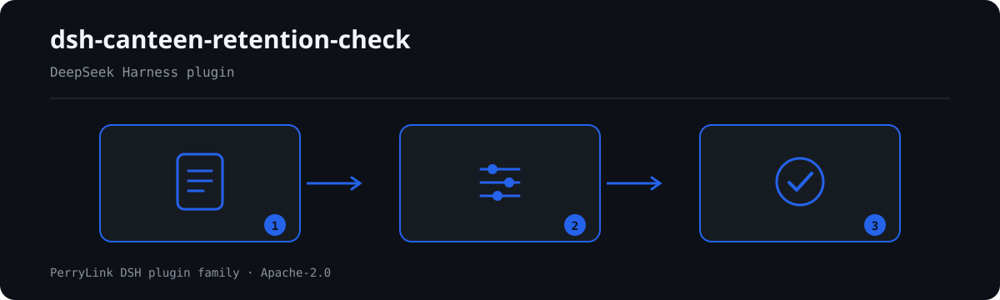

# dsh-canteen-retention-check — Canteen retention check (Español)

[English](README.md) · [简体中文](README-zh.md) · [Español](README-es.md) · [Português](README-pt.md) · [हिन्दी](README-hi.md)

[](https://dshfind.com/en/plugins/PerryLink/dsh-canteen-retention-check?ref=badge)

`dsh-canteen-retention-check` verifica un registro de retención de muestras de comedor: los cuatro elementos exigidos (nombre del plato, peso, hora, persona), el mínimo de 125 gramos, la ventana de 48 horas en frío y los marcadores de plantilla que quedan en una celda.

Verifica el registro, no la cocina. Una fila ausente significa que el registro no puede probar que se tomó una muestra; no significa que no se tomara.

## Install

```sh
dsh plugin --profile <name> add dsh-canteen-retention-check
dsh --profile <name> --dump-config | grep 'dsh-canteen-retention-check'
```

## What it looks like



*Workflow overview: document → rule pack → findings.*

**Límite:** solo comprueba la integridad del registro y su coherencia temporal interna. No juzga si una muestra satisfaría una inspección, si la comida era segura, ni qué ocurrió en la cocina. Una celda vacía se informa como «el registro no lo recoge», no como «no ocurrió».

## What it answers

- ¿Cada fila nombra el plato, el peso, la hora y la persona?
- ¿Cada peso alcanza 125 gramos?
- ¿La hora está registrada al minuto y no en el futuro?
- ¿Se mantuvo la muestra al menos 48 horas antes de liberarla?
- ¿Queda texto de plantilla como `XXX` o `待填`?

## Standards it follows

El paquete cita literalmente el artículo 40 del reglamento de seguridad alimentaria escolar (Orden n.º 45 de los tres ministerios). Esa única cláusula aporta los cuatro elementos y el mínimo de 125 gramos, por lo que esas comprobaciones son `direct` y pueden llegar a `error`.

## Compatibility

| Surface | Status |
|---|---|
| Harness | peer range `>=0.1.2-rc.1 <0.2.0 \|\| >=0.2.0-0 <0.3.0` |
| Node | `^22.19.0 || >=24.0.0` |
| Platforms | all (pure ESM; no native code, no network, no model call) |

## What it does

Nine rules, all single-table checks over the ledger. A column absent from the ledger is reported as "not applicable" rather than as a violation of every row.

## Configuration

| Key | Default | Meaning |
|---|---|---|
| `rulesFile` | `rules/canteen-retention-check.yaml` | 规则库路径 |

## Material format

One row per retained sample: `餐次`, `留样食品名称`, `留样量`, `留样时间`, `出柜时间`, `留样人员`. Column aliases are declared in `src/model.ts`.

## Rule sources

Quotations live in `rules/evidence/clause-verification-school-food-safety.md` and in the pack; `check:citations` verifies each appears verbatim. Known limit: the 48-hour window is compared as whole days, so 47 hours on the second day is not distinguished from 49.

## Troubleshooting

- **The plugin installs but the tool never appears**: check that `main` resolves to `lib/index.mjs` and that `pnpm run build` produced it.
- **`dsh plugin add` rejects the package**: the peer range covers `0.1.x` and `0.2.x`; outside it, grant an explicit exemption.
- **A rule did not run**: read the `skipped` array.

## Development

```sh
pnpm install
pnpm run typecheck
pnpm test
pnpm run build
node ../scripts/sync-shared.mjs dsh-canteen-retention-check
```

## PerryLink DSH Plugin Family

Full family index: [choose a checker by material](https://perrylink.github.io/zh/checkers/choose/) and [all plugins](https://github.com/PerryLink). This repository is one of them.

## License

[Apache License 2.0](LICENSE) © 2026 dsh-canteen-retention-check contributors.
