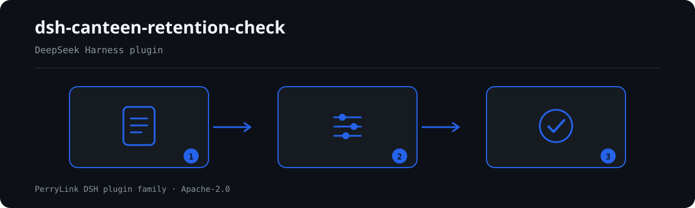

# dsh-canteen-retention-check — Canteen retention check (हिन्दी)

[English](README.md) · [简体中文](README-zh.md) · [Español](README-es.md) · [Português](README-pt.md) · [हिन्दी](README-hi.md)

[](https://dshfind.com/en/plugins/PerryLink/dsh-canteen-retention-check?ref=badge)

`dsh-canteen-retention-check` कैंटीन नमूना-रखरखाव रजिस्टर की जाँच करता है: नियम द्वारा अपेक्षित चार तत्व (व्यंजन का नाम, वज़न, समय, व्यक्ति), 125 ग्राम की न्यूनतम सीमा, 48 घंटे की शीत-भंडारण अवधि, और किसी कक्ष में छूटे टेम्पलेट प्लेसहोल्डर।

यह रजिस्टर की जाँच करता है, रसोई की नहीं। पंक्ति का अनुपस्थित होना बताता है कि रजिस्टर नमूना लेने का प्रमाण नहीं दे सकता; यह नहीं कि नमूना लिया ही नहीं गया।

## Install

```sh
dsh plugin --profile <name> add dsh-canteen-retention-check
dsh --profile <name> --dump-config | grep 'dsh-canteen-retention-check'
```

## What it looks like



*Workflow overview: document → rule pack → findings.*

**सीमा:** केवल रजिस्टर की पूर्णता और उसकी आंतरिक समय-संगति जाँचता है। यह नहीं आँकता कि नमूना निरीक्षण के लिए पर्याप्त है, भोजन सुरक्षित था, या रसोई में क्या हुआ। खाली कक्ष «रजिस्टर में दर्ज नहीं» बताता है, «हुआ ही नहीं» नहीं।

## What it answers

- क्या हर पंक्ति में व्यंजन, वज़न, समय और व्यक्ति दर्ज हैं?
- क्या हर वज़न 125 ग्राम या अधिक है?
- क्या समय मिनट तक दर्ज है और भविष्य का नहीं है?
- क्या नमूना 48 घंटे तक रखा गया?
- क्या कहीं `XXX` या `待填` जैसा टेम्पलेट पाठ बचा है?

## Standards it follows

पैक विद्यालय खाद्य सुरक्षा विनियम (तीन मंत्रालयों का आदेश संख्या 45) के अनुच्छेद 40 को शब्दशः उद्धृत करता है। वही अनुच्छेद चारों तत्व और 125 ग्राम की न्यूनतम सीमा देता है, इसलिए वे जाँचें `direct` हैं और `error` तक जा सकती हैं।

## Compatibility

| Surface | Status |
|---|---|
| Harness | peer range `>=0.1.2-rc.1 <0.2.0 \|\| >=0.2.0-0 <0.3.0` |
| Node | `^22.19.0 || >=24.0.0` |
| Platforms | all (pure ESM; no native code, no network, no model call) |

## What it does

Nine rules, all single-table checks over the ledger. A column absent from the ledger is reported as "not applicable" rather than as a violation of every row.

## Configuration

| Key | Default | Meaning |
|---|---|---|
| `rulesFile` | `rules/canteen-retention-check.yaml` | 规则库路径 |

## Material format

One row per retained sample: `餐次`, `留样食品名称`, `留样量`, `留样时间`, `出柜时间`, `留样人员`. Column aliases are declared in `src/model.ts`.

## Rule sources

Quotations live in `rules/evidence/clause-verification-school-food-safety.md` and in the pack; `check:citations` verifies each appears verbatim. Known limit: the 48-hour window is compared as whole days, so 47 hours on the second day is not distinguished from 49.

## Troubleshooting

- **The plugin installs but the tool never appears**: check that `main` resolves to `lib/index.mjs` and that `pnpm run build` produced it.
- **`dsh plugin add` rejects the package**: the peer range covers `0.1.x` and `0.2.x`; outside it, grant an explicit exemption.
- **A rule did not run**: read the `skipped` array.

## Development

```sh
pnpm install
pnpm run typecheck
pnpm test
pnpm run build
node ../scripts/sync-shared.mjs dsh-canteen-retention-check
```

## PerryLink DSH Plugin Family

Full family index: [choose a checker by material](https://perrylink.github.io/zh/checkers/choose/) and [all plugins](https://github.com/PerryLink). This repository is one of them.

## License

[Apache License 2.0](LICENSE) © 2026 dsh-canteen-retention-check contributors.
