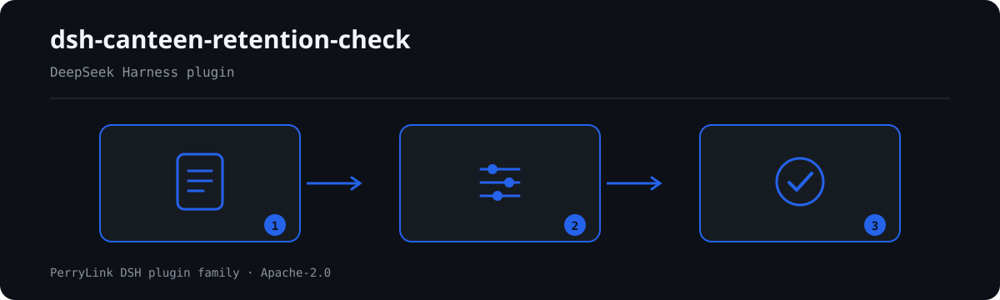

# dsh-canteen-retention-check — Canteen retention check (Português)

[English](README.md) · [简体中文](README-zh.md) · [Español](README-es.md) · [Português](README-pt.md) · [हिन्दी](README-hi.md)

[](https://dshfind.com/en/plugins/PerryLink/dsh-canteen-retention-check?ref=badge)

`dsh-canteen-retention-check` verifica um registro de retenção de amostras de refeitório: os quatro elementos exigidos (nome do prato, peso, hora, pessoa), o mínimo de 125 gramas, a janela de 48 horas em refrigeração e marcadores de modelo deixados numa célula.

Verifica o registro, não a cozinha. Uma linha ausente significa que o registro não prova que a amostra foi colhida; não significa que não foi.

## Install

```sh
dsh plugin --profile <name> add dsh-canteen-retention-check
dsh --profile <name> --dump-config | grep 'dsh-canteen-retention-check'
```

## What it looks like



*Workflow overview: document → rule pack → findings.*

**Limite:** verifica apenas a integridade do registro e a coerência temporal interna. Não julga se uma amostra satisfaria uma inspeção, se o alimento era seguro, nem o que aconteceu na cozinha. Uma célula vazia é reportada como «o registro não o contém», não como «não aconteceu».

## What it answers

- Cada linha nomeia o prato, o peso, a hora e a pessoa?
- Cada peso atinge 125 gramas?
- A hora está registada ao minuto e não no futuro?
- A amostra ficou pelo menos 48 horas antes da libertação?
- Resta texto de modelo como `XXX` ou `待填`?

## Standards it follows

O pacote cita literalmente o artigo 40.º do regulamento de segurança alimentar escolar (Portaria n.º 45 dos três ministérios). Esse único artigo fornece os quatro elementos e o mínimo de 125 gramas, pelo que essas verificações são `direct` e podem chegar a `error`.

## Compatibility

| Surface | Status |
|---|---|
| Harness | peer range `>=0.1.2-rc.1 <0.2.0 \|\| >=0.2.0-0 <0.3.0` |
| Node | `^22.19.0 || >=24.0.0` |
| Platforms | all (pure ESM; no native code, no network, no model call) |

## What it does

Nine rules, all single-table checks over the ledger. A column absent from the ledger is reported as "not applicable" rather than as a violation of every row.

## Configuration

| Key | Default | Meaning |
|---|---|---|
| `rulesFile` | `rules/canteen-retention-check.yaml` | 规则库路径 |

## Material format

One row per retained sample: `餐次`, `留样食品名称`, `留样量`, `留样时间`, `出柜时间`, `留样人员`. Column aliases are declared in `src/model.ts`.

## Rule sources

Quotations live in `rules/evidence/clause-verification-school-food-safety.md` and in the pack; `check:citations` verifies each appears verbatim. Known limit: the 48-hour window is compared as whole days, so 47 hours on the second day is not distinguished from 49.

## Troubleshooting

- **The plugin installs but the tool never appears**: check that `main` resolves to `lib/index.mjs` and that `pnpm run build` produced it.
- **`dsh plugin add` rejects the package**: the peer range covers `0.1.x` and `0.2.x`; outside it, grant an explicit exemption.
- **A rule did not run**: read the `skipped` array.

## Development

```sh
pnpm install
pnpm run typecheck
pnpm test
pnpm run build
node ../scripts/sync-shared.mjs dsh-canteen-retention-check
```

## PerryLink DSH Plugin Family

Full family index: [choose a checker by material](https://perrylink.github.io/zh/checkers/choose/) and [all plugins](https://github.com/PerryLink). This repository is one of them.

## License

[Apache License 2.0](LICENSE) © 2026 dsh-canteen-retention-check contributors.
