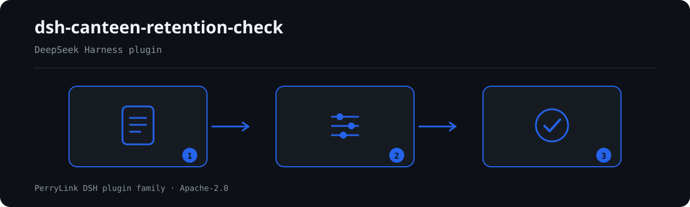

# dsh-canteen-retention-check — 食堂留样台账核对

## 快速试跑（1 分钟）

```bash
node samples/quickstart/run.mjs --check
```

样例在 `samples/quickstart/input/`，期望输出在 `samples/quickstart/expected/result.json`；截图见 `docs/assets/quickstart.png`。


[English](README.md) · [简体中文](README-zh.md) · [Español](README-es.md) · [Português](README-pt.md) · [हिन्दी](README-hi.md)

<!-- topblock:v1 -->
> **这是什么**　核对食堂留样台账：四要素、留样量、冷藏时长、模板占位符。
> **给谁用**　食堂管理员、食品安全员；不用懂命令行。
> **你交什么**　这项核对用到的原始材料（表格、清单或文书）；不改原件。Excel 可先转成 JSON/YAML，对话里也能代转。
> **它不做什么**　不判合规、不认定责任、不替代审核人；只列材料内部能逐条指认的差异。
> **怎么开始**　在 WorkBuddy / 扣子搜「安全合规核对包」（本检查是其中一项；上架以商城为准）；或命令行：
> `dsh plugin --profile <name> add dsh-canteen-retention-check`
<!-- /topblock:v1 -->

[](https://dshfind.com/en/plugins/PerryLink/dsh-canteen-retention-check?ref=badge)

`dsh-canteen-retention-check` 核对食堂留样台账：规章要求的四要素（品名、留样量、留样时间、留样人员）、125 克下限、48 小时冷藏期，以及单元格里残留的模板占位符。

它核对的是台账，不是厨房。缺一行说明台账无法证明留过样，不说明没有留样。

## Install

```sh
dsh plugin --profile <name> add dsh-canteen-retention-check
dsh --profile <name> --dump-config | grep 'dsh-canteen-retention-check'
```

## What it looks like



*Workflow overview: document → rule pack → findings.*

**边界：** 只核对台账自身的完整性与时间自洽。不判断留样是否满足检验需要、不判断食品是否安全、也不判断厨房里发生了什么。空格报的是「台账没有记录」，不是「没有发生过」——这两句话不同，只有前一句是文件能支撑的。

## What it answers

- 每一行是否都有品名、留样量、留样时间、留样人员？
- 留样量是否都达到 125 克？
- 留样时间是否记到时分、且不在未来？
- 是否至少冷藏 48 小时才出柜？
- 有没有单元格还残留 `XXX`、`待填` 这类模板文字？

## Standards it follows

规则包逐字引用《学校食品安全与营养健康管理规定》（教育部 国家市场监督管理总局 国家卫生健康委员会令第45号）第四十条：

> 中小学、幼儿园食堂应当对每餐次加工制作的每种食品成品进行留样，每个品种留样量应当满足检验需要，不得少于125克，并记录留样食品名称、留样量、留样时间、留样人员等。

四要素与 125 克下限都出自这一条，所以标 `direct` 且可到 `error`。48 小时按整天比较，并如实标注为整天比较，不假装引用了某条它并未出现的条款。

## Compatibility

| Surface | Status |
|---|---|
| Harness | peer range `>=0.1.2-rc.1 <0.2.0 \|\| >=0.2.0-0 <0.3.0` |
| Node | `^22.19.0 || >=24.0.0` |
| Platforms | all (pure ESM; no native code, no network, no model call) |

## What it does

Nine rules, all single-table checks over the ledger. A column absent from the ledger is reported as "not applicable" rather than as a violation of every row.

## Configuration

| Key | Default | Meaning |
|---|---|---|
| `rulesFile` | `rules/canteen-retention-check.yaml` | 规则库路径 |

## Material format

One row per retained sample: `餐次`, `留样食品名称`, `留样量`, `留样时间`, `出柜时间`, `留样人员`. Column aliases are declared in `src/model.ts`.

## Rule sources

Quotations live in `rules/evidence/clause-verification-school-food-safety.md` and in the pack; `check:citations` verifies each appears verbatim. Known limit: the 48-hour window is compared as whole days, so 47 hours on the second day is not distinguished from 49.

## Troubleshooting

- **The plugin installs but the tool never appears**: check that `main` resolves to `lib/index.mjs` and that `pnpm run build` produced it.
- **`dsh plugin add` rejects the package**: the peer range covers `0.1.x` and `0.2.x`; outside it, grant an explicit exemption.
- **A rule did not run**: read the `skipped` array.

## Development

```sh
pnpm install
pnpm run typecheck
pnpm test
pnpm run build
node ../scripts/sync-shared.mjs dsh-canteen-retention-check
```

## PerryLink DSH Plugin Family

完整清单（62 个核查器 + 通用插件）见 [按材料选核查器](https://perrylink.github.io/zh/checkers/choose/)；本仓只是其中一个。

## License

[Apache License 2.0](LICENSE) © 2026 dsh-canteen-retention-check contributors.
