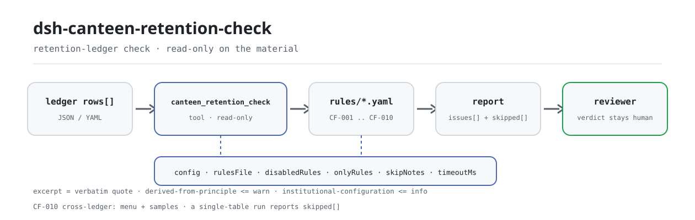

<div align="center">

<picture>
  <source media="(prefers-color-scheme: dark)" srcset="docs/assets/dsh-canteen-retention-check-flow-dark.svg">
  
</picture>

# dsh-canteen-retention-check

**Check every retained-sample row against the four required elements, the 125-gram floor, the 48-hour window, and leftover template placeholders — report only what the ledger can prove, leave the verdict to the reviewer.**

A data-type checker for DeepSeek Harness: it reads one canteen retention ledger (one row per retained sample), runs the bundled versioned rule pack (CF-001..CF-010), and never writes to the material — no network call, no model call.

[Install](#three-step-setup) · [Configuration](#configuration) · [FAQ](#faq) · [简体中文](README.md) · [English](README.en.md) · [Español](README.es.md) · [Português](README.pt.md) · [हिन्दी](README.hi.md)

[](LICENSE)
[](#compatibility)
[](https://www.npmjs.com/package/dsh-canteen-retention-check)
[](https://github.com/PerryLink/dsh-canteen-retention-check/actions/workflows/ci.yml)
[](#compatibility)

[](https://github.com/PerryLink/dsh-canteen-retention-check/stargazers)
[](https://www.npmjs.com/package/dsh-canteen-retention-check)
[](https://dshfind.com/plugins/PerryLink/dsh-canteen-retention-check?ref=badge)
[](https://securityscorecards.dev/viewer/?uri=github.com/PerryLink/dsh-canteen-retention-check)
[](https://gitee.com/perrylink/dsh-canteen-retention-check)

```sh
dsh plugin --profile <name> add dsh-canteen-retention-check
```

</div>

<sub>Community plugin, not affiliated with DeepSeek. Canonical repository: <https://github.com/PerryLink/dsh-canteen-retention-check> (Gitee is a mirror).</sub>

## What it is

`dsh-canteen-retention-check` reads a canteen retention ledger — a header plus one row per retained sample — and checks the ledger's own completeness and internal time consistency: whether the dish name, weight, sampling time, and keeper are filled in; whether every weight reaches 125 grams; whether the sampling time is recorded to the minute and is not in the future; whether release comes at least 48 hours after sampling; and whether a cell still holds template text such as `XXX` or a blank fill-in marker.

It checks the ledger, not the kitchen. A missing row means the ledger cannot prove a sample was taken; it does not mean no sample was taken. A blank cell is reported as "the ledger does not record it", not as "it did not happen" — the two are different claims, and only the first is supportable from a document.

Rules and code are separate: 9 single-table rules plus 1 cross-table rule (CF-010) are declared in `rules/canteen-retention.yaml`, so replacing the pack switches the whole rule set without touching a line of TypeScript. The report has two halves: `issues` lists differences, `skipped` lists every check that could not run and why — an empty `issues` list is not "nothing is wrong".

- **Who it is for**: canteen managers and food-safety officers; no command line required, hand the material over in chat.
- **What you give it**: the source material the check works on (a table, register or document); the original is never modified. Excel can be converted to JSON/YAML first, in chat if the platform supports it.
- **What it gives back**: a line-by-line list of what row, what column, what is missing, and how to fix it; every check that could not run is listed in `skipped` with its reason.

## Three-step setup

1. **Install** (pick one channel):

   ```sh
   # git channel (latest main; equivalent to git+https://github.com/PerryLink/dsh-canteen-retention-check.git)
   dsh plugin --profile <name> add github:PerryLink/dsh-canteen-retention-check
   # npm channel (published releases)
   dsh plugin --profile <name> add dsh-canteen-retention-check
   # tarball channel: pnpm pack in this repo, then
   dsh plugin --profile <name> add ./dsh-canteen-retention-check-<version>.tgz
   ```

   The npm channel ships `lib/`; the git channel builds it with `tsdown` through the `prepare` script.

2. **Minimal config** (sane defaults; a bundle row without `config` uses them all, and the rule pack resolves to the bundled `rules/canteen-retention.yaml`):

   ```yaml
   - insert:
       - id: dsh-canteen-retention-check
         name: dsh-canteen-retention-check
   ```

3. **Verify it mounts**:

   ```sh
   dsh --profile <name> --dump-config | grep 'dsh-canteen-retention-check'
   ```

   Then run the bundled sample (requires `pnpm install && pnpm run build` first to produce `lib/`):

   ```sh
   node samples/quickstart/run.mjs
   ```

   ```text
   $ node samples/quickstart/run.mjs
   canteen_retention_check: 1 issue(s) — error 1, warn 0, info 0
   skipped: 1
   ```

   The sample input is in `samples/quickstart/input/`, the expected summary in `samples/quickstart/expected/result.json`.

**Uninstall**: `dsh plugin --profile <name> remove dsh-canteen-retention-check` (or remove the row from the profile patch).

<details>
<summary>Use it in WorkBuddy / Coze</summary>

Search "Safety Compliance Suite" in WorkBuddy / Coze (this check is one part of the suite; availability follows the store) to use the same checking capability without a command line.

</details>

## Core capabilities

`dsh-canteen-retention-check` registers the `canteen_retention_check` tool: it reads one retention ledger, applies the versioned rule pack, and returns a report.

- **Ten rules in one pack** — 9 single-table rules (CF-001..CF-009) plus 1 cross-table rule (CF-010); the pack is data, not code, so replacing `rules/*.yaml` switches the rule set.
- **Read-only on the material** — accepts JSON or YAML and never modifies the original; pure ESM, no network requests, no model calls, no telemetry.
- **No fabricated citations** — every rule carries `document` / `number` / `clause` / `excerpt` / `kind` / `source`; `excerpt` must be a verbatim quotation, and a rule whose exact text could not be obtained says so in `excerpt` and is marked `derived-from-principle`.
- **Severity follows the evidence** — `derived-from-principle` is capped at `warn`, `institutional-configuration` at `info`, and a test asserts it.
- **An empty issue list is never "nothing is wrong"** — every check that could not run is reported in `skipped` with its reason; a rule whose required list is unset or whose column is missing reports itself in `skipped` rather than passing silently.
- **No adjudicating wording** — the report lists differences only; it never pronounces on compliance, liability or correctness. A wording guard enforces this and every report carries the disclaimer.

| Rule | Check | Severity | Basis kind |
|---|---|---|---|
| `CF-001` | Dish name recorded | error | direct |
| `CF-002` | Sample weight ≥ 125 g | error | direct |
| `CF-003` | Sampling time recorded | error | direct |
| `CF-004` | Keeper recorded | error | direct |
| `CF-005` | Sampling time recorded to the minute | warn | derived-from-principle |
| `CF-006` | Release at least 48 h after sampling | error | direct |
| `CF-007` | Meal recorded | info | derived-from-principle |
| `CF-008` | No template placeholder in the dish name | warn | derived-from-principle |
| `CF-009` | Sampling time not in the future | warn | derived-from-principle |
| `CF-010` | Every dish on every menu has a retained sample (needs two ledgers) | error | direct |

Questions it answers:

- Does every row name the dish, the weight, the time and the person?
- Is each weight at least 125 grams?
- Is the retention time recorded to the minute, and not in the future?
- Was the sample kept at least 48 hours before release?
- Does any cell still hold template text such as `XXX` or a blank fill-in marker?
- Does every dish on the menu have a retained sample? This one needs two ledgers; when only one is supplied, `CF-010` is listed in `skipped` rather than pretending it ran.

### Tool surface

| Argument | Type | Meaning |
|---|---|---|
| `file` | string | Absolute path to the material (JSON or YAML); one of `file` / `material` |
| `material` | string | Inline material text (JSON or YAML); one of `file` / `material` |
| `rulesFile` | string | Override the configured rule-pack path (relative to the package root or absolute) |
| `only` | string[] | Run only these rule ids; empty means every rule |

The result carries `plugin`, `target`, `checkedAt`, `rulesetVersion`, `summary`, `issueCount`, `skippedCount`, `markdown` and `reportJson`; `markdown` is the full model-facing report, `reportJson` the structured form of the same report.

### Examples

These are the plugin's real entry points; install once, then call one. The sample uses the bundled material:

```yaml
target: 食堂留样台账（差异样本：留样食品名称为空）
rows:
  - 餐次: 午餐
    留样食品名称: ''
    留样量: 125
    留样时间: 2026-03-04 11:40
    出柜时间: 2026-03-06 11:40
    留样人员: 张三
```

Output summary:

```json
{
  "tool": "canteen_retention_check",
  "issueCount": 1,
  "summary": { "error": 1, "warn": 0, "info": 0 },
  "skippedCount": 1
}
```

*Observed from `samples/quickstart/input/CF-001-unsafe.yaml`; `samples/quickstart/expected/result.json`; `docs/assets/quickstart.log`*

## Configuration

All tunables are Schemastery `Config` fields in `src/config.ts` (changeable from cordis.yml). An id-targeted override replaces the whole row — restate every key you need.

| Key | Type | Default | Meaning |
|---|---|---|---|
| `rulesFile` | string | `rules/canteen-retention.yaml` | Rule-pack path relative to the plugin package root; replacing the file switches the rule-set version |
| `disabledRules` | string[] | `[]` | Rule ids disabled for this deployment; each one appears in `skipped` |
| `onlyRules` | string[] | `[]` | Run only these rule ids; empty means every rule |
| `skipNotes` | string | `""` | Extra note appended to every `skipped` reason, e.g. to cite a local implementation rule |
| `timeoutMs` | number | `120000` | Cooperative tool timeout budget in milliseconds |

Example override in your profile patch:

```yaml
- insert:
    - id: dsh-canteen-retention-check
      name: dsh-canteen-retention-check
      config:
        disabledRules: [CF-007]
        skipNotes: this site checks lunch and dinner only
        timeoutMs: 180000
```

## Material format

One ledger, one table, one row per retained sample. The tool accepts JSON or YAML:

```text
餐次          meal (breakfast / lunch / dinner)
留样食品名称  dish name
留样量        sample weight in grams
留样时间      sampling time (YYYY-MM-DD HH:MM recommended)
出柜时间      release time (same format)
留样人员      person who retained the sample
单位          unit (optional)
存放条件      storage condition (optional; not judged)
备注          remark (optional)
```

Header fields and row-array keys (the Chinese aliases are the ones a Chinese ledger carries):

```text
header:   canteen / 食堂名称 / 单位名称 · period / 期间 / 月份 · checkedAt / 核对日期 / 检查日期 · basis / 依据
row keys: rows / items / samples / 留样 / 留样记录
```

Column matching is case-insensitive and ignores spaces, ideographic spaces, underscores and hyphens; the ledger's own column names are kept, so a finding names the column it actually read. Aliases are declared in `src/model.ts`, so the short dish-name, weight and keeper variants as well as the English names also resolve.

```yaml
target: canteen retention ledger
rows:
  - 餐次: 午餐
    留样食品名称: 番茄炒蛋
    留样量: 150
    留样时间: 2026-03-04 11:40
    出柜时间: 2026-03-06 12:10
    留样人员: 张三
```

## Standards & rule sources

The pack quotes Article 40 of the School Food Safety and Nutrition Health Management Regulation (Order No. 45 of the Ministry of Education, the State Administration for Market Regulation and the National Health Commission) verbatim:

```text
《学校食品安全与营养健康管理规定》第四十条：
中小学、幼儿园食堂应当对每餐次加工制作的每种食品成品进行留样，每个品种留样量应当满足检验需要，不得少于125克，并记录留样食品名称、留样量、留样时间、留样人员等。
```

That single clause supplies the four elements and the 125-gram floor, which is why CF-001..CF-004 and CF-006 are marked `direct` and can reach `error`. The clause covers **primary and secondary schools and kindergartens**; for higher-education canteens only the food categories listed in the second paragraph apply, so this pack does not put routine university canteen retention into `error` — missing columns go to `skipped`.

The 48-hour window is computed from the minute difference (`dateGap` uses `diffMinutes`); exactly 48 hours passes. All arithmetic is wall-clock on the input strings, with no timezone conversion. Refrigeration temperature and the "dedicated cabinet" are not in the ledger, and the pack does not judge them.

The quotations and the verification record ship in `rules/evidence/clause-verification-school-food-safety.md`; `pnpm run check:citations` checks every `excerpt` for a verbatim fragment in that record and tracks not-yet-traceable fragments in `rules/citations-baseline.json` — the baseline may only shrink. Rule-set version `2026.3`, `as_of` 2026-10-23.

## FAQ

<details>
<summary>Does it decide whether we are compliant or not?</summary>

No. It lists only the differences the material itself can prove (which row, which column, what is missing, how to fix it); it makes no factual finding and no compliance judgement — the verdict always stays with the reviewer. A wording guard constrains the report text, and every report carries the disclaimer.

</details>

<details>
<summary>Our ledger is Excel — can we feed it directly?</summary>

Convert it to JSON or YAML first; if the platform supports it, the conversion can happen in chat. The tool only reads the material and never modifies the original.

</details>

<details>
<summary>Can an empty `issues` list be read as "no problem"?</summary>

No. Every check that could not run is listed in `skipped` with its reason (missing column, unparseable time, rule pack not configured). Read `issues` and `skipped` together.

</details>

<details>
<summary>How exactly is the 48-hour window computed?</summary>

Release time minus sampling time, in minutes, converted to days and compared with 2 days; exactly 48 hours (2,880 minutes) passes, one minute short is reported. Both times must be parseable: a date-only value counts as `00:00`, so two same-day times compute to 0 days. All arithmetic is wall-clock with no timezone conversion.

</details>

<details>
<summary>Why is `CF-010` always `skipped`?</summary>

Because it is the one cross-table rule and needs a menu plus a retention ledger. The tool accepts one material at a time, so a single-table run lists it in `skipped` rather than silently omitting it. The join itself is implemented by `checkMenuCoverage` in `src/cross.ts`; the current tool surface has no argument that supplies both materials.

</details>

<details>
<summary>Will a whole semester of ledgers be too slow?</summary>

The check is local column matching and date arithmetic — no network requests, no model calls; `timeoutMs` (120 seconds by default) is a cooperative timeout budget you can raise.

</details>

## Troubleshooting

- **The plugin installs but the tool never appears.** Check that `main` resolves to `lib/index.mjs` and that `pnpm run build` produced it; a wrong `main` makes the loader skip the row silently.
- **`dsh plugin add` rejects the package.** The peer range covers `0.1.x` and `0.2.x`; outside it, grant an explicit exemption and do not force-install an older DSH core.
- **A rule did not run.** Read the `skipped` array in the report; the reason is written there. Do not infer from an empty `issues` list.
- **It installs but shows no findings.** Confirm the tool actually ran and returned a result — an empty result is not a skipped run; missing input is usually reported as `skipped`, never guessed as a finding.
- **Times look shifted.** All computation is wall-clock arithmetic on the input strings; no timezone conversion is applied.
- **The package is not found.** The target runtime is DSH `>=0.2.1-0 <0.3.0` and Node `^22.19.0 || >=24.0.0`; install through the profile closure: `dsh plugin --profile <name> add dsh-canteen-retention-check`.

## Security boundaries

- **Read-only on the material.** The tool reads the file or inline text you hand it and never writes back or edits the original; it writes nothing beyond the tool result and the DSH host's own session storage.
- **No network, no model calls, no telemetry.** The check is local column matching and date arithmetic; it collects no analytics and reports no usage.
- **No credentials.** It does not read secrets from the environment, store credentials, or make network requests.
- **Registration is an effect.** Tool registration returns a disposer, so unload or hot reload removes it; there are no background jobs, timers or resident processes.
- **Fail closed.** Missing columns, unparseable times and unknown rule ids go to `skipped` with a reason; they are never assumed to pass. The rule pack is validated on load, not trusted.
- **Wording guard.** The rendered report never pronounces on compliance, liability or correctness; it lists differences for a human to review and always carries the disclaimer.
- **The rule pack is data.** Replacing `rules/*.yaml` switches the rule set; load-time validation requires every rule to carry `document` / `number` / `clause` / `excerpt` / `kind` / `source`, and every excerpt must be findable verbatim in the verification record.

## Known limitations

- **It checks the ledger only.** It does not judge whether a retained sample would satisfy an inspection, whether the food was safe, or what happened outside the ledger. "Not recorded" means the ledger cannot prove it, not that it did not happen.
- **The scope is limited.** Article 40 covers primary and secondary schools and kindergartens; for higher-education canteens only the food categories in the second paragraph apply. This pack does not put routine university canteen retention into `error`; missing columns go to `skipped`.
- **The Chinese term for "etc." is not expanded.** The clause says the statutory record items are not limited to the four listed; this pack checks only the four named items (name, weight, time, keeper) and does not expand on "etc.".
- **125 grams is only a numeric floor.** "Meets inspection needs" is a separate substantive requirement that a ledger cannot decide; the pack compares the number only, and exactly 125 grams is not reported.
- **48 hours is arithmetic only.** It does not check refrigeration temperature, the "dedicated cabinet", or whether the sample was actually kept cold; ledgers usually do not record those. A date-only value counts as `00:00`, so two same-day times compute to 0 days.
- **The cross-table rule needs two ledgers.** `CF-010` needs a menu and a retention ledger; the tool accepts one material, so a single-table run lists it in `skipped`.
- **A missing column is "not applicable".** When a whole column is absent the report says `skipped` rather than marking every row as a violation — a ledger without a weight column is a shape problem, and per-row errors would bury it.
- **Wall-clock arithmetic only.** No timezone conversion and no cross-timezone alignment.

## Interoperability with other DSH plugins

This plugin registers a single model tool and takes no command, service or UI seat from the host or from other plugins:

- **No tool-name collision.** It registers only `canteen_retention_check`, a prefixed name that does not take a bare name owned by a built-in tool or another plugin.
- **No service-key collision.** It provides no service key at all.
- **No slot collision.** It registers no client slot (there is no client directory; this is a pure host plugin).
- **No HTTP route collision.** It registers no `webServer` prefix.
- **No global mutation.** It does not patch prototypes, rewrite `process.env`, or replace the global fetch dispatcher.
- **No background work.** It registers no timers, polling or background queue.
- **Registration is an effect.** Tool registration returns a disposer; unload removes it and leaves no listener behind.

Static evidence: the entire registration surface of `src/index.ts` is one `ctx.tools.register(...)`; everything else is pure checking and reading.

## Compatibility

| Surface | Status |
|---|---|
| Harness | `engines.dsh` is `>=0.2.1-0 <0.3.0`; peer range `>=0.1.2-rc.1 <0.2.0 \|\| >=0.2.0-0 <0.3.0` |
| Node | `^22.19.0 \|\| >=24.0.0` |
| Platforms | All platforms (pure ESM; no native code, no network, no model call) |
| Model | Text models fully supported; no extra model capability required |

## Ecosystem & quality

- [Gitee mirror](https://gitee.com/perrylink/dsh-canteen-retention-check) (sync mirror; GitHub is canonical)
- [dshfind plugin page](https://dshfind.com/plugins/PerryLink/dsh-canteen-retention-check) (installs and ranking)
- [OpenSSF Scorecard report](https://securityscorecards.dev/viewer/?uri=github.com/PerryLink/dsh-canteen-retention-check) (driven by [.github/workflows/scorecard.yml](.github/workflows/scorecard.yml))
- **1024 store channel**: `npm i -g dsh1024` once, then `dsh1024 plugin --profile <name> add dsh-canteen-retention-check` (counts toward the [deepseek1024.com](https://deepseek1024.com) install ranking)
- [Ecosystem knowledge base](https://perrylink.github.io/dsh-plugin-guide/) — plugin development guide · plugin-selection data · maintenance criteria

## Development

```sh
pnpm install                                        # node ^22.19 || >=24
pnpm run typecheck                                  # tsc --noEmit
pnpm test                                           # vitest: shared table-plugin suite + paired fixtures
pnpm run build                                      # tsdown -> lib/index.mjs + lib/index.d.mts
pnpm run verify:self-contained                      # dependency specs resolve from the registry
pnpm run check:lockfile                             # lockfile drift check
pnpm run check:readmes                              # five-language README consistency
pnpm run check:citations                            # rule-pack citation baseline
node ../scripts/sync-shared.mjs dsh-canteen-retention-check   # refresh src/shared from ../_shared
pnpm pack                                           # the published tarball
```

This plugin is **data-type**: `src/model.ts` declares the table shape and column aliases, the shared kit supplies the reader and the check engine, and the rule pack declares every check. Local sample run (build first to produce `lib/`):

```sh
node samples/quickstart/run.mjs
# => canteen_retention_check: 1 issue(s) — error 1, warn 0, info 0
#    skipped: 1
```

The sample input is in `samples/quickstart/input/`, the expected summary in `samples/quickstart/expected/result.json`, the screenshot in `docs/assets/quickstart.png`. The README images are generated programmatically by [`scripts/gen-readme-assets.py`](scripts/gen-readme-assets.py) (Python + Pillow) and are safe to re-run; the older single-skin flow diagram and demo assets stay in `docs/assets/` for external deep links, while the READMEs reference only the new light/dark pair.

Topics: `deepseek-harness`, `dsh`, `dsh-plugin`, `cordis`, `canteen`, `retention`, `food`

## Family & thanks

This project is part of the DeepSeek Harness plugin family from [PerryLink](https://github.com/PerryLink) (all Apache-2.0). The full family index is [choose a checker by material](https://perrylink.github.io/zh/checkers/choose/). If it is useful, **a star helps the next person find it** — nothing is gated behind it.

- [@PerryLink](https://github.com/PerryLink) — creator and maintainer: the canteen retention rule pack (CF-001..CF-010), the `canteen_retention_check` tool, the citation-verification record, and the five-language docs.

<details>
<summary>Expand all plugins</summary>

| Plugin | Status |
|---|---|
| **[dsh-aqua-input-check](https://github.com/PerryLink/dsh-aqua-input-check)** |  |
| **[dsh-archive-check](https://github.com/PerryLink/dsh-archive-check)** |  |
| **[dsh-auto-review](https://github.com/PerryLink/dsh-auto-review)** |  |
| **[dsh-autotier](https://github.com/PerryLink/dsh-autotier)** | 🧊 FROZEN — see the repo README |
| **[dsh-bid-ca-precheck](https://github.com/PerryLink/dsh-bid-ca-precheck)** |  |
| **[dsh-bid-qual-check](https://github.com/PerryLink/dsh-bid-qual-check)** |  |
| **[dsh-cert-mcp](https://github.com/PerryLink/dsh-cert-mcp)** | 🧊 FROZEN — see the repo README |
| **[dsh-checkpoint-rewind](https://github.com/PerryLink/dsh-checkpoint-rewind)** |  |
| **[dsh-click](https://github.com/PerryLink/dsh-click)** |  |
| **[dsh-composer-history](https://github.com/PerryLink/dsh-composer-history)** |  |
| **[dsh-contract-stance](https://github.com/PerryLink/dsh-contract-stance)** |  |
| **[dsh-customs-doc-check](https://github.com/PerryLink/dsh-customs-doc-check)** |  |
| **[dsh-data-quality](https://github.com/PerryLink/dsh-data-quality)** | 🧊 FROZEN — see the repo README |
| **[dsh-demurrage-ledger](https://github.com/PerryLink/dsh-demurrage-ledger)** |  |
| **[dsh-doublecheck](https://github.com/PerryLink/dsh-doublecheck)** |  |
| **[dsh-drill-script-check](https://github.com/PerryLink/dsh-drill-script-check)** |  |
| **[dsh-eia-guide-check](https://github.com/PerryLink/dsh-eia-guide-check)** |  |
| **[dsh-emergency-plan](https://github.com/PerryLink/dsh-emergency-plan)** |  |
| **[dsh-essay-rubric-check](https://github.com/PerryLink/dsh-essay-rubric-check)** |  |
| **[dsh-evidence-check](https://github.com/PerryLink/dsh-evidence-check)** |  |
| **[dsh-export-ctl-check](https://github.com/PerryLink/dsh-export-ctl-check)** |  |
| **[dsh-fast](https://github.com/PerryLink/dsh-fast)** |  |
| **[dsh-fmea-table-check](https://github.com/PerryLink/dsh-fmea-table-check)** |  |
| **[dsh-forecast-penalty](https://github.com/PerryLink/dsh-forecast-penalty)** |  |
| **[dsh-fund-research](https://github.com/PerryLink/dsh-fund-research)** |  |
| **[dsh-github](https://github.com/PerryLink/dsh-github)** |  |
| **[dsh-gongwen-flow-check](https://github.com/PerryLink/dsh-gongwen-flow-check)** |  |
| **[dsh-gongwen-word-check](https://github.com/PerryLink/dsh-gongwen-word-check)** |  |
| **[dsh-guard-plan-qc](https://github.com/PerryLink/dsh-guard-plan-qc)** |  |
| **[dsh-hazchem-check](https://github.com/PerryLink/dsh-hazchem-check)** |  |
| **[dsh-hazplan-check](https://github.com/PerryLink/dsh-hazplan-check)** |  |
| **[dsh-hidden-risk-map](https://github.com/PerryLink/dsh-hidden-risk-map)** |  |
| **[dsh-hs-classify](https://github.com/PerryLink/dsh-hs-classify)** |  |
| **[dsh-icd-rule-check](https://github.com/PerryLink/dsh-icd-rule-check)** |  |
| **[dsh-industry-research](https://github.com/PerryLink/dsh-industry-research)** |  |
| **[dsh-lawcite-adapter](https://github.com/PerryLink/dsh-lawcite-adapter)** |  |
| **[dsh-laya](https://github.com/PerryLink/dsh-laya)** |  |
| **[dsh-lc-doc-check](https://github.com/PerryLink/dsh-lc-doc-check)** |  |
| **[dsh-learning-gap-check](https://github.com/PerryLink/dsh-learning-gap-check)** |  |
| **[dsh-library](https://github.com/PerryLink/dsh-library)** |  |
| **[dsh-local-ai](https://github.com/PerryLink/dsh-local-ai)** |  |
| **[dsh-lsp-actions](https://github.com/PerryLink/dsh-lsp-actions)** |  |
| **[dsh-mask](https://github.com/PerryLink/dsh-mask)** |  |
| **[dsh-mcp-panel](https://github.com/PerryLink/dsh-mcp-panel)** |  |
| **[dsh-medrec-qc](https://github.com/PerryLink/dsh-medrec-qc)** |  |
| **[dsh-memento](https://github.com/PerryLink/dsh-memento)** | 🧊 FROZEN — see the repo README |
| **[dsh-nsfc-form-check](https://github.com/PerryLink/dsh-nsfc-form-check)** |  |
| **[dsh-nurse-record-check](https://github.com/PerryLink/dsh-nurse-record-check)** |  |
| **[dsh-observe](https://github.com/PerryLink/dsh-observe)** |  |
| **[dsh-origin-rvc-check](https://github.com/PerryLink/dsh-origin-rvc-check)** |  |
| **[dsh-ota-review-check](https://github.com/PerryLink/dsh-ota-review-check)** |  |
| **[dsh-output-styles](https://github.com/PerryLink/dsh-output-styles)** |  |
| **[dsh-paper-doc-adapter](https://github.com/PerryLink/dsh-paper-doc-adapter)** |  |
| **[dsh-permission-rules](https://github.com/PerryLink/dsh-permission-rules)** |  |
| **[dsh-permit-report-check](https://github.com/PerryLink/dsh-permit-report-check)** |  |
| **[dsh-pipeline-check](https://github.com/PerryLink/dsh-pipeline-check)** |  |
| **[dsh-pleading-draft](https://github.com/PerryLink/dsh-pleading-draft)** |  |
| **[dsh-plugin-doctor](https://github.com/PerryLink/dsh-plugin-doctor)** | 🚫 RETIRED (repo archived) |
| **[dsh-plugin-guide](https://github.com/PerryLink/dsh-plugin-guide)** |  |
| **[dsh-plugin-kit](https://github.com/PerryLink/dsh-plugin-kit)** | 🚫 RETIRED (repo archived) |
| **[dsh-plugin-upgrade](https://github.com/PerryLink/dsh-plugin-upgrade)** | 🚫 RETIRED (repo archived) |
| **[dsh-policy-brief-draft](https://github.com/PerryLink/dsh-policy-brief-draft)** |  |
| **[dsh-power-loss-split](https://github.com/PerryLink/dsh-power-loss-split)** |  |
| **[dsh-power-ticket-check](https://github.com/PerryLink/dsh-power-ticket-check)** |  |
| **[dsh-ppap-check](https://github.com/PerryLink/dsh-ppap-check)** |  |
| **[dsh-protest-deadline](https://github.com/PerryLink/dsh-protest-deadline)** |  |
| **[dsh-railway-window](https://github.com/PerryLink/dsh-railway-window)** |  |
| **[dsh-repair-order-qc](https://github.com/PerryLink/dsh-repair-order-qc)** |  |
| **[dsh-research-report](https://github.com/PerryLink/dsh-research-report)** |  |
| **[dsh-review-reply-check](https://github.com/PerryLink/dsh-review-reply-check)** |  |
| **[dsh-rulefile-check](https://github.com/PerryLink/dsh-rulefile-check)** |  |
| **[dsh-safety-brief-check](https://github.com/PerryLink/dsh-safety-brief-check)** |  |
| **[dsh-score](https://github.com/PerryLink/dsh-score)** | 🧊 FROZEN — see the repo README |
| **[dsh-session-sync](https://github.com/PerryLink/dsh-session-sync)** |  |
| **[dsh-site-log-check](https://github.com/PerryLink/dsh-site-log-check)** |  |
| **[dsh-skill-pack-security](https://github.com/PerryLink/dsh-skill-pack-security)** |  |
| **[dsh-soe-decision-check](https://github.com/PerryLink/dsh-soe-decision-check)** |  |
| **[dsh-soilwater-check](https://github.com/PerryLink/dsh-soilwater-check)** |  |
| **[dsh-sop-sync-check](https://github.com/PerryLink/dsh-sop-sync-check)** |  |
| **[dsh-spc-gbt-adapter](https://github.com/PerryLink/dsh-spc-gbt-adapter)** |  |
| **[dsh-talk](https://github.com/PerryLink/dsh-talk)** |  |
| **[dsh-tender-extract](https://github.com/PerryLink/dsh-tender-extract)** |  |
| **[dsh-tender-matrix](https://github.com/PerryLink/dsh-tender-matrix)** |  |
| **[dsh-test-drive](https://github.com/PerryLink/dsh-test-drive)** |  |
| **[dsh-ticktick](https://github.com/PerryLink/dsh-ticktick)** | 🚫 RETIRED (repo archived) |
| **[dsh-translate](https://github.com/PerryLink/dsh-translate)** |  |
| **[dsh-warranty-calc](https://github.com/PerryLink/dsh-warranty-calc)** |  |
| **[dsh-budget](https://github.com/PerryLink/dsh-budget)** | 🧊 FROZEN — see the repo README |
| **[dsh-claude-move](https://github.com/PerryLink/dsh-claude-move)** | 🧊 FROZEN — see the repo README |
| **[dsh-defend](https://github.com/PerryLink/dsh-defend)** | 🧊 FROZEN — see the repo README |
| **[dsh-draw](https://github.com/PerryLink/dsh-draw)** | 🧊 FROZEN — see the repo README |
| **[dsh-reach](https://github.com/PerryLink/dsh-reach)** | 🧊 FROZEN — see the repo README |
| **[dsh-background-agents](https://github.com/PerryLink/dsh-background-agents)** | 🚫 RETIRED (repo archived) |
| **[dsh-session-pin](https://github.com/PerryLink/dsh-session-pin)** | 🚫 RETIRED (repo archived) |
| **[dsh-team-rooms](https://github.com/PerryLink/dsh-team-rooms)** | 🚫 RETIRED (repo archived) |

</details>

## License

[LICENSE](LICENSE) (Apache License 2.0) © 2026 dsh-canteen-retention-check contributors

<p align="center"><sub>Apache-2.0 · Community plugin, not affiliated with DeepSeek.</sub></p>
