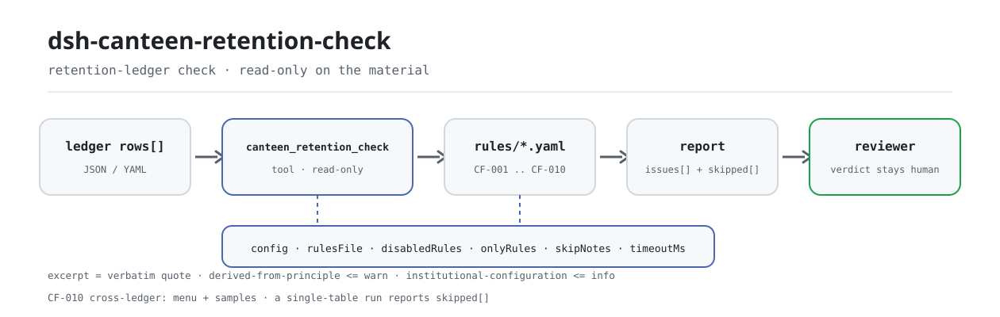

<div align="center">

<picture>
  <source media="(prefers-color-scheme: dark)" srcset="docs/assets/dsh-canteen-retention-check-flow-dark.svg">
  
</picture>

# dsh-canteen-retention-check

**Comprueba cada fila de muestra retenida contra los cuatro elementos exigidos, el mínimo de 125 gramos, la ventana de 48 horas y los marcadores de plantilla que quedan: solo lista lo que el registro puede probar y deja el dictamen al revisor.**

Un verificador de datos para DeepSeek Harness: lee un registro de retención de muestras de comedor (una fila por muestra), aplica el paquete de reglas versionado incluido (CF-001..CF-010) y nunca escribe en el material: sin red y sin llamadas al modelo.

[Instalar](#instalación-en-tres-pasos) · [Configuración](#configuración) · [FAQ](#faq) · [简体中文](README.md) · [English](README.en.md) · [Español](README.es.md) · [Português](README.pt.md) · [हिन्दी](README.hi.md)

[](LICENSE)
[](#compatibilidad)
[](https://www.npmjs.com/package/dsh-canteen-retention-check)
[](https://github.com/PerryLink/dsh-canteen-retention-check/actions/workflows/ci.yml)
[](#compatibilidad)

[](https://github.com/PerryLink/dsh-canteen-retention-check/stargazers)
[](https://www.npmjs.com/package/dsh-canteen-retention-check)
[](https://dshfind.com/plugins/PerryLink/dsh-canteen-retention-check?ref=badge)
[](https://securityscorecards.dev/viewer/?uri=github.com/PerryLink/dsh-canteen-retention-check)
[](https://gitee.com/perrylink/dsh-canteen-retention-check)

```sh
dsh plugin --profile <name> add dsh-canteen-retention-check
```

</div>

<sub>Plugin de la comunidad, no afiliado a DeepSeek. Repositorio canónico: <https://github.com/PerryLink/dsh-canteen-retention-check> (Gitee es un espejo).</sub>

## Qué es

`dsh-canteen-retention-check` lee un registro de retención de muestras de comedor — una cabecera más una fila por muestra retenida — y comprueba la integridad del propio registro y su coherencia temporal: si están rellenados el nombre del plato, el peso, la hora de muestreo y la persona; si cada peso alcanza 125 gramos; si la hora está registrada al minuto y no en el futuro; si la salida se produce al menos 48 horas después del muestreo; y si alguna celda conserva texto de plantilla como `XXX` o `待填`.

Verifica el registro, no la cocina. Una fila ausente significa que el registro no puede probar que se tomó una muestra; no significa que no se tomara. Una celda vacía se informa como «el registro no lo recoge», no como «no ocurrió»: son afirmaciones distintas y solo la primera se sostiene con un documento.

Reglas y código están separados: 9 reglas de una tabla más 1 regla de dos tablas (CF-010) se declaran en `rules/canteen-retention.yaml`, así que sustituir el paquete cambia todo el conjunto de reglas sin tocar una línea de TypeScript. El informe tiene dos mitades: `issues` enumera las diferencias y `skipped` enumera cada comprobación que no pudo ejecutarse y por qué; una lista `issues` vacía no significa «no hay nada mal».

- **Para quién**: responsables de comedor y oficiales de seguridad alimentaria; no hace falta saber usar la línea de comandos, basta con entregar el material en el chat.
- **Qué le das**: el material de origen sobre el que trabaja la comprobación (una tabla, un registro o un documento); el original nunca se modifica. Excel puede convertirse antes a JSON/YAML, en el chat si la plataforma lo permite.
- **Qué devuelve**: una lista de qué fila, qué columna, qué falta y cómo corregirlo; cada comprobación que no pudo ejecutarse aparece en `skipped` con su motivo.

## Instalación en tres pasos

1. **Instalar** (elige un canal):

   ```sh
   # canal git (main más reciente; equivale a git+https://github.com/PerryLink/dsh-canteen-retention-check.git)
   dsh plugin --profile <name> add github:PerryLink/dsh-canteen-retention-check
   # canal npm (versiones publicadas)
   dsh plugin --profile <name> add dsh-canteen-retention-check
   # canal tarball: tras pnpm pack en este repositorio
   dsh plugin --profile <name> add ./dsh-canteen-retention-check-<version>.tgz
   ```

   El canal npm publica `lib/`; el canal git lo construye con `tsdown` mediante el script `prepare`.

2. **Configuración mínima** (los valores por defecto sirven; una fila de bundle sin `config` los usa todos y el paquete de reglas apunta al `rules/canteen-retention.yaml` incluido):

   ```yaml
   - insert:
       - id: dsh-canteen-retention-check
         name: dsh-canteen-retention-check
   ```

3. **Comprobar que se montó**:

   ```sh
   dsh --profile <name> --dump-config | grep 'dsh-canteen-retention-check'
   ```

   Después ejecuta la muestra incluida (requiere `pnpm install && pnpm run build` para producir `lib/`):

   ```sh
   node samples/quickstart/run.mjs
   ```

   ```text
   $ node samples/quickstart/run.mjs
   canteen_retention_check: 1 issue(s) — error 1, warn 0, info 0
   skipped: 1
   ```

   La entrada de muestra está en `samples/quickstart/input/` y el resumen esperado en `samples/quickstart/expected/result.json`.

**Desinstalar**: `dsh plugin --profile <name> remove dsh-canteen-retention-check` (o borra la fila del patch del perfil).

<details>
<summary>Usarlo en WorkBuddy / Coze</summary>

Busca «Safety Compliance Suite» en WorkBuddy / Coze (esta comprobación es una parte del conjunto; la disponibilidad depende de la tienda) para usar la misma capacidad sin línea de comandos.

</details>

## Capacidades principales

`dsh-canteen-retention-check` registra la herramienta `canteen_retention_check`: lee un registro de retención, aplica el paquete de reglas versionado y devuelve un informe.

- **Diez reglas en un paquete** — 9 reglas de una tabla (CF-001..CF-009) y 1 regla de dos tablas (CF-010); el paquete es dato, no código, así que sustituir `rules/*.yaml` cambia el conjunto de reglas.
- **Solo lectura sobre el material** — acepta JSON o YAML y nunca modifica el original; ESM puro, sin peticiones de red, sin llamadas al modelo y sin telemetría.
- **Sin citas inventadas** — cada regla lleva `document` / `number` / `clause` / `excerpt` / `kind` / `source`; `excerpt` debe ser una cita literal, y la regla cuyo texto exacto no se pudo obtener lo dice en `excerpt` y se marca `derived-from-principle`.
- **La gravedad sigue a la evidencia** — `derived-from-principle` se limita a `warn` y `institutional-configuration` a `info`, y una prueba lo verifica.
- **Una lista vacía nunca es «nada va mal»** — cada comprobación que no pudo ejecutarse se informa en `skipped` con su motivo; una regla sin lista obligatoria o con la columna ausente se declara en `skipped` en vez de pasar en silencio.
- **Redacción que no dictamina** — el informe solo enumera diferencias; nunca se pronuncia sobre cumplimiento, responsabilidad ni corrección. Un guardián de redacción lo impone y todo informe lleva el descargo de responsabilidad.

| Regla | Comprobación | Gravedad | Tipo de base |
|---|---|---|---|
| `CF-001` | Nombre del plato registrado | error | direct |
| `CF-002` | Peso de la muestra ≥ 125 g | error | direct |
| `CF-003` | Hora de muestreo registrada | error | direct |
| `CF-004` | Persona que retuvo la muestra registrada | error | direct |
| `CF-005` | Hora de muestreo registrada al minuto | warn | derived-from-principle |
| `CF-006` | Salida al menos 48 h después del muestreo | error | direct |
| `CF-007` | Comida registrada | info | derived-from-principle |
| `CF-008` | Sin marcador de plantilla en el nombre del plato | warn | derived-from-principle |
| `CF-009` | Hora de muestreo no futura | warn | derived-from-principle |
| `CF-010` | Cada plato de cada menú tiene muestra retenida (requiere dos registros) | error | direct |

Preguntas que responde:

- ¿Cada fila nombra el plato, el peso, la hora y la persona?
- ¿Cada peso alcanza 125 gramos?
- ¿La hora está registrada al minuto y no en el futuro?
- ¿Se mantuvo la muestra al menos 48 horas antes de liberarla?
- ¿Queda texto de plantilla como `XXX` o `待填` en alguna celda?
- ¿Cada plato del menú tiene muestra retenida? Esta necesita dos registros; si solo se entrega uno, `CF-010` se enumera en `skipped` en vez de fingir que se ejecutó.

### Superficie de la herramienta

| Argumento | Tipo | Significado |
|---|---|---|
| `file` | string | Ruta absoluta del material (JSON o YAML); uno de `file` / `material` |
| `material` | string | Texto del material en línea (JSON o YAML); uno de `file` / `material` |
| `rulesFile` | string | Sobrescribe la ruta configurada del paquete de reglas (relativa a la raíz del paquete o absoluta) |
| `only` | string[] | Ejecuta solo estos ids de regla; vacío significa todas |

El resultado lleva `plugin`, `target`, `checkedAt`, `rulesetVersion`, `summary`, `issueCount`, `skippedCount`, `markdown` y `reportJson`; `markdown` es el informe completo para el modelo y `reportJson` la forma estructurada del mismo informe.

### Ejemplos

Estos son los puntos de entrada reales del plugin; instálalo una vez y llama a uno. La muestra usa el material incluido:

```yaml
target: 食堂留样台账（差异样本：留样食品名称为空）
rows:
  - 餐次: 午餐
    留样食品名称: ''
    留样量: 125
    留样时间: 2026-03-04 11:40
    出柜时间: 2026-03-06 11:40
    留样人员: 张三
```

Resumen de salida:

```json
{
  "tool": "canteen_retention_check",
  "issueCount": 1,
  "summary": { "error": 1, "warn": 0, "info": 0 },
  "skippedCount": 1
}
```

*Observed from `samples/quickstart/input/CF-001-unsafe.yaml`; `samples/quickstart/expected/result.json`; `docs/assets/quickstart.log`*

## Configuración

Todos los parámetros ajustables son campos Schemastery `Config` de `src/config.ts` (modificables desde cordis.yml). Una sobrescritura dirigida por id reemplaza la fila entera: repite todas las claves que necesites.

| Clave | Tipo | Valor por defecto | Significado |
|---|---|---|---|
| `rulesFile` | string | `rules/canteen-retention.yaml` | Ruta del paquete de reglas relativa a la raíz del paquete; sustituir el archivo cambia la versión del conjunto de reglas |
| `disabledRules` | string[] | `[]` | Ids de regla desactivados en este despliegue; cada uno aparece en `skipped` |
| `onlyRules` | string[] | `[]` | Ejecuta solo estos ids de regla; vacío significa todas |
| `skipNotes` | string | `""` | Nota añadida a cada motivo de `skipped`, por ejemplo para citar una norma interna |
| `timeoutMs` | number | `120000` | Presupuesto de tiempo de espera cooperativo de la herramienta, en milisegundos |

Ejemplo de sobrescritura en el patch del perfil:

```yaml
- insert:
    - id: dsh-canteen-retention-check
      name: dsh-canteen-retention-check
      config:
        disabledRules: [CF-007]
        skipNotes: esta sede comprueba solo comida y cena
        timeoutMs: 180000
```

## Formato del material

Un registro, una tabla, una fila por muestra retenida. La herramienta acepta JSON o YAML:

```text
餐次          comida (desayuno / comida / cena)
留样食品名称  nombre del plato
留样量        peso de la muestra en gramos
留样时间      hora de muestreo (se recomienda AAAA-MM-DD HH:MM)
出柜时间      hora de salida (mismo formato)
留样人员      persona que retuvo la muestra
单位          unidad (opcional)
存放条件      condición de conservación (opcional; no se juzga)
备注          observaciones (opcional)
```

Campos de cabecera (opcionales): `canteen` / `食堂名称` / `单位名称`, `period` / `期间` / `月份`, `checkedAt` / `核对日期` / `检查日期`, `basis` / `依据`. Claves del array de filas: `rows` / `items` / `samples` / `留样` / `留样记录`.

La coincidencia de columnas no distingue mayúsculas y minúsculas y omite espacios, espacios ideográficos, guiones bajos y guiones; se conservan los nombres de columna del registro, así que un hallazgo nombra la columna que realmente leyó. Los alias se declaran en `src/model.ts`, por lo que `品名`, `留样重量`, `留样人` y los nombres en inglés también resuelven.

```yaml
target: registro de retención de muestras
rows:
  - 餐次: 午餐
    留样食品名称: 番茄炒蛋
    留样量: 150
    留样时间: 2026-03-04 11:40
    出柜时间: 2026-03-06 12:10
    留样人员: 张三
```

## Normas y fuentes de las reglas

El paquete cita literalmente el artículo 40 del Reglamento de gestión de seguridad y nutrición alimentaria escolar (Orden n.º 45 del Ministerio de Educación, la Administración Estatal de Regulación del Mercado y la Comisión Nacional de Salud):

```text
《学校食品安全与营养健康管理规定》第四十条：
中小学、幼儿园食堂应当对每餐次加工制作的每种食品成品进行留样，每个品种留样量应当满足检验需要，不得少于125克，并记录留样食品名称、留样量、留样时间、留样人员等。
```

Ese único artículo aporta los cuatro elementos y el mínimo de 125 gramos, por lo que CF-001..CF-004 y CF-006 son `direct` y pueden llegar a `error`. El artículo cubre **escuelas primarias y secundarias y jardines de infancia**; en comedores de educación superior solo se aplican las categorías alimentarias del segundo párrafo, así que este paquete no pone la retención ordinaria de comedores universitarios en `error`: las columnas ausentes van a `skipped`.

La ventana de 48 horas se calcula con la diferencia en minutos (`dateGap` usa `diffMinutes`); exactamente 48 horas no se reporta. Toda la aritmética es de reloj de pared sobre las cadenas de entrada, sin conversión de zona horaria. La temperatura de refrigeración y el «armario dedicado» no están en el registro y el paquete no los juzga.

Las citas y el registro de verificación se incluyen en `rules/evidence/clause-verification-school-food-safety.md`; `pnpm run check:citations` comprueba que cada `excerpt` tenga un fragmento literal en ese registro y anota los fragmentos aún no rastreables en `rules/citations-baseline.json` — la línea base solo puede encoger. Versión del conjunto de reglas `2026.3`, `as_of` 2026-10-23.

## FAQ

<details>
<summary>¿Decide si cumplimos o no?</summary>

No. Solo enumera las diferencias que el propio material puede probar (qué fila, qué columna, qué falta y cómo corregirlo); no emite juicios de hecho ni de cumplimiento: el dictamen siempre queda en el revisor. Un guardián de redacción limita el texto del informe y todo informe lleva el descargo de responsabilidad.

</details>

<details>
<summary>Nuestro registro está en Excel, ¿podemos usarlo directamente?</summary>

Conviértelo antes a JSON o YAML; si la plataforma lo permite, la conversión puede hacerse en el chat. La herramienta solo lee el material y nunca modifica el original.

</details>

<details>
<summary>¿Una lista `issues` vacía significa «sin problemas»?</summary>

No. Cada comprobación que no pudo ejecutarse aparece en `skipped` con su motivo (columna ausente, hora no analizable, paquete de reglas sin configurar). Lee `issues` y `skipped` juntos.

</details>

<details>
<summary>¿Cómo se calculan exactamente las 48 horas?</summary>

Hora de salida menos hora de muestreo, en minutos, convertida a días y comparada con 2 días; exactamente 48 horas (2.880 minutos) no se reporta y un minuto menos sí. Ambas horas deben poder analizarse: un valor solo con fecha cuenta como `00:00`, así que dos horas del mismo día dan 0 días. Toda la aritmética es de reloj de pared, sin conversión de zona horaria.

</details>

<details>
<summary>¿Por qué `CF-010` siempre está en `skipped`?</summary>

Porque es la única regla de dos tablas y necesita un menú y un registro de retención. La herramienta acepta un material cada vez, así que una ejecución de una sola tabla la enumera en `skipped` en lugar de omitirla en silencio. La unión la implementa `checkMenuCoverage` en `src/cross.ts`; la superficie actual de la herramienta no tiene ningún argumento que entregue los dos materiales.

</details>

<details>
<summary>¿Un semestre entero de registros será demasiado lento?</summary>

La comprobación es coincidencia de columnas y aritmética de fechas local: sin peticiones de red ni llamadas al modelo; `timeoutMs` (120 segundos por defecto) es un presupuesto de tiempo cooperativo que puedes ampliar.

</details>

## Solución de problemas

- **El plugin se instala pero la herramienta no aparece.** Comprueba que `main` resuelve a `lib/index.mjs` y que `pnpm run build` lo produjo; un `main` incorrecto hace que el cargador omita la fila en silencio.
- **`dsh plugin add` rechaza el paquete.** El rango de peers cubre `0.1.x` y `0.2.x`; fuera de él, concede una exención explícita y no fuerces la instalación de un núcleo DSH antiguo.
- **Una regla no se ejecutó.** Lee el array `skipped` del informe; el motivo está ahí. No lo deduzcas de una lista `issues` vacía.
- **Se instala pero no muestra hallazgos.** Confirma que la herramienta se ejecutó y devolvió un resultado: un resultado vacío no es una ejecución omitida; la falta de entrada suele informarse como `skipped`, nunca se adivina un hallazgo.
- **Las horas parecen desplazadas.** Todo el cálculo es aritmética de reloj de pared sobre las cadenas de entrada; no se aplica conversión de zona horaria.
- **No se encuentra el paquete.** El entorno objetivo es DSH `>=0.2.1-0 <0.3.0` y Node `^22.19.0 || >=24.0.0`; instala a través del cierre del perfil: `dsh plugin --profile <name> add dsh-canteen-retention-check`.

## Límites de seguridad

- **Solo lectura sobre el material.** La herramienta lee el archivo o el texto en línea que le entregas y nunca escribe ni edita el original; no escribe nada más allá del resultado de la herramienta y del almacenamiento de sesión del propio host DSH.
- **Sin red, sin llamadas al modelo, sin telemetría.** La comprobación es coincidencia de columnas y aritmética de fechas local; no recoge analíticas ni informa del uso.
- **Sin credenciales.** No lee secretos del entorno, no almacena credenciales ni hace peticiones de red.
- **El registro es un efecto.** El registro de la herramienta devuelve un disposer, así que descargar o recargar en caliente lo elimina; no hay tareas en segundo plano, temporizadores ni procesos residentes.
- **Fallo cerrado.** Columnas ausentes, horas no analizables e ids de regla desconocidos van a `skipped` con su motivo; nunca se asumen como aprobados. El paquete de reglas se valida al cargar, no se confía en él.
- **Guardián de redacción.** El informe renderizado nunca se pronuncia sobre cumplimiento, responsabilidad ni corrección; enumera diferencias para revisión humana y siempre lleva el descargo de responsabilidad.
- **El paquete de reglas es dato.** Sustituir `rules/*.yaml` cambia el conjunto de reglas; la validación al cargar exige que cada regla lleve `document` / `number` / `clause` / `excerpt` / `kind` / `source`, y que cada excerpt sea localizable literalmente en el registro de verificación.

## Limitaciones conocidas

- **Solo comprueba el registro.** No juzga si una muestra satisfaría una inspección, si la comida era segura ni qué ocurrió fuera del registro. «No registrado» significa que el registro no puede probarlo, no que no ocurriera.
- **El alcance es limitado.** El artículo 40 cubre escuelas primarias y secundarias y jardines de infancia; en comedores de educación superior solo se aplican las categorías alimentarias del segundo párrafo. Este paquete no pone la retención ordinaria de comedores universitarios en `error`; las columnas ausentes van a `skipped`.
- **El «等» (etc.) no se amplía.** El artículo dice que los elementos legales de registro no se limitan a los cuatro enumerados; este paquete solo comprueba los cuatro nombrados (nombre, peso, hora, persona) y no amplía por «etc.».
- **125 gramos es solo un mínimo numérico.** «Satisfacer las necesidades de inspección» es un requisito sustantivo aparte que un registro no puede decidir; el paquete solo compara el número y exactamente 125 gramos no se reporta.
- **48 horas es solo aritmética.** No comprueba la temperatura de refrigeración, el «armario dedicado» ni si la muestra se conservó realmente en frío; los registros no suelen recogerlo. Un valor solo con fecha cuenta como `00:00`, así que dos horas del mismo día dan 0 días.
- **La regla de dos tablas necesita dos registros.** `CF-010` necesita un menú y un registro de retención; la herramienta acepta un material, así que una ejecución de una sola tabla la enumera en `skipped`.
- **Una columna ausente es «no aplicable».** Cuando falta una columna entera, el informe dice `skipped` en vez de marcar cada fila como infracción: un registro sin columna `留样量` es un problema de forma y los errores fila a fila lo enterrarían.
- **Solo aritmética de reloj de pared.** Sin conversión de zona horaria ni alineación entre zonas.

## Interoperabilidad con otros plugins DSH

Este plugin registra una única herramienta de modelo y no ocupa ningún asiento de comando, servicio o interfaz del host ni de otros plugins:

- **Sin colisión de nombres de herramienta.** Solo registra `canteen_retention_check`, un nombre con prefijo que no toma un nombre desnudo de una herramienta integrada ni de otro plugin.
- **Sin colisión de claves de servicio.** No proporciona ninguna clave de servicio.
- **Sin colisión de slots.** No registra ningún slot de cliente (no hay directorio client; es un plugin puramente host).
- **Sin colisión de rutas HTTP.** No registra ningún prefijo `webServer`.
- **Sin mutación global.** No parchea prototipos, no reescribe `process.env` ni sustituye el dispatcher global de fetch.
- **Sin trabajo en segundo plano.** No registra temporizadores, sondeos ni colas en segundo plano.
- **El registro es un efecto.** El registro de la herramienta devuelve un disposer; descargar la elimina y no deja ningún listener.

Evidencia estática: toda la superficie de registro de `src/index.ts` es una llamada `ctx.tools.register(...)`; el resto es comprobación y lectura puras.

## Compatibilidad

| Superficie | Estado |
|---|---|
| Harness | `engines.dsh` es `>=0.2.1-0 <0.3.0`; rango de peers `>=0.1.2-rc.1 <0.2.0 \|\| >=0.2.0-0 <0.3.0` |
| Node | `^22.19.0 \|\| >=24.0.0` |
| Plataformas | Todas (ESM puro; sin código nativo, sin red, sin llamadas al modelo) |
| Modelo | Modelos de texto totalmente compatibles; no hace falta capacidad extra |

## Ecosistema y calidad

- [Espejo en Gitee](https://gitee.com/perrylink/dsh-canteen-retention-check) (espejo sincronizado; GitHub es canónico)
- [Página del plugin en dshfind](https://dshfind.com/plugins/PerryLink/dsh-canteen-retention-check) (instalaciones y ranking)
- [Informe OpenSSF Scorecard](https://securityscorecards.dev/viewer/?uri=github.com/PerryLink/dsh-canteen-retention-check) (impulsado por [.github/workflows/scorecard.yml](.github/workflows/scorecard.yml))
- **Canal de la tienda 1024**: `npm i -g dsh1024` una vez y luego `dsh1024 plugin --profile <name> add dsh-canteen-retention-check` (cuenta para el ranking de instalaciones de [deepseek1024.com](https://deepseek1024.com))
- [Base de conocimiento del ecosistema](https://perrylink.github.io/dsh-plugin-guide/): guía de desarrollo de plugins · datos medidos de selección · criterios de mantenimiento

## Desarrollo

```sh
pnpm install                                        # node ^22.19 || >=24
pnpm run typecheck                                  # tsc --noEmit
pnpm test                                           # vitest: suite compartida de tablas + fixtures emparejados
pnpm run build                                      # tsdown -> lib/index.mjs + lib/index.d.mts
pnpm run verify:self-contained                      # las dependencias resuelven desde el registry
pnpm run check:lockfile                             # comprobación de deriva del lockfile
pnpm run check:readmes                              # consistencia de los README en cinco idiomas
pnpm run check:citations                            # línea base de citas del paquete de reglas
node ../scripts/sync-shared.mjs dsh-canteen-retention-check   # refrescar src/shared desde ../_shared
pnpm pack                                           # el tarball publicado
```

Este plugin es **de datos**: `src/model.ts` declara la forma de la tabla y los alias de columna, el kit compartido aporta el lector y el motor de comprobación, y el paquete de reglas declara cada comprobación. Ejecución de la muestra local (construye antes para producir `lib/`):

```sh
node samples/quickstart/run.mjs
# => canteen_retention_check: 1 issue(s) — error 1, warn 0, info 0
#    skipped: 1
```

La entrada de muestra está en `samples/quickstart/input/`, el resumen esperado en `samples/quickstart/expected/result.json` y la captura en `docs/assets/quickstart.png`. Las imágenes del README las genera programáticamente [`scripts/gen-readme-assets.py`](scripts/gen-readme-assets.py) (Python + Pillow) y se pueden volver a ejecutar; el diagrama de flujo de una sola piel y los recursos de demostración antiguos se quedan en `docs/assets/` para enlaces externos, mientras que los README solo referencian el nuevo par claro/oscuro.

Topics: `deepseek-harness`, `dsh`, `dsh-plugin`, `cordis`, `canteen`, `retention`, `food`

## Familia y agradecimientos

Este proyecto forma parte de la familia de plugins de DeepSeek Harness de [PerryLink](https://github.com/PerryLink) (todos Apache-2.0). El índice completo de la familia es [elige un verificador por material](https://perrylink.github.io/zh/checkers/choose/). Si te resulta útil, **una estrella ayuda a que la siguiente persona lo encuentre**: no desbloquea nada.

- [@PerryLink](https://github.com/PerryLink) — creador y mantenedor: el paquete de reglas de retención de comedor (CF-001..CF-010), la herramienta `canteen_retention_check`, el registro de verificación de citas y la documentación en cinco idiomas.

<details>
<summary>Expandir todos los plugins</summary>

| Plugin | Estado |
|---|---|
| **[dsh-aqua-input-check](https://github.com/PerryLink/dsh-aqua-input-check)** |  |
| **[dsh-archive-check](https://github.com/PerryLink/dsh-archive-check)** |  |
| **[dsh-auto-review](https://github.com/PerryLink/dsh-auto-review)** |  |
| **[dsh-autotier](https://github.com/PerryLink/dsh-autotier)** | 🧊 CONGELADO — ver el README del repo |
| **[dsh-bid-ca-precheck](https://github.com/PerryLink/dsh-bid-ca-precheck)** |  |
| **[dsh-bid-qual-check](https://github.com/PerryLink/dsh-bid-qual-check)** |  |
| **[dsh-cert-mcp](https://github.com/PerryLink/dsh-cert-mcp)** | 🧊 CONGELADO — ver el README del repo |
| **[dsh-checkpoint-rewind](https://github.com/PerryLink/dsh-checkpoint-rewind)** |  |
| **[dsh-click](https://github.com/PerryLink/dsh-click)** |  |
| **[dsh-composer-history](https://github.com/PerryLink/dsh-composer-history)** |  |
| **[dsh-contract-stance](https://github.com/PerryLink/dsh-contract-stance)** |  |
| **[dsh-customs-doc-check](https://github.com/PerryLink/dsh-customs-doc-check)** |  |
| **[dsh-data-quality](https://github.com/PerryLink/dsh-data-quality)** | 🧊 CONGELADO — ver el README del repo |
| **[dsh-demurrage-ledger](https://github.com/PerryLink/dsh-demurrage-ledger)** |  |
| **[dsh-doublecheck](https://github.com/PerryLink/dsh-doublecheck)** |  |
| **[dsh-drill-script-check](https://github.com/PerryLink/dsh-drill-script-check)** |  |
| **[dsh-eia-guide-check](https://github.com/PerryLink/dsh-eia-guide-check)** |  |
| **[dsh-emergency-plan](https://github.com/PerryLink/dsh-emergency-plan)** |  |
| **[dsh-essay-rubric-check](https://github.com/PerryLink/dsh-essay-rubric-check)** |  |
| **[dsh-evidence-check](https://github.com/PerryLink/dsh-evidence-check)** |  |
| **[dsh-export-ctl-check](https://github.com/PerryLink/dsh-export-ctl-check)** |  |
| **[dsh-fast](https://github.com/PerryLink/dsh-fast)** |  |
| **[dsh-fmea-table-check](https://github.com/PerryLink/dsh-fmea-table-check)** |  |
| **[dsh-forecast-penalty](https://github.com/PerryLink/dsh-forecast-penalty)** |  |
| **[dsh-fund-research](https://github.com/PerryLink/dsh-fund-research)** |  |
| **[dsh-github](https://github.com/PerryLink/dsh-github)** |  |
| **[dsh-gongwen-flow-check](https://github.com/PerryLink/dsh-gongwen-flow-check)** |  |
| **[dsh-gongwen-word-check](https://github.com/PerryLink/dsh-gongwen-word-check)** |  |
| **[dsh-guard-plan-qc](https://github.com/PerryLink/dsh-guard-plan-qc)** |  |
| **[dsh-hazchem-check](https://github.com/PerryLink/dsh-hazchem-check)** |  |
| **[dsh-hazplan-check](https://github.com/PerryLink/dsh-hazplan-check)** |  |
| **[dsh-hidden-risk-map](https://github.com/PerryLink/dsh-hidden-risk-map)** |  |
| **[dsh-hs-classify](https://github.com/PerryLink/dsh-hs-classify)** |  |
| **[dsh-icd-rule-check](https://github.com/PerryLink/dsh-icd-rule-check)** |  |
| **[dsh-industry-research](https://github.com/PerryLink/dsh-industry-research)** |  |
| **[dsh-lawcite-adapter](https://github.com/PerryLink/dsh-lawcite-adapter)** |  |
| **[dsh-laya](https://github.com/PerryLink/dsh-laya)** |  |
| **[dsh-lc-doc-check](https://github.com/PerryLink/dsh-lc-doc-check)** |  |
| **[dsh-learning-gap-check](https://github.com/PerryLink/dsh-learning-gap-check)** |  |
| **[dsh-library](https://github.com/PerryLink/dsh-library)** |  |
| **[dsh-local-ai](https://github.com/PerryLink/dsh-local-ai)** |  |
| **[dsh-lsp-actions](https://github.com/PerryLink/dsh-lsp-actions)** |  |
| **[dsh-mask](https://github.com/PerryLink/dsh-mask)** |  |
| **[dsh-mcp-panel](https://github.com/PerryLink/dsh-mcp-panel)** |  |
| **[dsh-medrec-qc](https://github.com/PerryLink/dsh-medrec-qc)** |  |
| **[dsh-memento](https://github.com/PerryLink/dsh-memento)** | 🧊 CONGELADO — ver el README del repo |
| **[dsh-nsfc-form-check](https://github.com/PerryLink/dsh-nsfc-form-check)** |  |
| **[dsh-nurse-record-check](https://github.com/PerryLink/dsh-nurse-record-check)** |  |
| **[dsh-observe](https://github.com/PerryLink/dsh-observe)** |  |
| **[dsh-origin-rvc-check](https://github.com/PerryLink/dsh-origin-rvc-check)** |  |
| **[dsh-ota-review-check](https://github.com/PerryLink/dsh-ota-review-check)** |  |
| **[dsh-output-styles](https://github.com/PerryLink/dsh-output-styles)** |  |
| **[dsh-paper-doc-adapter](https://github.com/PerryLink/dsh-paper-doc-adapter)** |  |
| **[dsh-permission-rules](https://github.com/PerryLink/dsh-permission-rules)** |  |
| **[dsh-permit-report-check](https://github.com/PerryLink/dsh-permit-report-check)** |  |
| **[dsh-pipeline-check](https://github.com/PerryLink/dsh-pipeline-check)** |  |
| **[dsh-pleading-draft](https://github.com/PerryLink/dsh-pleading-draft)** |  |
| **[dsh-plugin-doctor](https://github.com/PerryLink/dsh-plugin-doctor)** | 🚫 RETIRADO (repo archivado) |
| **[dsh-plugin-guide](https://github.com/PerryLink/dsh-plugin-guide)** |  |
| **[dsh-plugin-kit](https://github.com/PerryLink/dsh-plugin-kit)** | 🚫 RETIRADO (repo archivado) |
| **[dsh-plugin-upgrade](https://github.com/PerryLink/dsh-plugin-upgrade)** | 🚫 RETIRADO (repo archivado) |
| **[dsh-policy-brief-draft](https://github.com/PerryLink/dsh-policy-brief-draft)** |  |
| **[dsh-power-loss-split](https://github.com/PerryLink/dsh-power-loss-split)** |  |
| **[dsh-power-ticket-check](https://github.com/PerryLink/dsh-power-ticket-check)** |  |
| **[dsh-ppap-check](https://github.com/PerryLink/dsh-ppap-check)** |  |
| **[dsh-protest-deadline](https://github.com/PerryLink/dsh-protest-deadline)** |  |
| **[dsh-railway-window](https://github.com/PerryLink/dsh-railway-window)** |  |
| **[dsh-repair-order-qc](https://github.com/PerryLink/dsh-repair-order-qc)** |  |
| **[dsh-research-report](https://github.com/PerryLink/dsh-research-report)** |  |
| **[dsh-review-reply-check](https://github.com/PerryLink/dsh-review-reply-check)** |  |
| **[dsh-rulefile-check](https://github.com/PerryLink/dsh-rulefile-check)** |  |
| **[dsh-safety-brief-check](https://github.com/PerryLink/dsh-safety-brief-check)** |  |
| **[dsh-score](https://github.com/PerryLink/dsh-score)** | 🧊 CONGELADO — ver el README del repo |
| **[dsh-session-sync](https://github.com/PerryLink/dsh-session-sync)** |  |
| **[dsh-site-log-check](https://github.com/PerryLink/dsh-site-log-check)** |  |
| **[dsh-skill-pack-security](https://github.com/PerryLink/dsh-skill-pack-security)** |  |
| **[dsh-soe-decision-check](https://github.com/PerryLink/dsh-soe-decision-check)** |  |
| **[dsh-soilwater-check](https://github.com/PerryLink/dsh-soilwater-check)** |  |
| **[dsh-sop-sync-check](https://github.com/PerryLink/dsh-sop-sync-check)** |  |
| **[dsh-spc-gbt-adapter](https://github.com/PerryLink/dsh-spc-gbt-adapter)** |  |
| **[dsh-talk](https://github.com/PerryLink/dsh-talk)** |  |
| **[dsh-tender-extract](https://github.com/PerryLink/dsh-tender-extract)** |  |
| **[dsh-tender-matrix](https://github.com/PerryLink/dsh-tender-matrix)** |  |
| **[dsh-test-drive](https://github.com/PerryLink/dsh-test-drive)** |  |
| **[dsh-ticktick](https://github.com/PerryLink/dsh-ticktick)** | 🚫 RETIRADO (repo archivado) |
| **[dsh-translate](https://github.com/PerryLink/dsh-translate)** |  |
| **[dsh-warranty-calc](https://github.com/PerryLink/dsh-warranty-calc)** |  |
| **[dsh-budget](https://github.com/PerryLink/dsh-budget)** | 🧊 CONGELADO — ver el README del repo |
| **[dsh-claude-move](https://github.com/PerryLink/dsh-claude-move)** | 🧊 CONGELADO — ver el README del repo |
| **[dsh-defend](https://github.com/PerryLink/dsh-defend)** | 🧊 CONGELADO — ver el README del repo |
| **[dsh-draw](https://github.com/PerryLink/dsh-draw)** | 🧊 CONGELADO — ver el README del repo |
| **[dsh-reach](https://github.com/PerryLink/dsh-reach)** | 🧊 CONGELADO — ver el README del repo |
| **[dsh-background-agents](https://github.com/PerryLink/dsh-background-agents)** | 🚫 RETIRADO (repo archivado) |
| **[dsh-session-pin](https://github.com/PerryLink/dsh-session-pin)** | 🚫 RETIRADO (repo archivado) |
| **[dsh-team-rooms](https://github.com/PerryLink/dsh-team-rooms)** | 🚫 RETIRADO (repo archivado) |

</details>

## Licencia

[LICENSE](LICENSE) (Apache License 2.0) © 2026 dsh-canteen-retention-check contributors

<p align="center"><sub>Apache-2.0 · Plugin de la comunidad, no afiliado a DeepSeek.</sub></p>
