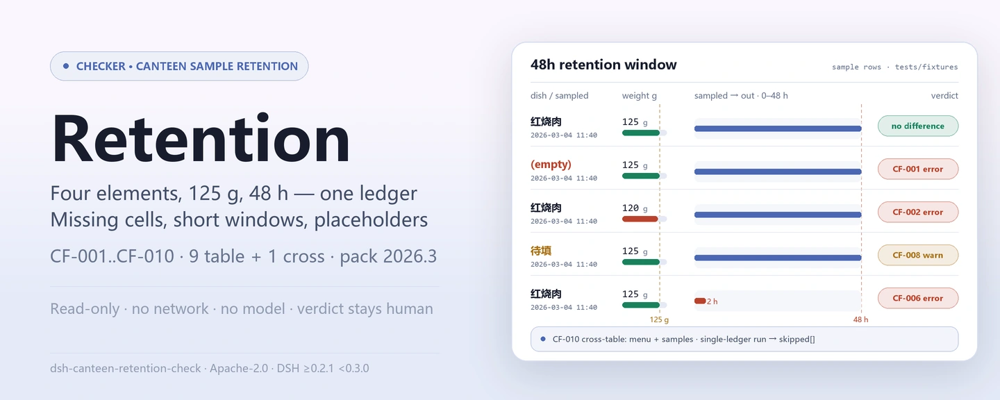
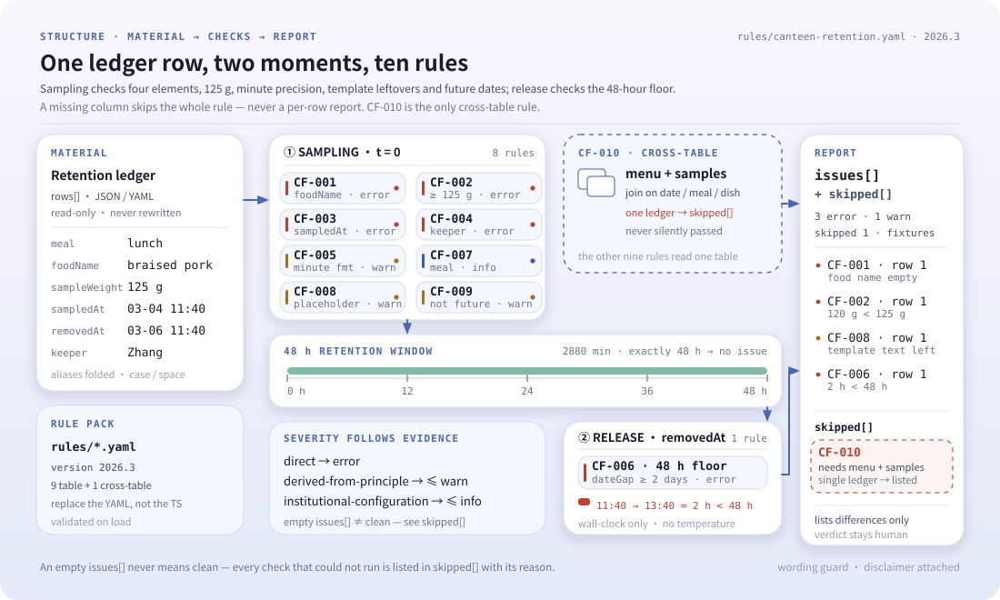

<div align="center">

<picture>
  <source media="(prefers-color-scheme: dark)" srcset="docs/assets/dsh-canteen-retention-check-hero-en-dark.webp">
  
</picture>

# dsh-canteen-retention-check

**हर नमूना-पंक्ति की जाँच चार अनिवार्य तत्वों, 125 ग्राम की न्यूनतम सीमा, 48 घंटे की अवधि और बचे टेम्पलेट प्लेसहोल्डर पर करें — केवल वही बताएँ जो रजिस्टर साबित कर सकता है, निर्णय समीक्षक पर छोड़ें।**

DeepSeek Harness के लिए डेटा-प्रकार चेकर: एक कैंटीन नमूना-रखरखाव रजिस्टर (हर नमूने के लिए एक पंक्ति) पढ़ता है, साथ भेजे गए संस्करणित नियम पैक (CF-001..CF-010) को लागू करता है, और सामग्री में कभी नहीं लिखता — कोई नेटवर्क कॉल नहीं, कोई मॉडल कॉल नहीं।

[इंस्टॉल](#तीन-चरणों-में-शुरुआत) · [कॉन्फ़िगरेशन](#कॉन्फ़िगरेशन) · [FAQ](#faq) · [简体中文](README.md) · [English](README.en.md) · [Español](README.es.md) · [Português](README.pt.md) · [हिन्दी](README.hi.md)

[](LICENSE)
[](#संगतता)
[](https://www.npmjs.com/package/dsh-canteen-retention-check)
[](https://github.com/PerryLink/dsh-canteen-retention-check/actions/workflows/ci.yml)
[](#संगतता)

[](https://github.com/PerryLink/dsh-canteen-retention-check/stargazers)
[](https://www.npmjs.com/package/dsh-canteen-retention-check)
[](https://dshfind.com/plugins/PerryLink/dsh-canteen-retention-check?ref=badge)
[](https://securityscorecards.dev/viewer/?uri=github.com/PerryLink/dsh-canteen-retention-check)
[](https://gitee.com/perrylink/dsh-canteen-retention-check)

```sh
dsh plugin --profile <name> add dsh-canteen-retention-check
```

</div>

<sub>सामुदायिक प्लगइन, DeepSeek से असंबद्ध। कैनोनिकल रिपॉज़िटरी: <https://github.com/PerryLink/dsh-canteen-retention-check> (Gitee एक मिरर है)।</sub>

## यह क्या है

`dsh-canteen-retention-check` एक कैंटीन नमूना-रखरखाव रजिस्टर पढ़ता है — एक शीर्षक पंक्ति और हर रखे गए नमूने के लिए एक पंक्ति — और रजिस्टर की अपनी पूर्णता तथा आंतरिक समय-संगति की जाँच करता है: व्यंजन का नाम, वज़न, नमूना समय और व्यक्ति भरे हैं या नहीं; हर वज़न 125 ग्राम तक पहुँचता है या नहीं; नमूना समय मिनट तक दर्ज है और भविष्य का नहीं है या नहीं; निकासी नमूने के कम से कम 48 घंटे बाद हुई है या नहीं; और किसी कक्ष में `XXX` या `待填` जैसा टेम्पलेट पाठ बचा है या नहीं।

यह रजिस्टर की जाँच करता है, रसोई की नहीं। पंक्ति का अनुपस्थित होना बताता है कि रजिस्टर नमूना लेने का प्रमाण नहीं दे सकता; यह नहीं कि नमूना लिया ही नहीं गया। खाली कक्ष «रजिस्टर में दर्ज नहीं» बताता है, «हुआ ही नहीं» नहीं — ये अलग दावे हैं और केवल पहला दस्तावेज़ से सिद्ध होता है।

नियम और कोड अलग हैं: 9 एक-तालिका नियम और 1 दो-तालिका नियम (CF-010) `rules/canteen-retention.yaml` में घोषित हैं, इसलिए पैक बदलने से पूरा नियम-समूह बदल जाता है और TypeScript की एक पंक्ति भी नहीं छूनी पड़ती। रिपोर्ट के दो भाग हैं: `issues` अंतर बताता है और `skipped` हर वह जाँच बताता है जो नहीं चल सकी और क्यों — खाली `issues` का अर्थ «कुछ गलत नहीं» नहीं है।

- **किसके लिए**: कैंटीन प्रबंधक और खाद्य-सुरक्षा अधिकारी; कमांड लाइन जानने की ज़रूरत नहीं, सामग्री चैट में सौंप दें।
- **आप क्या देते हैं**: वह मूल सामग्री जिस पर यह जाँच चलती है (तालिका, रजिस्टर या दस्तावेज़); मूल कभी नहीं बदला जाता। Excel को पहले JSON/YAML में बदला जा सकता है, प्लेटफ़ॉर्म समर्थन दे तो चैट में भी।
- **यह क्या देता है**: «कौन-सी पंक्ति, कौन-सा स्तंभ, क्या कम है, कैसे सुधारें» की सूची; हर जाँच जो नहीं चल सकी, `skipped` में कारण के साथ दर्ज होती है।

<picture>
  <source media="(prefers-color-scheme: dark)" srcset="docs/assets/dsh-canteen-retention-check-flow-v5-dark.svg">
  
</picture>

## तीन चरणों में शुरुआत

1. **इंस्टॉल करें** (कोई एक चैनल चुनें):

   ```sh
   # git चैनल (नवीनतम main; git+https://github.com/PerryLink/dsh-canteen-retention-check.git के बराबर)
   dsh plugin --profile <name> add github:PerryLink/dsh-canteen-retention-check
   # npm चैनल (प्रकाशित संस्करण)
   dsh plugin --profile <name> add dsh-canteen-retention-check
   # tarball चैनल: इस रेपो में pnpm pack के बाद
   dsh plugin --profile <name> add ./dsh-canteen-retention-check-<version>.tgz
   ```

   npm चैनल `lib/` के साथ आता है; git चैनल इसे `prepare` स्क्रिप्ट के ज़रिए `tsdown` से बनाता है।

2. **न्यूनतम कॉन्फ़िगरेशन** (डिफ़ॉल्ट ही पर्याप्त हैं; `config` के बिना bundle पंक्ति सभी डिफ़ॉल्ट लेती है और नियम पैक साथ भेजे `rules/canteen-retention.yaml` पर जाता है):

   ```yaml
   - insert:
       - id: dsh-canteen-retention-check
         name: dsh-canteen-retention-check
   ```

3. **जाँचें कि माउंट हुआ**:

   ```sh
   dsh --profile <name> --dump-config | grep 'dsh-canteen-retention-check'
   ```

   फिर साथ भेजा नमूना चलाएँ (`lib/` बनाने के लिए पहले `pnpm install && pnpm run build` आवश्यक):

   ```sh
   node samples/quickstart/run.mjs
   ```

   ```text
   $ node samples/quickstart/run.mjs
   canteen_retention_check: 1 issue(s) — error 1, warn 0, info 0
   skipped: 1
   ```

   नमूना इनपुट `samples/quickstart/input/` में और अपेक्षित सारांश `samples/quickstart/expected/result.json` में है।

**अनइंस्टॉल**: `dsh plugin --profile <name> remove dsh-canteen-retention-check` (या प्रोफ़ाइल पैच से वह पंक्ति हटा दें)।

<details>
<summary>WorkBuddy / Coze में उपयोग करें</summary>

WorkBuddy / Coze में «Safety Compliance Suite» खोजें (यह जाँच उस सेट का एक भाग है; उपलब्धता स्टोर पर निर्भर है) और बिना कमांड लाइन के वही जाँच क्षमता पाएँ।

</details>

## मुख्य क्षमताएँ

`dsh-canteen-retention-check` टूल `canteen_retention_check` को रजिस्टर करता है: एक रखरखाव रजिस्टर पढ़ता है, संस्करणित नियम पैक लागू करता है और रिपोर्ट लौटाता है।

- **एक पैक में दस नियम** — 9 एक-तालिका नियम (CF-001..CF-009) और 1 दो-तालिका नियम (CF-010); पैक डेटा है, कोड नहीं, इसलिए `rules/*.yaml` बदलने से नियम-समूह बदल जाता है।
- **सामग्री पर केवल पढ़ाई** — JSON या YAML स्वीकार करता है और मूल कभी नहीं बदलता; शुद्ध ESM, कोई नेटवर्क अनुरोध नहीं, कोई मॉडल कॉल नहीं, कोई टेलीमेट्री नहीं।
- **कोई मनगढ़ंत उद्धरण नहीं** — हर नियम में `document` / `number` / `clause` / `excerpt` / `kind` / `source` होते हैं; `excerpt` शब्दशः उद्धरण होना चाहिए, और जिस नियम का सटीक पाठ नहीं मिला वह `excerpt` में यह बताता है और `derived-from-principle` चिह्नित होता है।
- **गंभीरता साक्ष्य के अनुसार** — `derived-from-principle` अधिकतम `warn` और `institutional-configuration` अधिकतम `info`, और एक परीक्षण इसे सत्यापित करता है।
- **खाली सूची का अर्थ «कुछ गलत नहीं» नहीं** — हर जाँच जो नहीं चल सकी, `skipped` में कारण के साथ दर्ज होती है; जिस नियम की अनिवार्य सूची सेट नहीं या स्तंभ अनुपस्थित है, वह चुपचाप पास होने के बजाय `skipped` में खुद को बताता है।
- **निर्णायक शब्दावली नहीं** — रिपोर्ट केवल अंतर बताती है; अनुपालन, दायित्व या सत्यता पर कभी निर्णय नहीं देती। एक शब्दावली-गार्ड इसे लागू करता है और हर रिपोर्ट के साथ अस्वीकरण रहता है।

| नियम | जाँच | गंभीरता | आधार प्रकार |
|---|---|---|---|
| `CF-001` | व्यंजन का नाम दर्ज है | error | direct |
| `CF-002` | नमूने का वज़न ≥ 125 ग्राम | error | direct |
| `CF-003` | नमूना समय दर्ज है | error | direct |
| `CF-004` | नमूना रखने वाला व्यक्ति दर्ज है | error | direct |
| `CF-005` | नमूना समय मिनट तक दर्ज है | warn | derived-from-principle |
| `CF-006` | निकासी नमूने के कम से कम 48 घंटे बाद | error | direct |
| `CF-007` | भोजन दर्ज है | info | derived-from-principle |
| `CF-008` | व्यंजन के नाम में कोई टेम्पलेट प्लेसहोल्डर नहीं | warn | derived-from-principle |
| `CF-009` | नमूना समय भविष्य का नहीं | warn | derived-from-principle |
| `CF-010` | मेन्यू के हर व्यंजन का नमूना रखा गया है (दो रजिस्टर आवश्यक) | error | direct |

जिन प्रश्नों का उत्तर देता है:

- क्या हर पंक्ति में व्यंजन, वज़न, समय और व्यक्ति दर्ज हैं?
- क्या हर वज़न 125 ग्राम या अधिक है?
- क्या समय मिनट तक दर्ज है और भविष्य का नहीं है?
- क्या नमूना 48 घंटे तक रखा गया?
- क्या कहीं `XXX` या `待填` जैसा टेम्पलेट पाठ बचा है?
- क्या मेन्यू के हर व्यंजन का नमूना रखा गया है? इसके लिए दो रजिस्टर चाहिए; केवल एक दिया जाए तो `CF-010` चलने का दिखावा करने के बजाय `skipped` में दर्ज होता है।

### टूल की सतह

| तर्क | प्रकार | अर्थ |
|---|---|---|
| `file` | string | सामग्री फ़ाइल का निरपेक्ष पथ (JSON या YAML); `file` / `material` में से एक |
| `material` | string | इनलाइन सामग्री पाठ (JSON या YAML); `file` / `material` में से एक |
| `rulesFile` | string | कॉन्फ़िगर किया गया नियम-पैक पथ बदलें (पैकेज रूट के सापेक्ष या निरपेक्ष) |
| `only` | string[] | केवल ये नियम आईडी चलाएँ; खाली का अर्थ सभी |

परिणाम में `plugin`, `target`, `checkedAt`, `rulesetVersion`, `summary`, `issueCount`, `skippedCount`, `markdown` और `reportJson` होते हैं; `markdown` मॉडल के लिए पूरी रिपोर्ट है और `reportJson` उसी रिपोर्ट का संरचित रूप।

### उदाहरण

ये प्लगइन के वास्तविक प्रवेश-बिंदु हैं; एक बार इंस्टॉल करके इनमें से कोई एक चलाएँ। नमूना साथ भेजी सामग्री का उपयोग करता है:

```yaml
target: 食堂留样台账（差异样本：留样食品名称为空）
rows:
  - 餐次: 午餐
    留样食品名称: ''
    留样量: 125
    留样时间: 2026-03-04 11:40
    出柜时间: 2026-03-06 11:40
    留样人员: 张三
```

आउटपुट सारांश:

```json
{
  "tool": "canteen_retention_check",
  "issueCount": 1,
  "summary": { "error": 1, "warn": 0, "info": 0 },
  "skippedCount": 1
}
```

*Observed from `samples/quickstart/input/CF-001-unsafe.yaml`; `samples/quickstart/expected/result.json`; `docs/assets/quickstart.log`*

## कॉन्फ़िगरेशन

सभी समायोज्य पैरामीटर `src/config.ts` में Schemastery `Config` फ़ील्ड हैं (cordis.yml से बदले जा सकते हैं)। आईडी-आधारित ओवरराइड पूरी पंक्ति बदल देता है — ज़रूरी सभी कुंजियाँ दोबारा लिखें।

| कुंजी | प्रकार | डिफ़ॉल्ट | अर्थ |
|---|---|---|---|
| `rulesFile` | string | `rules/canteen-retention.yaml` | पैकेज रूट के सापेक्ष नियम-पैक पथ; फ़ाइल बदलने से नियम-समूह का संस्करण बदलता है |
| `disabledRules` | string[] | `[]` | इस परिनियोजन में बंद नियम आईडी; हर एक `skipped` में आता है |
| `onlyRules` | string[] | `[]` | केवल ये नियम आईडी चलाएँ; खाली का अर्थ सभी |
| `skipNotes` | string | `""` | हर `skipped` कारण के साथ जोड़ा जाने वाला नोट, जैसे स्थानीय कार्यान्वयन नियम बताना |
| `timeoutMs` | number | `120000` | टूल का सहकारी समय-सीमा बजट, मिलीसेकंड में |

प्रोफ़ाइल पैच में ओवरराइड का उदाहरण:

```yaml
- insert:
    - id: dsh-canteen-retention-check
      name: dsh-canteen-retention-check
      config:
        disabledRules: [CF-007]
        skipNotes: यह साइट केवल दोपहर और रात का भोजन जाँचती है
        timeoutMs: 180000
```

## सामग्री का प्रारूप

एक रजिस्टर, एक तालिका, हर रखे गए नमूने के लिए एक पंक्ति। टूल JSON या YAML स्वीकार करता है:

```text
餐次          भोजन (नाश्ता / दोपहर / रात)
留样食品名称  व्यंजन का नाम
留样量        नमूने का वज़न ग्राम में
留样时间      नमूना समय (YYYY-MM-DD HH:MM सुझाया गया)
出柜时间      निकासी समय (वही प्रारूप)
留样人员      नमूना रखने वाला व्यक्ति
单位          इकाई (वैकल्पिक)
存放条件      भंडारण स्थिति (वैकल्पिक; इसका निर्णय नहीं होता)
备注          टिप्पणी (वैकल्पिक)
```

शीर्षक फ़ील्ड (वैकल्पिक): `canteen` / `食堂名称` / `单位名称`, `period` / `期间` / `月份`, `checkedAt` / `核对日期` / `检查日期`, `basis` / `依据`। पंक्ति-सरणी कुंजियाँ: `rows` / `items` / `samples` / `留样` / `留样记录`।

स्तंभ मिलान बड़े/छोटे अक्षरों में अंतर नहीं करता और खाली स्थान, पूर्ण चौड़ाई खाली स्थान, अंडरस्कोर और हाइफ़न छोड़ देता है; रजिस्टर के अपने स्तंभ नाम सुरक्षित रहते हैं, इसलिए कोई अंतर वही स्तंभ बताता है जो वास्तव में पढ़ा गया। उपनाम `src/model.ts` में घोषित हैं, इसलिए `品名`, `留样重量`, `留样人` और अंग्रेज़ी नाम भी मिलते हैं।

```yaml
target: कैंटीन नमूना-रखरखाव रजिस्टर
rows:
  - 餐次: 午餐
    留样食品名称: 番茄炒蛋
    留样量: 150
    留样时间: 2026-03-04 11:40
    出柜时间: 2026-03-06 12:10
    留样人员: 张三
```

## मानक और नियम स्रोत

पैक विद्यालय खाद्य सुरक्षा एवं पोषण स्वास्थ्य प्रबंधन विनियम (शिक्षा मंत्रालय, राज्य बाज़ार नियमन प्रशासन और राष्ट्रीय स्वास्थ्य आयोग का आदेश संख्या 45) के अनुच्छेद 40 को शब्दशः उद्धृत करता है:

```text
《学校食品安全与营养健康管理规定》第四十条：
中小学、幼儿园食堂应当对每餐次加工制作的每种食品成品进行留样，每个品种留样量应当满足检验需要，不得少于125克，并记录留样食品名称、留样量、留样时间、留样人员等。
```

वही अनुच्छेद चारों तत्व और 125 ग्राम की न्यूनतम सीमा देता है, इसलिए CF-001..CF-004 और CF-006 `direct` हैं और `error` तक जा सकते हैं। अनुच्छेद **प्राथमिक और माध्यमिक विद्यालयों तथा किंडरगार्टन** पर लागू है; उच्च शिक्षा कैंटीन के लिए केवल दूसरे पैराग्राफ की खाद्य श्रेणियाँ लागू होती हैं, इसलिए यह पैक विश्वविद्यालय कैंटीन के सामान्य नमूना-रखरखाव को `error` में नहीं रखता — अनुपस्थित स्तंभ `skipped` में जाते हैं।

48 घंटे की अवधि मिनट के अंतर से निकाली जाती है (`dateGap` `diffMinutes` का उपयोग करता है); ठीक 48 घंटे पर कोई रिपोर्ट नहीं। सारी गणना इनपुट स्ट्रिंग्स पर वॉल-क्लॉक है, समय-क्षेत्र रूपांतरण नहीं। प्रशीतन तापमान और «समर्पित कैबिनेट» रजिस्टर में नहीं होते और पैक उनका निर्णय नहीं करता।

उद्धरण और सत्यापन रिकॉर्ड `rules/evidence/clause-verification-school-food-safety.md` में साथ आते हैं; `pnpm run check:citations` जाँचता है कि हर `excerpt` का शब्दशः अंश उस रिकॉर्ड में मिलता है और अभी अ-अनुसरणीय अंशों को `rules/citations-baseline.json` में दर्ज करता है — आधार-रेखा केवल छोटी हो सकती है। नियम-समूह संस्करण `2026.3`, `as_of` 2026-10-23।

## FAQ

<details>
<summary>क्या यह तय करता है कि हम अनुपालन में हैं या नहीं?</summary>

नहीं। यह केवल वे अंतर बताता है जो सामग्री स्वयं साबित कर सकती है (कौन-सी पंक्ति, कौन-सा स्तंभ, क्या कम है, कैसे सुधारें); यह तथ्य या अनुपालन पर निर्णय नहीं देता — निर्णय हमेशा समीक्षक के पास रहता है। शब्दावली-गार्ड रिपोर्ट के पाठ को सीमित करता है और हर रिपोर्ट के साथ अस्वीकरण रहता है।

</details>

<details>
<summary>हमारा रजिस्टर Excel में है — सीधे दे सकते हैं?</summary>

पहले इसे JSON या YAML में बदलें; प्लेटफ़ॉर्म समर्थन दे तो रूपांतरण चैट में भी हो सकता है। टूल केवल सामग्री पढ़ता है और मूल कभी नहीं बदलता।

</details>

<details>
<summary>क्या खाली `issues` सूची का अर्थ «कोई समस्या नहीं» है?</summary>

नहीं। हर जाँच जो नहीं चल सकी, `skipped` में कारण के साथ आती है (स्तंभ अनुपस्थित, समय अपठनीय, नियम पैक कॉन्फ़िगर नहीं)। `issues` और `skipped` साथ पढ़ें।

</details>

<details>
<summary>48 घंटे ठीक कैसे गिने जाते हैं?</summary>

निकासी समय घटा नमूना समय, मिनटों में, दिनों में बदलकर 2 दिन से तुलना; ठीक 48 घंटे (2,880 मिनट) पर रिपोर्ट नहीं, एक मिनट कम पर रिपोर्ट। दोनों समय पठनीय होने चाहिए: केवल तारीख़ वाला मान `00:00` गिना जाता है, इसलिए एक ही दिन के दो समय 0 दिन बनते हैं। सारी गणना वॉल-क्लॉक है, समय-क्षेत्र रूपांतरण नहीं।

</details>

<details>
<summary>`CF-010` हमेशा `skipped` क्यों रहता है?</summary>

क्योंकि यह एकमात्र दो-तालिका नियम है और इसके लिए मेन्यू तथा रखरखाव रजिस्टर दोनों चाहिए। टूल एक बार में एक सामग्री लेता है, इसलिए एक-तालिका रन इसे चुपचाप छोड़ने के बजाय `skipped` में दर्ज करता है। जॉइन `src/cross.ts` में `checkMenuCoverage` से लागू होता है; वर्तमान टूल सतह में दोनों सामग्री एक साथ देने वाला कोई तर्क नहीं है।

</details>

<details>
<summary>पूरे सेमेस्टर का रजिस्टर बहुत धीमा होगा?</summary>

जाँच स्थानीय स्तंभ-मिलान और तिथि-गणित है — कोई नेटवर्क अनुरोध नहीं, कोई मॉडल कॉल नहीं; `timeoutMs` (डिफ़ॉल्ट 120 सेकंड) सहकारी समय-सीमा बजट है जिसे बढ़ाया जा सकता है।

</details>

## समस्या निवारण

- **प्लगइन इंस्टॉल होता है पर टूल दिखता नहीं।** जाँचें कि `main` `lib/index.mjs` पर जाता है और `pnpm run build` ने उसे बनाया है; गलत `main` लोडर को पंक्ति चुपचाप छोड़ने पर मजबूर करता है।
- **`dsh plugin add` पैकेज अस्वीकार करता है।** peer सीमा `0.1.x` और `0.2.x` को कवर करती है; उसके बाहर स्पष्ट छूट दें और पुराना DSH कोर ज़बरदस्ती इंस्टॉल न करें।
- **कोई नियम नहीं चला।** रिपोर्ट का `skipped` सरणी पढ़ें; कारण वहीं लिखा है। खाली `issues` से अनुमान न लगाएँ।
- **इंस्टॉल होता है पर कोई निष्कर्ष नहीं दिखता।** पुष्टि करें कि टूल वास्तव में चला और परिणाम लौटाया — खाली परिणाम छोड़ी गई जाँच नहीं है; इनपुट की कमी सामान्यतः `skipped` बताई जाती है, निष्कर्ष का अनुमान कभी नहीं लगाया जाता।
- **समय खिसका हुआ लगता है।** सारी गणना इनपुट स्ट्रिंग्स पर वॉल-क्लॉक है; समय-क्षेत्र रूपांतरण लागू नहीं होता।
- **पैकेज नहीं मिलता।** लक्ष्य रनटाइम DSH `>=0.2.1-0 <0.3.0` और Node `^22.19.0 || >=24.0.0` है; प्रोफ़ाइल क्लोज़र से इंस्टॉल करें: `dsh plugin --profile <name> add dsh-canteen-retention-check`.

## सुरक्षा सीमाएँ

- **सामग्री पर केवल पढ़ाई।** टूल आपकी दी फ़ाइल या इनलाइन पाठ पढ़ता है और कभी वापस नहीं लिखता या मूल नहीं बदलता; टूल परिणाम और DSH होस्ट के अपने सत्र भंडारण के अलावा कुछ नहीं लिखता।
- **कोई नेटवर्क नहीं, कोई मॉडल कॉल नहीं, कोई टेलीमेट्री नहीं।** जाँच स्थानीय स्तंभ-मिलान और तिथि-गणित है; यह कोई एनालिटिक्स एकत्र या उपयोग रिपोर्ट नहीं करता।
- **कोई क्रेडेंशियल नहीं।** पर्यावरण से रहस्य नहीं पढ़ता, क्रेडेंशियल संग्रहीत नहीं करता और नेटवर्क अनुरोध नहीं करता।
- **रजिस्ट्रेशन एक effect है।** टूल रजिस्ट्रेशन disposer लौटाता है, इसलिए अनलोड या हॉट रीलोड उसे हटा देता है; कोई पृष्ठभूमि कार्य, टाइमर या निवासी प्रक्रिया नहीं।
- **फेल-क्लोज़्ड।** अनुपस्थित स्तंभ, अपठनीय समय और अज्ञात नियम आईडी कारण के साथ `skipped` में जाते हैं; उन्हें कभी पास नहीं माना जाता। नियम पैक लोड पर सत्यापित होता है, उस पर भरोसा नहीं किया जाता।
- **शब्दावली-गार्ड।** प्रस्तुत रिपोर्ट अनुपालन, दायित्व या सत्यता पर कभी निर्णय नहीं देती; मानव समीक्षा के लिए अंतर बताती है और हमेशा अस्वीकरण रखती है।
- **नियम पैक डेटा है।** `rules/*.yaml` बदलने से नियम-समूह बदलता है; लोड-समय सत्यापन चाहता है कि हर नियम में `document` / `number` / `clause` / `excerpt` / `kind` / `source` हो और हर excerpt सत्यापन रिकॉर्ड में शब्दशः मिले।

## ज्ञात सीमाएँ

- **केवल रजिस्टर की जाँच।** यह निर्णय नहीं देता कि नमूना निरीक्षण के लिए पर्याप्त है, भोजन सुरक्षित था, या रजिस्टर के बाहर क्या हुआ। «दर्ज नहीं» का अर्थ है रजिस्टर साबित नहीं कर सकता, यह नहीं कि हुआ ही नहीं।
- **दायरा सीमित है।** अनुच्छेद 40 प्राथमिक और माध्यमिक विद्यालयों तथा किंडरगार्टन पर लागू है; उच्च शिक्षा कैंटीन के लिए केवल दूसरे पैराग्राफ की खाद्य श्रेणियाँ लागू हैं। यह पैक विश्वविद्यालय कैंटीन के सामान्य नमूना-रखरखाव को `error` में नहीं रखता; अनुपस्थित स्तंभ `skipped` में जाते हैं।
- **«等» (आदि) का विस्तार नहीं।** अनुच्छेद कहता है कि वैधानिक रिकॉर्ड मदें केवल चार तक सीमित नहीं; यह पैक केवल नामित चार (नाम, वज़न, समय, व्यक्ति) जाँचता है और «आदि» से विस्तार नहीं करता।
- **125 ग्राम केवल संख्यात्मक न्यूनतम है।** «निरीक्षण आवश्यकताओं की पूर्ति» एक अलग मूलभूत अपेक्षा है जिसे रजिस्टर तय नहीं कर सकता; पैक केवल संख्या की तुलना करता है और ठीक 125 ग्राम पर रिपोर्ट नहीं होती।
- **48 घंटे केवल गणित है।** यह प्रशीतन तापमान, «समर्पित कैबिनेट» या नमूना वास्तव में ठंडा रखा गया या नहीं — कुछ भी नहीं जाँचता; रजिस्टर सामान्यतः ये दर्ज नहीं करते। केवल तारीख़ वाला मान `00:00` गिना जाता है, इसलिए एक ही दिन के दो समय 0 दिन बनते हैं।
- **दो-तालिका नियम को दो रजिस्टर चाहिए।** `CF-010` के लिए मेन्यू और रखरखाव रजिस्टर दोनों चाहिए; टूल एक सामग्री लेता है, इसलिए एक-तालिका रन इसे `skipped` में दर्ज करता है।
- **अनुपस्थित स्तंभ «लागू नहीं» है।** जब पूरा स्तंभ गायब हो, रिपोर्ट `skipped` कहती है न कि हर पंक्ति को उल्लंघन मानती है — `留样量` स्तंभ के बिना रजिस्टर आकार की समस्या है और पंक्ति-दर-पंक्ति त्रुटियाँ उसे दबा देंगी।
- **केवल वॉल-क्लॉक गणित।** कोई समय-क्षेत्र रूपांतरण या क्षेत्र-से-क्षेत्र संरेखण नहीं।

## अन्य DSH प्लगइनों के साथ इंटरऑपरेबिलिटी

यह प्लगइन केवल एक मॉडल टूल रजिस्टर करता है और होस्ट या दूसरे प्लगइनों से कोई कमांड, सेवा या UI स्थान नहीं लेता:

- **टूल नाम टकराव नहीं।** केवल `canteen_retention_check` रजिस्टर करता है, जो उपसर्ग वाला नाम है और किसी अंतर्निहित टूल या दूसरे प्लगइन का खाली नाम नहीं लेता।
- **सेवा कुंजी टकराव नहीं।** कोई सेवा कुंजी प्रदान नहीं करता।
- **slot टकराव नहीं।** कोई क्लाइंट slot रजिस्टर नहीं करता (कोई client निर्देशिका नहीं; यह शुद्ध host प्लगइन है)।
- **HTTP रूट टकराव नहीं।** कोई `webServer` उपसर्ग रजिस्टर नहीं करता।
- **कोई ग्लोबल बदलाव नहीं।** प्रोटोटाइप नहीं बदलता, `process.env` नहीं लिखता, ग्लोबल fetch dispatcher नहीं बदलता।
- **कोई पृष्ठभूमि कार्य नहीं।** कोई टाइमर, पोलिंग या पृष्ठभूमि कतार रजिस्टर नहीं करता।
- **रजिस्ट्रेशन एक effect है।** टूल रजिस्ट्रेशन disposer लौटाता है; अनलोड उसे हटा देता है और कोई listener नहीं छोड़ता।

स्थिर साक्ष्य: `src/index.ts` की पूरी रजिस्ट्रेशन सतह एक `ctx.tools.register(...)` कॉल है; बाकी सब शुद्ध जाँच और पढ़ाई है।

## संगतता

| सतह | स्थिति |
|---|---|
| Harness | `engines.dsh` है `>=0.2.1-0 <0.3.0`; peer सीमा `>=0.1.2-rc.1 <0.2.0 \|\| >=0.2.0-0 <0.3.0` |
| Node | `^22.19.0 \|\| >=24.0.0` |
| प्लेटफ़ॉर्म | सभी (शुद्ध ESM; कोई नेटिव कोड नहीं, कोई नेटवर्क नहीं, कोई मॉडल कॉल नहीं) |
| मॉडल | टेक्स्ट मॉडल पूरी तरह समर्थित; अतिरिक्त मॉडल क्षमता नहीं चाहिए |

## इकोसिस्टम और गुणवत्ता

- [Gitee मिरर](https://gitee.com/perrylink/dsh-canteen-retention-check) (सिंक मिरर; कैनोनिकल GitHub है)
- [dshfind प्लगइन पेज](https://dshfind.com/plugins/PerryLink/dsh-canteen-retention-check) (इंस्टॉल और रैंकिंग)
- [OpenSSF Scorecard रिपोर्ट](https://securityscorecards.dev/viewer/?uri=github.com/PerryLink/dsh-canteen-retention-check) ([.github/workflows/scorecard.yml](.github/workflows/scorecard.yml) द्वारा संचालित)
- **1024 स्टोर चैनल**: एक बार `npm i -g dsh1024`, फिर `dsh1024 plugin --profile <name> add dsh-canteen-retention-check` ([deepseek1024.com](https://deepseek1024.com) की इंस्टॉल रैंकिंग में गिना जाता है)
- [इकोसिस्टम ज्ञानकोश](https://perrylink.github.io/dsh-plugin-guide/): प्लगइन विकास गाइड · चयन के मापे गए आँकड़े · रखरखाव के मानदंड

## डेवलपमेंट

```sh
pnpm install                                        # node ^22.19 || >=24
pnpm run typecheck                                  # tsc --noEmit
pnpm test                                           # vitest: साझा टेबल-प्लगइन सूट + युग्मित फ़िक्सचर
pnpm run build                                      # tsdown -> lib/index.mjs + lib/index.d.mts
pnpm run verify:self-contained                      # निर्भरताएँ registry से हल होती हैं
pnpm run check:lockfile                             # lockfile ड्रिफ्ट जाँच
pnpm run check:readmes                              # पाँच-भाषा README संगति
pnpm run check:citations                            # नियम-पैक उद्धरण आधार-रेखा
node ../scripts/sync-shared.mjs dsh-canteen-retention-check   # ../_shared से src/shared ताज़ा करें
pnpm pack                                           # प्रकाशित tarball
```

यह प्लगइन **डेटा-प्रकार** है: `src/model.ts` तालिका का आकार और स्तंभ उपनाम घोषित करता है, साझा किट पाठक और जाँच इंजन देता है, और नियम पैक हर जाँच घोषित करता है। स्थानीय नमूना रन (`lib/` बनाने के लिए पहले बिल्ड करें):

```sh
node samples/quickstart/run.mjs
# => canteen_retention_check: 1 issue(s) — error 1, warn 0, info 0
#    skipped: 1
```

नमूना इनपुट `samples/quickstart/input/` में, अपेक्षित सारांश `samples/quickstart/expected/result.json` में और स्क्रीनशॉट `docs/assets/quickstart.png` में है। README की छवियाँ [`scripts/gen-readme-assets.py`](scripts/gen-readme-assets.py) से क्रमादेशित रूप से बनती हैं (hero Pillow से बनता है और संरचना आरेख हस्तलिखित SVG है; दोनों हल्के और गहरे variant में) और दोबारा चलाई जा सकती हैं; पुराना एक-रूप फ़्लो डायग्राम और डेमो संपत्तियाँ बाहरी लिंक के लिए `docs/assets/` में रहती हैं।

Topics: `deepseek-harness`, `dsh`, `dsh-plugin`, `cordis`, `canteen`, `retention`, `food`

## परिवार और आभार

यह परियोजना [PerryLink](https://github.com/PerryLink) के DeepSeek Harness प्लगइन परिवार का सदस्य है (सभी Apache-2.0)। पूरा परिवार सूचकांक [सामग्री के अनुसार चेकर चुनें](https://perrylink.github.io/zh/checkers/choose/) है। अगर यह उपयोगी लगे तो **एक star अगले व्यक्ति को इसे खोजने में मदद करता है** — इससे कोई सुविधा अनलॉक नहीं होती।

- [@PerryLink](https://github.com/PerryLink) — निर्माता और अनुरक्षक: कैंटीन नमूना-रखरखाव नियम पैक (CF-001..CF-010), `canteen_retention_check` टूल, उद्धरण-सत्यापन रिकॉर्ड और पाँच-भाषा दस्तावेज़।

<details>
<summary>सभी प्लगइन देखें</summary>

| प्लगइन | स्थिति |
|---|---|
| **[dsh-aqua-input-check](https://github.com/PerryLink/dsh-aqua-input-check)** |  |
| **[dsh-archive-check](https://github.com/PerryLink/dsh-archive-check)** |  |
| **[dsh-auto-review](https://github.com/PerryLink/dsh-auto-review)** |  |
| **[dsh-autotier](https://github.com/PerryLink/dsh-autotier)** | 🧊 फ़्रोज़न — रेपो README देखें |
| **[dsh-bid-ca-precheck](https://github.com/PerryLink/dsh-bid-ca-precheck)** |  |
| **[dsh-bid-qual-check](https://github.com/PerryLink/dsh-bid-qual-check)** |  |
| **[dsh-cert-mcp](https://github.com/PerryLink/dsh-cert-mcp)** | 🧊 फ़्रोज़न — रेपो README देखें |
| **[dsh-checkpoint-rewind](https://github.com/PerryLink/dsh-checkpoint-rewind)** |  |
| **[dsh-click](https://github.com/PerryLink/dsh-click)** |  |
| **[dsh-composer-history](https://github.com/PerryLink/dsh-composer-history)** |  |
| **[dsh-contract-stance](https://github.com/PerryLink/dsh-contract-stance)** |  |
| **[dsh-customs-doc-check](https://github.com/PerryLink/dsh-customs-doc-check)** |  |
| **[dsh-data-quality](https://github.com/PerryLink/dsh-data-quality)** | 🧊 फ़्रोज़न — रेपो README देखें |
| **[dsh-demurrage-ledger](https://github.com/PerryLink/dsh-demurrage-ledger)** |  |
| **[dsh-doublecheck](https://github.com/PerryLink/dsh-doublecheck)** |  |
| **[dsh-drill-script-check](https://github.com/PerryLink/dsh-drill-script-check)** |  |
| **[dsh-eia-guide-check](https://github.com/PerryLink/dsh-eia-guide-check)** |  |
| **[dsh-emergency-plan](https://github.com/PerryLink/dsh-emergency-plan)** |  |
| **[dsh-essay-rubric-check](https://github.com/PerryLink/dsh-essay-rubric-check)** |  |
| **[dsh-evidence-check](https://github.com/PerryLink/dsh-evidence-check)** |  |
| **[dsh-export-ctl-check](https://github.com/PerryLink/dsh-export-ctl-check)** |  |
| **[dsh-fast](https://github.com/PerryLink/dsh-fast)** |  |
| **[dsh-fmea-table-check](https://github.com/PerryLink/dsh-fmea-table-check)** |  |
| **[dsh-forecast-penalty](https://github.com/PerryLink/dsh-forecast-penalty)** |  |
| **[dsh-fund-research](https://github.com/PerryLink/dsh-fund-research)** |  |
| **[dsh-github](https://github.com/PerryLink/dsh-github)** |  |
| **[dsh-gongwen-flow-check](https://github.com/PerryLink/dsh-gongwen-flow-check)** |  |
| **[dsh-gongwen-word-check](https://github.com/PerryLink/dsh-gongwen-word-check)** |  |
| **[dsh-guard-plan-qc](https://github.com/PerryLink/dsh-guard-plan-qc)** |  |
| **[dsh-hazchem-check](https://github.com/PerryLink/dsh-hazchem-check)** |  |
| **[dsh-hazplan-check](https://github.com/PerryLink/dsh-hazplan-check)** |  |
| **[dsh-hidden-risk-map](https://github.com/PerryLink/dsh-hidden-risk-map)** |  |
| **[dsh-hs-classify](https://github.com/PerryLink/dsh-hs-classify)** |  |
| **[dsh-icd-rule-check](https://github.com/PerryLink/dsh-icd-rule-check)** |  |
| **[dsh-industry-research](https://github.com/PerryLink/dsh-industry-research)** |  |
| **[dsh-lawcite-adapter](https://github.com/PerryLink/dsh-lawcite-adapter)** |  |
| **[dsh-laya](https://github.com/PerryLink/dsh-laya)** |  |
| **[dsh-lc-doc-check](https://github.com/PerryLink/dsh-lc-doc-check)** |  |
| **[dsh-learning-gap-check](https://github.com/PerryLink/dsh-learning-gap-check)** |  |
| **[dsh-library](https://github.com/PerryLink/dsh-library)** |  |
| **[dsh-local-ai](https://github.com/PerryLink/dsh-local-ai)** |  |
| **[dsh-lsp-actions](https://github.com/PerryLink/dsh-lsp-actions)** |  |
| **[dsh-mask](https://github.com/PerryLink/dsh-mask)** |  |
| **[dsh-mcp-panel](https://github.com/PerryLink/dsh-mcp-panel)** |  |
| **[dsh-medrec-qc](https://github.com/PerryLink/dsh-medrec-qc)** |  |
| **[dsh-memento](https://github.com/PerryLink/dsh-memento)** | 🧊 फ़्रोज़न — रेपो README देखें |
| **[dsh-nsfc-form-check](https://github.com/PerryLink/dsh-nsfc-form-check)** |  |
| **[dsh-nurse-record-check](https://github.com/PerryLink/dsh-nurse-record-check)** |  |
| **[dsh-observe](https://github.com/PerryLink/dsh-observe)** |  |
| **[dsh-origin-rvc-check](https://github.com/PerryLink/dsh-origin-rvc-check)** |  |
| **[dsh-ota-review-check](https://github.com/PerryLink/dsh-ota-review-check)** |  |
| **[dsh-output-styles](https://github.com/PerryLink/dsh-output-styles)** |  |
| **[dsh-paper-doc-adapter](https://github.com/PerryLink/dsh-paper-doc-adapter)** |  |
| **[dsh-permission-rules](https://github.com/PerryLink/dsh-permission-rules)** |  |
| **[dsh-permit-report-check](https://github.com/PerryLink/dsh-permit-report-check)** |  |
| **[dsh-pipeline-check](https://github.com/PerryLink/dsh-pipeline-check)** |  |
| **[dsh-pleading-draft](https://github.com/PerryLink/dsh-pleading-draft)** |  |
| **[dsh-plugin-doctor](https://github.com/PerryLink/dsh-plugin-doctor)** | 🚫 रिटायर्ड (रेपो संग्रहीत) |
| **[dsh-plugin-guide](https://github.com/PerryLink/dsh-plugin-guide)** |  |
| **[dsh-plugin-kit](https://github.com/PerryLink/dsh-plugin-kit)** | 🚫 रिटायर्ड (रेपो संग्रहीत) |
| **[dsh-plugin-upgrade](https://github.com/PerryLink/dsh-plugin-upgrade)** | 🚫 रिटायर्ड (रेपो संग्रहीत) |
| **[dsh-policy-brief-draft](https://github.com/PerryLink/dsh-policy-brief-draft)** |  |
| **[dsh-power-loss-split](https://github.com/PerryLink/dsh-power-loss-split)** |  |
| **[dsh-power-ticket-check](https://github.com/PerryLink/dsh-power-ticket-check)** |  |
| **[dsh-ppap-check](https://github.com/PerryLink/dsh-ppap-check)** |  |
| **[dsh-protest-deadline](https://github.com/PerryLink/dsh-protest-deadline)** |  |
| **[dsh-railway-window](https://github.com/PerryLink/dsh-railway-window)** |  |
| **[dsh-repair-order-qc](https://github.com/PerryLink/dsh-repair-order-qc)** |  |
| **[dsh-research-report](https://github.com/PerryLink/dsh-research-report)** |  |
| **[dsh-review-reply-check](https://github.com/PerryLink/dsh-review-reply-check)** |  |
| **[dsh-rulefile-check](https://github.com/PerryLink/dsh-rulefile-check)** |  |
| **[dsh-safety-brief-check](https://github.com/PerryLink/dsh-safety-brief-check)** |  |
| **[dsh-score](https://github.com/PerryLink/dsh-score)** | 🧊 फ़्रोज़न — रेपो README देखें |
| **[dsh-session-sync](https://github.com/PerryLink/dsh-session-sync)** |  |
| **[dsh-site-log-check](https://github.com/PerryLink/dsh-site-log-check)** |  |
| **[dsh-skill-pack-security](https://github.com/PerryLink/dsh-skill-pack-security)** |  |
| **[dsh-soe-decision-check](https://github.com/PerryLink/dsh-soe-decision-check)** |  |
| **[dsh-soilwater-check](https://github.com/PerryLink/dsh-soilwater-check)** |  |
| **[dsh-sop-sync-check](https://github.com/PerryLink/dsh-sop-sync-check)** |  |
| **[dsh-spc-gbt-adapter](https://github.com/PerryLink/dsh-spc-gbt-adapter)** |  |
| **[dsh-talk](https://github.com/PerryLink/dsh-talk)** |  |
| **[dsh-tender-extract](https://github.com/PerryLink/dsh-tender-extract)** |  |
| **[dsh-tender-matrix](https://github.com/PerryLink/dsh-tender-matrix)** |  |
| **[dsh-test-drive](https://github.com/PerryLink/dsh-test-drive)** |  |
| **[dsh-ticktick](https://github.com/PerryLink/dsh-ticktick)** | 🚫 रिटायर्ड (रेपो संग्रहीत) |
| **[dsh-translate](https://github.com/PerryLink/dsh-translate)** |  |
| **[dsh-warranty-calc](https://github.com/PerryLink/dsh-warranty-calc)** |  |
| **[dsh-budget](https://github.com/PerryLink/dsh-budget)** | 🧊 फ़्रोज़न — रेपो README देखें |
| **[dsh-claude-move](https://github.com/PerryLink/dsh-claude-move)** | 🧊 फ़्रोज़न — रेपो README देखें |
| **[dsh-defend](https://github.com/PerryLink/dsh-defend)** | 🧊 फ़्रोज़न — रेपो README देखें |
| **[dsh-draw](https://github.com/PerryLink/dsh-draw)** | 🧊 फ़्रोज़न — रेपो README देखें |
| **[dsh-reach](https://github.com/PerryLink/dsh-reach)** | 🧊 फ़्रोज़न — रेपो README देखें |
| **[dsh-background-agents](https://github.com/PerryLink/dsh-background-agents)** | 🚫 रिटायर्ड (रेपो संग्रहीत) |
| **[dsh-session-pin](https://github.com/PerryLink/dsh-session-pin)** | 🚫 रिटायर्ड (रेपो संग्रहीत) |
| **[dsh-team-rooms](https://github.com/PerryLink/dsh-team-rooms)** | 🚫 रिटायर्ड (रेपो संग्रहीत) |

</details>

## लाइसेंस

[LICENSE](LICENSE) (Apache License 2.0) © 2026 dsh-canteen-retention-check contributors

<p align="center"><sub>Apache-2.0 · सामुदायिक प्लगइन, DeepSeek से असंबद्ध।</sub></p>
