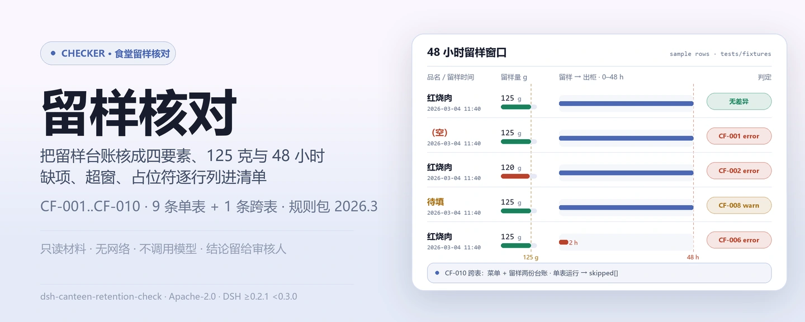
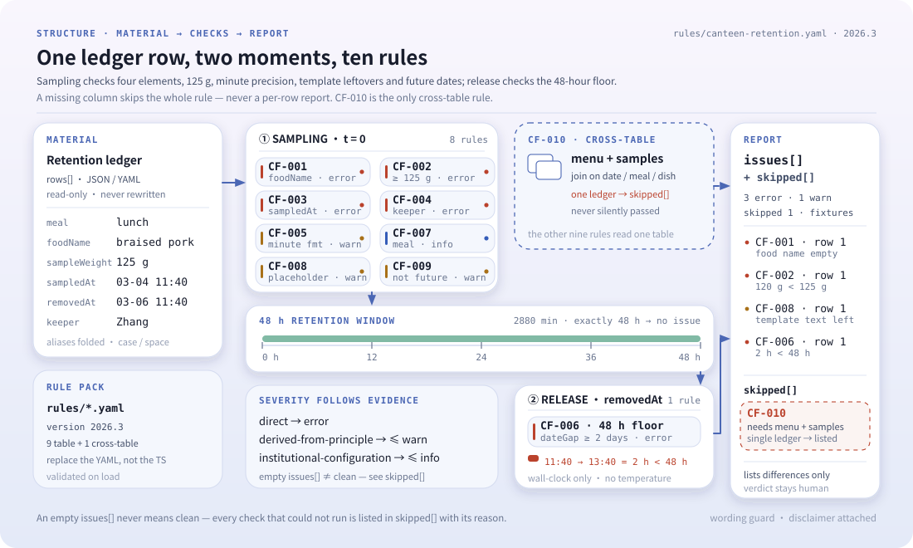

<div align="center">

<picture>
  <source media="(prefers-color-scheme: dark)" srcset="docs/assets/dsh-canteen-retention-check-hero-zh-dark.webp">
  
</picture>

# dsh-canteen-retention-check

**核对食堂留样台账的四要素、125 克下限、48 小时冷藏与模板占位符——只列台账里能逐条指认的差异，结论留给审核人。**

面向 DeepSeek Harness 的数据型核查插件：读入一份留样台账（每行一条留样记录），按随包的版本化规则包（CF-001..CF-010）逐条核对；只读材料、不改原件，无网络请求、不调用模型。

[安装](#三步上手) · [配置](#配置) · [FAQ](#faq) · [简体中文](README.md) · [English](README.en.md) · [Español](README.es.md) · [Português](README.pt.md) · [हिन्दी](README.hi.md)

[](LICENSE)
[](#兼容性)
[](https://www.npmjs.com/package/dsh-canteen-retention-check)
[](https://github.com/PerryLink/dsh-canteen-retention-check/actions/workflows/ci.yml)
[](#兼容性)

[](https://github.com/PerryLink/dsh-canteen-retention-check/stargazers)
[](https://www.npmjs.com/package/dsh-canteen-retention-check)
[](https://dshfind.com/plugins/PerryLink/dsh-canteen-retention-check?ref=badge)
[](https://securityscorecards.dev/viewer/?uri=github.com/PerryLink/dsh-canteen-retention-check)
[](https://gitee.com/perrylink/dsh-canteen-retention-check)

```sh
dsh plugin --profile <name> add dsh-canteen-retention-check
```

</div>

<sub>社区插件，与 DeepSeek 官方无关。唯一仓库：<https://github.com/PerryLink/dsh-canteen-retention-check>（Gitee 为镜像）。</sub>

## 它是什么

`dsh-canteen-retention-check` 读取一份食堂留样台账——表头加每行一条留样记录——核对台账自身的齐备与时间自洽：品名、留样量、留样时间、留样人员四要素是否填写，留样量是否达到 125 克，留样时间是否记到时分且不在未来，出柜是否距留样满 48 小时，单元格里是否还残留 `XXX`、`待填` 这类模板文字。

它核对的是台账，不是厨房。缺一行说明台账无法证明留过样，不说明没有留样；空白格报的是「台账没有记录」，不是「没有发生过」——这两句话不同，只有前一句是文件能支撑的。

规则与代码分离：9 条单表规则加 1 条跨表规则（CF-010）都在 `rules/canteen-retention.yaml` 里声明，替换规则包即换掉整套检查，不动一行 TypeScript。报告分两部分：`issues` 列出差异，`skipped` 列出没能执行的检查及原因——空 `issues` 不能当成「没问题」。

- **给谁用**：食堂管理员、食品安全员；不用懂命令行，在对话里把材料交给它即可。
- **你交什么**：这项核对用到的原始材料（表格、清单或文书）；不改原件。Excel 可先转成 JSON/YAML，对话里也能代转。
- **它交什么**：一份「哪一行、哪一栏、差什么、怎么补」的清单；没能执行的检查逐条列入 `skipped` 并写明原因。

<picture>
  <source media="(prefers-color-scheme: dark)" srcset="docs/assets/dsh-canteen-retention-check-flow-v5-dark.svg">
  
</picture>

## 三步上手

1. **安装**（三选一）：

   ```sh
   # git 通道（最新 main；等价于 git+https://github.com/PerryLink/dsh-canteen-retention-check.git）
   dsh plugin --profile <name> add github:PerryLink/dsh-canteen-retention-check
   # npm 通道（已发布版本）
   dsh plugin --profile <name> add dsh-canteen-retention-check
   # tarball 通道：本仓库 pnpm pack 后
   dsh plugin --profile <name> add ./dsh-canteen-retention-check-<version>.tgz
   ```

   npm 通道随包发布 `lib/`；git 通道安装时由 `prepare` 脚本执行 `tsdown` 构建。

2. **最小配置**（默认即可用；bundle 行不带 `config` 时全部走默认值，规则包路径指向随包的 `rules/canteen-retention.yaml`）：

   ```yaml
   - insert:
       - id: dsh-canteen-retention-check
         name: dsh-canteen-retention-check
   ```

3. **验证已生效**：

   ```sh
   dsh --profile <name> --dump-config | grep 'dsh-canteen-retention-check'
   ```

   然后用仓内自带样例跑一次（需先 `pnpm install && pnpm run build` 产出 `lib/`）：

   ```sh
   node samples/quickstart/run.mjs
   ```

   ```text
   $ node samples/quickstart/run.mjs
   canteen_retention_check: 1 issue(s) — error 1, warn 0, info 0
   skipped: 1
   ```

   样例输入在 `samples/quickstart/input/`，期望输出在 `samples/quickstart/expected/result.json`。

**卸载**：`dsh plugin --profile <name> remove dsh-canteen-retention-check`（或从 profile patch 删掉该行）。

<details>
<summary>在 WorkBuddy / 扣子中使用</summary>

在 WorkBuddy / 扣子搜「安全合规核对包」（本检查是其中一项；上架以商城为准）即可调用同一套核对能力，无需命令行。

</details>

## 核心能力

`dsh-canteen-retention-check` 注册 `canteen_retention_check` 工具：读入一份留样台账，套用版本化规则包，返回一份报告。

- **十条规则一包带走** —— 9 条单表规则（CF-001..CF-009）加 1 条跨表规则（CF-010），规则包是数据不是代码；替换 `rules/*.yaml` 即切换规则集。
- **只读材料** —— 接受 JSON 或 YAML，原件永不修改；纯 ESM，无网络请求、不调用模型、无遥测。
- **引文不造假** —— 每条规则带 `document` / `number` / `clause` / `excerpt` / `kind` / `source`；`excerpt` 必须是逐字引文，取不到原文的规则在 `excerpt` 里如实写明并标为 `derived-from-principle`。
- **严重级跟着证据走** —— `derived-from-principle` 最高 `warn`，本机构配置（`institutional-configuration`）最高 `info`，并有测试断言。
- **空清单 ≠ 没问题** —— 每条没能执行的检查都进 `skipped` 并写明原因；必填清单未配置或列缺失时自我报告 `skipped`，绝不静默通过。
- **措辞不作裁决** —— 报告只列差异，不判定合规、责任或正确性；措辞守卫（wording guard）强制执行，报告永远附带免责声明。

| 规则 | 核对内容 | 严重级 | 依据类别 |
|---|---|---|---|
| `CF-001` | 留样食品名称已记录 | error | direct |
| `CF-002` | 留样量 ≥ 125 克 | error | direct |
| `CF-003` | 留样时间已记录 | error | direct |
| `CF-004` | 留样人员已记录 | error | direct |
| `CF-005` | 留样时间记录到时分 | warn | derived-from-principle |
| `CF-006` | 出柜距留样满 48 小时 | error | direct |
| `CF-007` | 餐次已记录 | info | derived-from-principle |
| `CF-008` | 品名无模板占位符 | warn | derived-from-principle |
| `CF-009` | 留样时间不在未来 | warn | derived-from-principle |
| `CF-010` | 菜单每餐每种都有留样记录（需两份台账） | error | direct |

它能回答的问题：

- 每一行是否都有品名、留样量、留样时间、留样人员？
- 留样量是否都达到 125 克？
- 留样时间是否记到时分、且不在未来？
- 是否至少冷藏 48 小时才出柜？
- 有没有单元格还残留 `XXX`、`待填` 这类模板文字？
- 菜单上的每道菜是否都有留样记录？这一条需要菜单与留样两份台账；只给一份时 `CF-010` 会列进 `skipped`，不会假装跑过。

### 工具面

| 参数 | 类型 | 说明 |
|---|---|---|
| `file` | string | 材料文件绝对路径（JSON 或 YAML），与 `material` 二选一 |
| `material` | string | 内联材料文本（JSON 或 YAML），与 `file` 二选一 |
| `rulesFile` | string | 覆盖配置中的规则库路径（相对插件包根或绝对路径） |
| `only` | string[] | 只执行这些规则 id；留空表示执行全部规则 |

返回 `plugin`、`target`、`checkedAt`、`rulesetVersion`、`summary`、`issueCount`、`skippedCount`、`markdown` 与 `reportJson`；`markdown` 是给模型读的完整报告，`reportJson` 是同一份报告的结构化形式。

### 示例

以下为插件真实入口；安装后调用一次即可。样例取仓内自带材料：

```yaml
target: 食堂留样台账（差异样本：留样食品名称为空）
rows:
  - 餐次: 午餐
    留样食品名称: ''
    留样量: 125
    留样时间: 2026-03-04 11:40
    出柜时间: 2026-03-06 11:40
    留样人员: 张三
```

输出摘要：

```json
{
  "tool": "canteen_retention_check",
  "issueCount": 1,
  "summary": { "error": 1, "warn": 0, "info": 0 },
  "skippedCount": 1
}
```

*Observed from `samples/quickstart/input/CF-001-unsafe.yaml`; `samples/quickstart/expected/result.json`; `docs/assets/quickstart.log`*

## 配置

全部可调参数都是 `src/config.ts` 里的 Schemastery `Config` 字段（可从 cordis.yml 覆盖）。按 id 覆盖会替换整行——请重述所有需要的键。

| 键 | 类型 | 默认值 | 说明 |
|---|---|---|---|
| `rulesFile` | string | `rules/canteen-retention.yaml` | 规则库文件路径，相对插件包根目录；替换该文件即可切换规则集版本 |
| `disabledRules` | string[] | `[]` | 要停用的规则 id 列表；每条都会出现在 `skipped` 中 |
| `onlyRules` | string[] | `[]` | 只执行这些规则 id；留空表示执行全部规则 |
| `skipNotes` | string | `""` | 附加到每条 `skipped` 说明后的备注，例如标注本机构实施细则 |
| `timeoutMs` | number | `120000` | 工具协作式超时预算（毫秒） |

profile patch 覆盖示例：

```yaml
- insert:
    - id: dsh-canteen-retention-check
      name: dsh-canteen-retention-check
      config:
        disabledRules: [CF-007]
        skipNotes: 本机构按午餐、晚餐两个餐次核对
        timeoutMs: 180000
```

## 材料格式

一份台账一张表，每行一条留样记录。工具接受 JSON 或 YAML：

| 列 | 含义 |
|---|---|
| `餐次` | 餐次：早餐 / 午餐 / 晚餐 |
| `留样食品名称` | 留样食品名称；本条只核对是否填写，不判断名称是否与实际供餐一一对应 |
| `留样量` | 留样量（克）；只比较数值，不判断留样是否满足检验需要 |
| `留样时间` | 留样时间，建议写成 `YYYY-MM-DD HH:MM` |
| `出柜时间` | 出柜时间，格式同上 |
| `留样人员` | 留样人员；只核对是否填写，不判断岗位资格 |
| `单位` | 计量单位，可选 |
| `存放条件` | 存放条件，可选；本包不据此判断是否冷藏 |
| `备注` | 备注，可选 |

表头字段（可选）：`canteen` / `食堂名称` / `单位名称`，`period` / `期间` / `月份`，`checkedAt` / `核对日期` / `检查日期`，`basis` / `依据`。行数组键名支持 `rows`、`items`、`samples`、`留样`、`留样记录`。

列名匹配忽略大小写，并忽略空格、全角空格、下划线与连字符；台账自己的列名会被保留，因此发现里写明的列就是它实际读到的列。别名声明在 `src/model.ts`，所以 `品名`、`留样重量`、`留样人` 与英文列名也能解析。

```yaml
target: 食堂留样台账
rows:
  - 餐次: 午餐
    留样食品名称: 番茄炒蛋
    留样量: 150
    留样时间: 2026-03-04 11:40
    出柜时间: 2026-03-06 12:10
    留样人员: 张三
```

## 依据的标准与规则来源

规则包逐字引用《学校食品安全与营养健康管理规定》（教育部 国家市场监督管理总局 国家卫生健康委员会令第45号）第四十条：

> 中小学、幼儿园食堂应当对每餐次加工制作的每种食品成品进行留样，每个品种留样量应当满足检验需要，不得少于125克，并记录留样食品名称、留样量、留样时间、留样人员等。

这一条同时给出四要素与 125 克下限，所以 CF-001..CF-004 与 CF-006 标 `direct`、可到 `error`。条文只规定**中小学、幼儿园**食堂；高等院校仅限第二款列举的食品类别，本包不把高校食堂的常规留样纳入 `error`，缺列时进 `skipped`。

48 小时按分钟差值折算（`dateGap` 用 `diffMinutes`），恰好 48 小时不报；只对输入字符串做墙上时钟运算，不做时区换算。冷藏温度与「专柜」不在台账里，本包不判断。

引文与核验记录随包收录在 `rules/evidence/clause-verification-school-food-safety.md`；`pnpm run check:citations` 逐条比对每条 `excerpt` 能否在核验记录中找到逐字片段，并在 `rules/citations-baseline.json` 中记录尚未可追溯的片段——基线只允许缩小。规则集版本 `2026.3`，`as_of` 为 2026-10-23。

## FAQ

<details>
<summary>它会替我们下「合规 / 不合规」的结论吗？</summary>

不会。它只列出材料内部能逐条指认的差异（哪一行、哪一栏、差什么、怎么补），不下事实判断，也不评价合规性——结论永远留给审核人。报告措辞由 wording guard 强制约束，且每份报告都带免责声明。

</details>

<details>
<summary>我的台账是 Excel，能直接用吗？</summary>

可以，先转成 JSON 或 YAML；平台支持时在对话里就能代为转换。工具只读材料，永不修改原件。

</details>

<details>
<summary>`issues` 为空能当作「没问题」吗？</summary>

不能。每条没能执行的检查都列在 `skipped` 里并写明原因（例如缺列、缺时间、规则包未配置）。判读报告时请把 `issues` 与 `skipped` 一起看完。

</details>

<details>
<summary>48 小时到底怎么算？</summary>

拿「出柜时间」减「留样时间」，按分钟差值折算成天，与 2 天比较；恰好 48 小时（2880 分钟）不报，少一分钟就报。两个时间都必须可解析：只写日期不写时分时按 `00:00` 计，同一天的两个时间会算成 0 天。全部计算是墙上时钟运算，不做时区换算。

</details>

<details>
<summary>为什么 `CF-010` 总是 `skipped`？</summary>

因为它是唯一一条跨表规则，需要菜单与留样两份台账对上；工具一次只接收一份材料，所以单表运行时它会明确列进 `skipped`，而不是静默省略。跨表连接由 `src/cross.ts` 的 `checkMenuCoverage` 实现，当前工具面还没有把两份材料一起传入的参数。

</details>

<details>
<summary>一整个学期的台账一起查，性能吃得消吗？</summary>

检查本身是纯本地的列匹配与日期算术，无网络请求、不调用模型；`timeoutMs`（默认 120 秒）是协作式超时预算，可按时长调大。

</details>

## 排障

- **插件装上了但工具不出现。** 确认 `main` 解析到 `lib/index.mjs`，且 `pnpm run build` 已产出该文件；`main` 写错会让加载器静默跳过该条目。
- **`dsh plugin add` 以不兼容为由拒绝安装。** peer 范围覆盖 `0.1.x` 与 `0.2.x`；若运行时在其之外，需显式豁免，不要强装旧版 DSH 内核。
- **某条规则没跑。** 读报告里的 `skipped` 数组，原因写在里面，不要从空 `issues` 推断。
- **装了却看不到任何发现。** 确认工具真的运行并返回了结果——空结果不等于跳过了检查；缺输入通常报为 `skipped`，不会猜一条发现。
- **时间看起来偏移。** 全部计算都是对输入字符串做墙上时钟运算，不做时区换算。
- **找不到包。** 目标运行时为 DSH `>=0.2.1-0 <0.3.0`、Node `^22.19.0 || >=24.0.0`；经 profile 闭包安装：`dsh plugin --profile <name> add dsh-canteen-retention-check`。

## 安全边界

- **只读材料。** 工具读取你交给它的文件或内联文本，永不写回、永不修改原件；除工具结果与宿主自己的会话存储外不写任何数据。
- **无网络、无模型调用、无遥测。** 检查是纯本地的列匹配与日期算术；不采集分析数据，不上报使用情况。
- **无凭据。** 不读环境变量里的密钥，不存凭据，不发起网络请求。
- **注册即 effect。** 工具注册返回 disposer，插件卸载或热重载即撤销；没有后台任务、定时器或常驻进程。
- **失败关闭。** 缺列、无法解析的时间、未知规则 id 都进 `skipped` 并写明原因，绝不假定为通过；规则包在加载期校验，不信任输入。
- **措辞守卫。** 渲染报告不判定合规、责任或正确性；只列差异供人工复核，并始终附免责声明。
- **规则包是数据。** 替换 `rules/*.yaml` 即换规则集；加载期校验每条规则都带全 `document` / `number` / `clause` / `excerpt` / `kind` / `source`，引文必须能在核验记录中找到逐字片段。

## 已知限制

- **只核对台账自身。** 不判断留样是否满足检验需要、留样食品是否变质、台账之外发生了什么；「没有记录」只说明台账无法证明，不等于「没有留样」。
- **适用范围有限。** 第四十条只规定中小学、幼儿园食堂；高等院校仅限第二款列举的食品类别。本包不把高校食堂的常规留样纳入 `error`，缺列时进 `skipped`。
- **「等」字不扩展。** 条文用「等」表示法定记录项不限于四项；本包只核对被明列的四项（名称、量、时间、人员），不据「等」字扩展。
- **125 克只是数值下限。** 「满足检验需要」是并列的实质要求，无法由台账判断；本包只比较数值，125 克整不报差异。
- **48 小时只做算术。** 不核对冷藏温度、不核对「专柜」、不核对现场是否确实冷藏；这些台账通常没有记录。只写日期不写时分时按 `00:00` 计，同一天的两个时间会算成 0 天。
- **跨表规则需要两份台账。** `CF-010` 需要菜单与留样两份材料；工具一次只收一份，单表运行时列进 `skipped`。
- **列缺失按「不适用」处理。** 台账整列缺失时报告 `skipped`，而不是把每一行都判为违规——一张没有 `留样量` 列的台账是形态问题，逐行报错会把它埋掉。
- **只对输入字符串做墙上时钟运算。** 不做时区换算，也不做跨时区对齐。

## 与其他 DSH 插件的互操作性

本插件只注册一个模型工具，不占用宿主或其他插件的命令、服务或界面座位：

- **无工具名冲突。** 只注册 `canteen_retention_check`，名字带前缀，不占用内置工具或其他插件的裸名。
- **无服务键冲突。** 不提供任何服务键。
- **无 slot 冲突。** 不注册客户端 slot（本包没有 client 目录，纯 host）。
- **无 HTTP 路由冲突。** 不注册任何 `webServer` 前缀。
- **无全局改写。** 不改原型、不改写 `process.env`、不替换全局 fetch dispatcher。
- **无后台任务。** 不注册定时器、轮询或后台队列。
- **注册即 effect。** 工具注册返回 disposer，卸载即撤销，不残留监听器。

静态证据：`src/index.ts` 的全部注册面就是一次 `ctx.tools.register(...)`，其余都是纯函数式检查与读取。

## 兼容性

| 项目 | 状态 |
|---|---|
| Harness | `engines.dsh` 为 `>=0.2.1-0 <0.3.0`；peer 范围为 `>=0.1.2-rc.1 <0.2.0 \|\| >=0.2.0-0 <0.3.0` |
| Node | `^22.19.0 \|\| >=24.0.0` |
| 平台 | 全平台（纯 ESM；无原生代码、无联网、不调用模型） |
| 模型 | 文本模型完全支持；无需额外模型能力 |

## 生态与质量

- [Gitee 镜像](https://gitee.com/perrylink/dsh-canteen-retention-check)（同步镜像，以 GitHub 为准）
- [dshfind 插件页](https://dshfind.com/plugins/PerryLink/dsh-canteen-retention-check)（安装量与排名）
- [OpenSSF Scorecard 报告](https://securityscorecards.dev/viewer/?uri=github.com/PerryLink/dsh-canteen-retention-check)（由 [.github/workflows/scorecard.yml](.github/workflows/scorecard.yml) 驱动）
- **1024 商店渠道**：先 `npm i -g dsh1024`，再 `dsh1024 plugin --profile <name> add dsh-canteen-retention-check`（计入 [deepseek1024.com](https://deepseek1024.com) 安装排行）
- [生态实测知识库](https://perrylink.github.io/dsh-plugin-guide/)：插件开发指南 · 选型实测数据 · 维护取舍判据

## 开发

```sh
pnpm install                                        # node ^22.19 || >=24
pnpm run typecheck                                  # tsc --noEmit
pnpm test                                           # vitest：共享表格插件套件 + 成对夹具
pnpm run build                                      # tsdown -> lib/index.mjs + lib/index.d.mts
pnpm run verify:self-contained                      # 依赖 spec 均来自 registry
pnpm run check:lockfile                             # lockfile 漂移检查
pnpm run check:readmes                              # 五语 README 一致性
pnpm run check:citations                            # 规则包引文基线
node ../scripts/sync-shared.mjs dsh-canteen-retention-check   # 从 ../_shared 刷新 src/shared
pnpm pack                                           # 发布 tarball
```

本插件是**数据型**的：`src/model.ts` 声明表格结构与列别名，共享套件提供读取器与检查引擎，规则包声明每一条检查。本地样例试跑（需先 `pnpm run build` 产出 `lib/`）：

```sh
node samples/quickstart/run.mjs
# => canteen_retention_check: 1 issue(s) — error 1, warn 0, info 0
#    skipped: 1
```

样例输入在 `samples/quickstart/input/`，期望输出在 `samples/quickstart/expected/result.json`，截图见 `docs/assets/quickstart.png`。README 配图由 [`scripts/gen-readme-assets.py`](scripts/gen-readme-assets.py) 程序化生成（hero 用 Pillow 绘制、结构图为手写 SVG，均为深浅双版），可重复执行；旧的单版流程图与演示图保留在 `docs/assets/` 供外链使用。

Topics：`deepseek-harness`, `dsh`, `dsh-plugin`, `cordis`, `canteen`, `retention`, `food`

## 家族与致谢

本项目是 [PerryLink](https://github.com/PerryLink) 维护的 DeepSeek Harness 插件家族成员（全部 Apache-2.0）。完整家族索引见[按材料选核查器](https://perrylink.github.io/zh/checkers/choose/)。如果这个插件帮到了你，**给个 star**——它不解锁任何功能，但会让下一个人更容易找到它。

- [@PerryLink](https://github.com/PerryLink) —— 创建者与维护者：食堂留样规则包（CF-001..CF-010）、`canteen_retention_check` 工具、引文核验记录与五语文档。

<details>
<summary>展开全部插件</summary>

| 插件 | 状态 |
|---|---|
| **[dsh-aqua-input-check](https://github.com/PerryLink/dsh-aqua-input-check)** |  |
| **[dsh-archive-check](https://github.com/PerryLink/dsh-archive-check)** |  |
| **[dsh-auto-review](https://github.com/PerryLink/dsh-auto-review)** |  |
| **[dsh-autotier](https://github.com/PerryLink/dsh-autotier)** | 🧊 已冻结 — 见仓库 README |
| **[dsh-bid-ca-precheck](https://github.com/PerryLink/dsh-bid-ca-precheck)** |  |
| **[dsh-bid-qual-check](https://github.com/PerryLink/dsh-bid-qual-check)** |  |
| **[dsh-cert-mcp](https://github.com/PerryLink/dsh-cert-mcp)** | 🧊 已冻结 — 见仓库 README |
| **[dsh-checkpoint-rewind](https://github.com/PerryLink/dsh-checkpoint-rewind)** |  |
| **[dsh-click](https://github.com/PerryLink/dsh-click)** |  |
| **[dsh-composer-history](https://github.com/PerryLink/dsh-composer-history)** |  |
| **[dsh-contract-stance](https://github.com/PerryLink/dsh-contract-stance)** |  |
| **[dsh-customs-doc-check](https://github.com/PerryLink/dsh-customs-doc-check)** |  |
| **[dsh-data-quality](https://github.com/PerryLink/dsh-data-quality)** | 🧊 已冻结 — 见仓库 README |
| **[dsh-demurrage-ledger](https://github.com/PerryLink/dsh-demurrage-ledger)** |  |
| **[dsh-doublecheck](https://github.com/PerryLink/dsh-doublecheck)** |  |
| **[dsh-drill-script-check](https://github.com/PerryLink/dsh-drill-script-check)** |  |
| **[dsh-eia-guide-check](https://github.com/PerryLink/dsh-eia-guide-check)** |  |
| **[dsh-emergency-plan](https://github.com/PerryLink/dsh-emergency-plan)** |  |
| **[dsh-essay-rubric-check](https://github.com/PerryLink/dsh-essay-rubric-check)** |  |
| **[dsh-evidence-check](https://github.com/PerryLink/dsh-evidence-check)** |  |
| **[dsh-export-ctl-check](https://github.com/PerryLink/dsh-export-ctl-check)** |  |
| **[dsh-fast](https://github.com/PerryLink/dsh-fast)** |  |
| **[dsh-fmea-table-check](https://github.com/PerryLink/dsh-fmea-table-check)** |  |
| **[dsh-forecast-penalty](https://github.com/PerryLink/dsh-forecast-penalty)** |  |
| **[dsh-fund-research](https://github.com/PerryLink/dsh-fund-research)** |  |
| **[dsh-github](https://github.com/PerryLink/dsh-github)** |  |
| **[dsh-gongwen-flow-check](https://github.com/PerryLink/dsh-gongwen-flow-check)** |  |
| **[dsh-gongwen-word-check](https://github.com/PerryLink/dsh-gongwen-word-check)** |  |
| **[dsh-guard-plan-qc](https://github.com/PerryLink/dsh-guard-plan-qc)** |  |
| **[dsh-hazchem-check](https://github.com/PerryLink/dsh-hazchem-check)** |  |
| **[dsh-hazplan-check](https://github.com/PerryLink/dsh-hazplan-check)** |  |
| **[dsh-hidden-risk-map](https://github.com/PerryLink/dsh-hidden-risk-map)** |  |
| **[dsh-hs-classify](https://github.com/PerryLink/dsh-hs-classify)** |  |
| **[dsh-icd-rule-check](https://github.com/PerryLink/dsh-icd-rule-check)** |  |
| **[dsh-industry-research](https://github.com/PerryLink/dsh-industry-research)** |  |
| **[dsh-lawcite-adapter](https://github.com/PerryLink/dsh-lawcite-adapter)** |  |
| **[dsh-laya](https://github.com/PerryLink/dsh-laya)** |  |
| **[dsh-lc-doc-check](https://github.com/PerryLink/dsh-lc-doc-check)** |  |
| **[dsh-learning-gap-check](https://github.com/PerryLink/dsh-learning-gap-check)** |  |
| **[dsh-library](https://github.com/PerryLink/dsh-library)** |  |
| **[dsh-local-ai](https://github.com/PerryLink/dsh-local-ai)** |  |
| **[dsh-lsp-actions](https://github.com/PerryLink/dsh-lsp-actions)** |  |
| **[dsh-mask](https://github.com/PerryLink/dsh-mask)** |  |
| **[dsh-mcp-panel](https://github.com/PerryLink/dsh-mcp-panel)** |  |
| **[dsh-medrec-qc](https://github.com/PerryLink/dsh-medrec-qc)** |  |
| **[dsh-memento](https://github.com/PerryLink/dsh-memento)** | 🧊 已冻结 — 见仓库 README |
| **[dsh-nsfc-form-check](https://github.com/PerryLink/dsh-nsfc-form-check)** |  |
| **[dsh-nurse-record-check](https://github.com/PerryLink/dsh-nurse-record-check)** |  |
| **[dsh-observe](https://github.com/PerryLink/dsh-observe)** |  |
| **[dsh-origin-rvc-check](https://github.com/PerryLink/dsh-origin-rvc-check)** |  |
| **[dsh-ota-review-check](https://github.com/PerryLink/dsh-ota-review-check)** |  |
| **[dsh-output-styles](https://github.com/PerryLink/dsh-output-styles)** |  |
| **[dsh-paper-doc-adapter](https://github.com/PerryLink/dsh-paper-doc-adapter)** |  |
| **[dsh-permission-rules](https://github.com/PerryLink/dsh-permission-rules)** |  |
| **[dsh-permit-report-check](https://github.com/PerryLink/dsh-permit-report-check)** |  |
| **[dsh-pipeline-check](https://github.com/PerryLink/dsh-pipeline-check)** |  |
| **[dsh-pleading-draft](https://github.com/PerryLink/dsh-pleading-draft)** |  |
| **[dsh-plugin-doctor](https://github.com/PerryLink/dsh-plugin-doctor)** | 🚫 已退役（仓库已归档） |
| **[dsh-plugin-guide](https://github.com/PerryLink/dsh-plugin-guide)** |  |
| **[dsh-plugin-kit](https://github.com/PerryLink/dsh-plugin-kit)** | 🚫 已退役（仓库已归档） |
| **[dsh-plugin-upgrade](https://github.com/PerryLink/dsh-plugin-upgrade)** | 🚫 已退役（仓库已归档） |
| **[dsh-policy-brief-draft](https://github.com/PerryLink/dsh-policy-brief-draft)** |  |
| **[dsh-power-loss-split](https://github.com/PerryLink/dsh-power-loss-split)** |  |
| **[dsh-power-ticket-check](https://github.com/PerryLink/dsh-power-ticket-check)** |  |
| **[dsh-ppap-check](https://github.com/PerryLink/dsh-ppap-check)** |  |
| **[dsh-protest-deadline](https://github.com/PerryLink/dsh-protest-deadline)** |  |
| **[dsh-railway-window](https://github.com/PerryLink/dsh-railway-window)** |  |
| **[dsh-repair-order-qc](https://github.com/PerryLink/dsh-repair-order-qc)** |  |
| **[dsh-research-report](https://github.com/PerryLink/dsh-research-report)** |  |
| **[dsh-review-reply-check](https://github.com/PerryLink/dsh-review-reply-check)** |  |
| **[dsh-rulefile-check](https://github.com/PerryLink/dsh-rulefile-check)** |  |
| **[dsh-safety-brief-check](https://github.com/PerryLink/dsh-safety-brief-check)** |  |
| **[dsh-score](https://github.com/PerryLink/dsh-score)** | 🧊 已冻结 — 见仓库 README |
| **[dsh-session-sync](https://github.com/PerryLink/dsh-session-sync)** |  |
| **[dsh-site-log-check](https://github.com/PerryLink/dsh-site-log-check)** |  |
| **[dsh-skill-pack-security](https://github.com/PerryLink/dsh-skill-pack-security)** |  |
| **[dsh-soe-decision-check](https://github.com/PerryLink/dsh-soe-decision-check)** |  |
| **[dsh-soilwater-check](https://github.com/PerryLink/dsh-soilwater-check)** |  |
| **[dsh-sop-sync-check](https://github.com/PerryLink/dsh-sop-sync-check)** |  |
| **[dsh-spc-gbt-adapter](https://github.com/PerryLink/dsh-spc-gbt-adapter)** |  |
| **[dsh-talk](https://github.com/PerryLink/dsh-talk)** |  |
| **[dsh-tender-extract](https://github.com/PerryLink/dsh-tender-extract)** |  |
| **[dsh-tender-matrix](https://github.com/PerryLink/dsh-tender-matrix)** |  |
| **[dsh-test-drive](https://github.com/PerryLink/dsh-test-drive)** |  |
| **[dsh-ticktick](https://github.com/PerryLink/dsh-ticktick)** | 🚫 已退役（仓库已归档） |
| **[dsh-translate](https://github.com/PerryLink/dsh-translate)** |  |
| **[dsh-warranty-calc](https://github.com/PerryLink/dsh-warranty-calc)** |  |
| **[dsh-budget](https://github.com/PerryLink/dsh-budget)** | 🧊 已冻结 — 见仓库 README |
| **[dsh-claude-move](https://github.com/PerryLink/dsh-claude-move)** | 🧊 已冻结 — 见仓库 README |
| **[dsh-defend](https://github.com/PerryLink/dsh-defend)** | 🧊 已冻结 — 见仓库 README |
| **[dsh-draw](https://github.com/PerryLink/dsh-draw)** | 🧊 已冻结 — 见仓库 README |
| **[dsh-reach](https://github.com/PerryLink/dsh-reach)** | 🧊 已冻结 — 见仓库 README |
| **[dsh-background-agents](https://github.com/PerryLink/dsh-background-agents)** | 🚫 已退役（仓库已归档） |
| **[dsh-session-pin](https://github.com/PerryLink/dsh-session-pin)** | 🚫 已退役（仓库已归档） |
| **[dsh-team-rooms](https://github.com/PerryLink/dsh-team-rooms)** | 🚫 已退役（仓库已归档） |

</details>

## License

[LICENSE](LICENSE)（Apache License 2.0）© 2026 dsh-canteen-retention-check contributors

<p align="center"><sub>Apache-2.0 · 社区插件，与 DeepSeek 无关。</sub></p>
