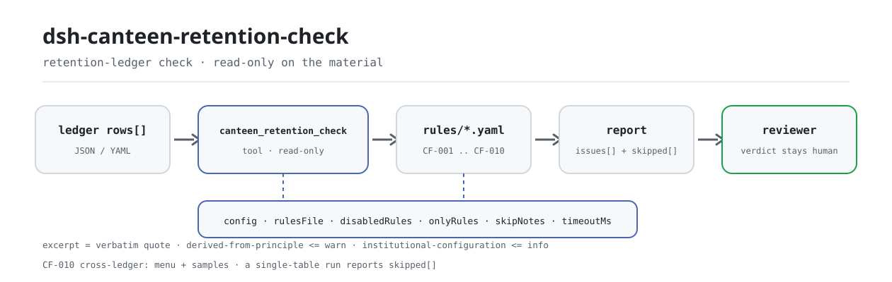

<div align="center">

<picture>
  <source media="(prefers-color-scheme: dark)" srcset="docs/assets/dsh-canteen-retention-check-flow-dark.svg">
  
</picture>

# dsh-canteen-retention-check

**Verifica cada linha de amostra retida contra os quatro elementos exigidos, o mínimo de 125 gramas, a janela de 48 horas e os marcadores de modelo restantes — lista apenas o que o registo consegue provar e deixa a decisão para o revisor.**

Um verificador de dados para o DeepSeek Harness: lê um registo de retenção de amostras de refeitório (uma linha por amostra), aplica o pacote de regras versionado incluído (CF-001..CF-010) e nunca escreve no material — sem rede e sem chamadas ao modelo.

[Instalar](#instalação-em-três-passos) · [Configuração](#configuração) · [FAQ](#faq) · [简体中文](README.md) · [English](README.en.md) · [Español](README.es.md) · [Português](README.pt.md) · [हिन्दी](README.hi.md)

[](LICENSE)
[](#compatibilidade)
[](https://www.npmjs.com/package/dsh-canteen-retention-check)
[](https://github.com/PerryLink/dsh-canteen-retention-check/actions/workflows/ci.yml)
[](#compatibilidade)

[](https://github.com/PerryLink/dsh-canteen-retention-check/stargazers)
[](https://www.npmjs.com/package/dsh-canteen-retention-check)
[](https://dshfind.com/plugins/PerryLink/dsh-canteen-retention-check?ref=badge)
[](https://securityscorecards.dev/viewer/?uri=github.com/PerryLink/dsh-canteen-retention-check)
[](https://gitee.com/perrylink/dsh-canteen-retention-check)

```sh
dsh plugin --profile <name> add dsh-canteen-retention-check
```

</div>

<sub>Plugin da comunidade, sem afiliação com a DeepSeek. Repositório canónico: <https://github.com/PerryLink/dsh-canteen-retention-check> (o Gitee é um espelho).</sub>

## O que é

O `dsh-canteen-retention-check` lê um registo de retenção de amostras de refeitório — um cabeçalho mais uma linha por amostra retida — e verifica a integridade do próprio registo e a coerência temporal: se estão preenchidos o nome do prato, o peso, a hora de colheita e a pessoa; se cada peso atinge 125 gramas; se a hora está registada ao minuto e não está no futuro; se a saída ocorre pelo menos 48 horas após a colheita; e se alguma célula ainda contém texto de modelo como `XXX` ou `待填`.

Verifica o registo, não a cozinha. Uma linha ausente significa que o registo não prova que a amostra foi colhida; não significa que não foi. Uma célula vazia é reportada como «o registo não o contém», não como «não aconteceu» — são afirmações diferentes e só a primeira é sustentável por um documento.

Regras e código estão separados: 9 regras de uma tabela mais 1 regra de duas tabelas (CF-010) são declaradas em `rules/canteen-retention.yaml`, pelo que substituir o pacote muda todo o conjunto de regras sem tocar numa linha de TypeScript. O relatório tem duas metades: `issues` lista as diferenças e `skipped` lista cada verificação que não pôde ser executada e porquê; uma lista `issues` vazia não significa «nada está errado».

- **Para quem**: responsáveis de refeitório e responsáveis de segurança alimentar; não é preciso saber usar a linha de comandos, basta entregar o material no chat.
- **O que entrega**: o material de origem sobre o qual a verificação trabalha (uma tabela, um registo ou um documento); o original nunca é modificado. O Excel pode ser convertido primeiro para JSON/YAML, no chat se a plataforma o permitir.
- **O que recebe**: uma lista de que linha, que coluna, o que falta e como corrigir; cada verificação que não pôde ser executada aparece em `skipped` com o motivo.

## Instalação em três passos

1. **Instalar** (escolha um canal):

   ```sh
   # canal git (main mais recente; equivale a git+https://github.com/PerryLink/dsh-canteen-retention-check.git)
   dsh plugin --profile <name> add github:PerryLink/dsh-canteen-retention-check
   # canal npm (versões publicadas)
   dsh plugin --profile <name> add dsh-canteen-retention-check
   # canal tarball: após pnpm pack neste repositório
   dsh plugin --profile <name> add ./dsh-canteen-retention-check-<version>.tgz
   ```

   O canal npm publica `lib/`; o canal git constrói-o com `tsdown` através do script `prepare`.

2. **Configuração mínima** (os valores por omissão servem; uma linha de bundle sem `config` usa-os todos e o pacote de regras aponta para o `rules/canteen-retention.yaml` incluído):

   ```yaml
   - insert:
       - id: dsh-canteen-retention-check
         name: dsh-canteen-retention-check
   ```

3. **Confirmar que montou**:

   ```sh
   dsh --profile <name> --dump-config | grep 'dsh-canteen-retention-check'
   ```

   Depois execute a amostra incluída (requer `pnpm install && pnpm run build` para produzir `lib/`):

   ```sh
   node samples/quickstart/run.mjs
   ```

   ```text
   $ node samples/quickstart/run.mjs
   canteen_retention_check: 1 issue(s) — error 1, warn 0, info 0
   skipped: 1
   ```

   A entrada da amostra está em `samples/quickstart/input/` e o resumo esperado em `samples/quickstart/expected/result.json`.

**Desinstalar**: `dsh plugin --profile <name> remove dsh-canteen-retention-check` (ou remova a linha do patch do perfil).

<details>
<summary>Usar no WorkBuddy / Coze</summary>

Procure «Safety Compliance Suite» no WorkBuddy / Coze (esta verificação é uma parte do conjunto; a disponibilidade depende da loja) para usar a mesma capacidade sem linha de comandos.

</details>

## Capacidades principais

O `dsh-canteen-retention-check` regista a ferramenta `canteen_retention_check`: lê um registo de retenção, aplica o pacote de regras versionado e devolve um relatório.

- **Dez regras num pacote** — 9 regras de uma tabela (CF-001..CF-009) e 1 regra de duas tabelas (CF-010); o pacote é dado, não código, pelo que substituir `rules/*.yaml` muda o conjunto de regras.
- **Apenas leitura sobre o material** — aceita JSON ou YAML e nunca modifica o original; ESM puro, sem pedidos de rede, sem chamadas ao modelo e sem telemetria.
- **Sem citações inventadas** — cada regra leva `document` / `number` / `clause` / `excerpt` / `kind` / `source`; `excerpt` tem de ser uma citação literal, e a regra cujo texto exato não foi obtido diz isso em `excerpt` e é marcada `derived-from-principle`.
- **A gravidade segue a evidência** — `derived-from-principle` fica limitada a `warn` e `institutional-configuration` a `info`, e um teste verifica-o.
- **Uma lista vazia nunca é «nada está errado»** — cada verificação que não pôde ser executada é reportada em `skipped` com o motivo; uma regra sem lista obrigatória ou com a coluna ausente declara-se em `skipped` em vez de passar em silêncio.
- **Redação que não decide** — o relatório lista apenas diferenças; nunca se pronuncia sobre conformidade, responsabilidade ou correção. Um guardião de redação impõe-no e todos os relatórios levam o aviso legal.

| Regra | Verificação | Gravidade | Tipo de base |
|---|---|---|---|
| `CF-001` | Nome do prato registado | error | direct |
| `CF-002` | Peso da amostra ≥ 125 g | error | direct |
| `CF-003` | Hora de colheita registada | error | direct |
| `CF-004` | Pessoa que reteve a amostra registada | error | direct |
| `CF-005` | Hora de colheita registada ao minuto | warn | derived-from-principle |
| `CF-006` | Saída pelo menos 48 h após a colheita | error | direct |
| `CF-007` | Refeição registada | info | derived-from-principle |
| `CF-008` | Sem marcador de modelo no nome do prato | warn | derived-from-principle |
| `CF-009` | Hora de colheita não futura | warn | derived-from-principle |
| `CF-010` | Cada prato de cada menu tem amostra retida (requer dois registos) | error | direct |

Perguntas a que responde:

- Cada linha nomeia o prato, o peso, a hora e a pessoa?
- Cada peso atinge 125 gramas?
- A hora está registada ao minuto e não no futuro?
- A amostra ficou pelo menos 48 horas antes da libertação?
- Resta texto de modelo como `XXX` ou `待填` em alguma célula?
- Cada prato do menu tem amostra retida? Esta precisa de dois registos; se só for entregue um, `CF-010` é listada em `skipped` em vez de fingir que correu.

### Superfície da ferramenta

| Argumento | Tipo | Significado |
|---|---|---|
| `file` | string | Caminho absoluto do material (JSON ou YAML); um de `file` / `material` |
| `material` | string | Texto do material em linha (JSON ou YAML); um de `file` / `material` |
| `rulesFile` | string | Substitui o caminho configurado do pacote de regras (relativo à raiz do pacote ou absoluto) |
| `only` | string[] | Executa apenas estes ids de regra; vazio significa todas |

O resultado leva `plugin`, `target`, `checkedAt`, `rulesetVersion`, `summary`, `issueCount`, `skippedCount`, `markdown` e `reportJson`; `markdown` é o relatório completo para o modelo e `reportJson` a forma estruturada do mesmo relatório.

### Exemplos

Estes são os pontos de entrada reais do plugin; instale uma vez e chame um. A amostra usa o material incluído:

```yaml
target: 食堂留样台账（差异样本：留样食品名称为空）
rows:
  - 餐次: 午餐
    留样食品名称: ''
    留样量: 125
    留样时间: 2026-03-04 11:40
    出柜时间: 2026-03-06 11:40
    留样人员: 张三
```

Resumo da saída:

```json
{
  "tool": "canteen_retention_check",
  "issueCount": 1,
  "summary": { "error": 1, "warn": 0, "info": 0 },
  "skippedCount": 1
}
```

*Observed from `samples/quickstart/input/CF-001-unsafe.yaml`; `samples/quickstart/expected/result.json`; `docs/assets/quickstart.log`*

## Configuração

Todos os parâmetros ajustáveis são campos Schemastery `Config` em `src/config.ts` (alteráveis a partir do cordis.yml). Uma substituição dirigida por id substitui a linha inteira — repita todas as chaves necessárias.

| Chave | Tipo | Valor por omissão | Significado |
|---|---|---|---|
| `rulesFile` | string | `rules/canteen-retention.yaml` | Caminho do pacote de regras relativo à raiz do pacote; substituir o ficheiro muda a versão do conjunto de regras |
| `disabledRules` | string[] | `[]` | Ids de regra desativados nesta instalação; cada um aparece em `skipped` |
| `onlyRules` | string[] | `[]` | Executa apenas estes ids de regra; vazio significa todas |
| `skipNotes` | string | `""` | Nota acrescentada a cada motivo de `skipped`, por exemplo para citar uma norma interna |
| `timeoutMs` | number | `120000` | Orçamento de tempo limite cooperativo da ferramenta, em milissegundos |

Exemplo de substituição no patch do perfil:

```yaml
- insert:
    - id: dsh-canteen-retention-check
      name: dsh-canteen-retention-check
      config:
        disabledRules: [CF-007]
        skipNotes: esta unidade verifica apenas almoço e jantar
        timeoutMs: 180000
```

## Formato do material

Um registo, uma tabela, uma linha por amostra retida. A ferramenta aceita JSON ou YAML:

```text
餐次          refeição (pequeno-almoço / almoço / jantar)
留样食品名称  nome do prato
留样量        peso da amostra em gramas
留样时间      hora de colheita (recomenda-se AAAA-MM-DD HH:MM)
出柜时间      hora de saída (mesmo formato)
留样人员      pessoa que reteve a amostra
单位          unidade (opcional)
存放条件      condição de armazenamento (opcional; não é julgada)
备注          observações (opcional)
```

Campos de cabeçalho (opcionais): `canteen` / `食堂名称` / `单位名称`, `period` / `期间` / `月份`, `checkedAt` / `核对日期` / `检查日期`, `basis` / `依据`. Chaves do array de linhas: `rows` / `items` / `samples` / `留样` / `留样记录`.

A correspondência de colunas ignora maiúsculas e minúsculas e espaços, espaços ideográficos, sublinhados e hífenes; os nomes de coluna do registo são preservados, pelo que um achado nomeia a coluna que realmente leu. Os aliases são declarados em `src/model.ts`, pelo que `品名`, `留样重量`, `留样人` e os nomes em inglês também resolvem.

```yaml
target: registo de retenção de amostras
rows:
  - 餐次: 午餐
    留样食品名称: 番茄炒蛋
    留样量: 150
    留样时间: 2026-03-04 11:40
    出柜时间: 2026-03-06 12:10
    留样人员: 张三
```

## Normas e fontes das regras

O pacote cita literalmente o artigo 40.º do Regulamento de Gestão da Segurança e Nutrição Alimentar Escolar (Portaria n.º 45 do Ministério da Educação, da Administração Estatal de Regulação do Mercado e da Comissão Nacional de Saúde):

```text
《学校食品安全与营养健康管理规定》第四十条：
中小学、幼儿园食堂应当对每餐次加工制作的每种食品成品进行留样，每个品种留样量应当满足检验需要，不得少于125克，并记录留样食品名称、留样量、留样时间、留样人员等。
```

Esse único artigo fornece os quatro elementos e o mínimo de 125 gramas, pelo que CF-001..CF-004 e CF-006 são `direct` e podem chegar a `error`. O artigo abrange **escolas primárias e secundárias e jardins de infância**; nos refeitórios do ensino superior aplicam-se apenas as categorias alimentares do segundo parágrafo, pelo que este pacote não coloca a retenção corrente de refeitórios universitários em `error`: as colunas ausentes vão para `skipped`.

A janela de 48 horas é calculada pela diferença em minutos (`dateGap` usa `diffMinutes`); exatamente 48 horas não é reportado. Toda a aritmética é de relógio de parede sobre as cadeias de entrada, sem conversão de fuso horário. A temperatura de refrigeração e o «armário dedicado» não estão no registo e o pacote não os julga.

As citações e o registo de verificação vêm em `rules/evidence/clause-verification-school-food-safety.md`; `pnpm run check:citations` verifica que cada `excerpt` tem um fragmento literal nesse registo e anota os fragmentos ainda não rastreáveis em `rules/citations-baseline.json` — a linha de base só pode encolher. Versão do conjunto de regras `2026.3`, `as_of` 2026-10-23.

## FAQ

<details>
<summary>Decide se estamos em conformidade ou não?</summary>

Não. Lista apenas as diferenças que o próprio material consegue provar (que linha, que coluna, o que falta e como corrigir); não emite juízos de facto nem de conformidade — a decisão fica sempre com o revisor. Um guardião de redação limita o texto do relatório e todos os relatórios levam o aviso legal.

</details>

<details>
<summary>O nosso registo está em Excel — podemos usá-lo diretamente?</summary>

Converta primeiro para JSON ou YAML; se a plataforma o permitir, a conversão pode ser feita no chat. A ferramenta apenas lê o material e nunca modifica o original.

</details>

<details>
<summary>Uma lista `issues` vazia significa «sem problemas»?</summary>

Não. Cada verificação que não pôde ser executada aparece em `skipped` com o motivo (coluna ausente, hora não analisável, pacote de regras por configurar). Leia `issues` e `skipped` em conjunto.

</details>

<details>
<summary>Como são calculadas exatamente as 48 horas?</summary>

Hora de saída menos hora de colheita, em minutos, convertida em dias e comparada com 2 dias; exatamente 48 horas (2 880 minutos) não é reportado e um minuto a menos é. Ambas as horas têm de ser analisáveis: um valor só com data conta como `00:00`, pelo que duas horas do mesmo dia dão 0 dias. Toda a aritmética é de relógio de parede, sem conversão de fuso horário.

</details>

<details>
<summary>Porque é que `CF-010` está sempre em `skipped`?</summary>

Porque é a única regra de duas tabelas e precisa de um menu e de um registo de retenção. A ferramenta aceita um material de cada vez, pelo que uma execução de uma só tabela a lista em `skipped` em vez de a omitir em silêncio. A junção é implementada por `checkMenuCoverage` em `src/cross.ts`; a superfície atual da ferramenta não tem qualquer argumento que forneça os dois materiais.

</details>

<details>
<summary>Um semestre inteiro de registos será demasiado lento?</summary>

A verificação é correspondência de colunas e aritmética de datas local — sem pedidos de rede nem chamadas ao modelo; `timeoutMs` (120 segundos por omissão) é um orçamento de tempo cooperativo que pode aumentar.

</details>

## Resolução de problemas

- **O plugin instala-se mas a ferramenta não aparece.** Confirme que `main` resolve para `lib/index.mjs` e que `pnpm run build` o produziu; um `main` errado faz o carregador ignorar a linha em silêncio.
- **`dsh plugin add` rejeita o pacote.** O intervalo de peers cobre `0.1.x` e `0.2.x`; fora dele, conceda uma isenção explícita e não force a instalação de um núcleo DSH antigo.
- **Uma regra não correu.** Leia o array `skipped` do relatório; o motivo está lá. Não o deduza de uma lista `issues` vazia.
- **Instala-se mas não mostra achados.** Confirme que a ferramenta correu e devolveu um resultado — um resultado vazio não é uma execução ignorada; a falta de entrada é normalmente reportada como `skipped`, nunca adivinhada como achado.
- **As horas parecem deslocadas.** Todo o cálculo é aritmética de relógio de parede sobre as cadeias de entrada; não é aplicada conversão de fuso horário.
- **O pacote não é encontrado.** O ambiente alvo é DSH `>=0.2.1-0 <0.3.0` e Node `^22.19.0 || >=24.0.0`; instale através do fecho do perfil: `dsh plugin --profile <name> add dsh-canteen-retention-check`.

## Limites de segurança

- **Apenas leitura sobre o material.** A ferramenta lê o ficheiro ou o texto em linha que lhe entrega e nunca escreve nem edita o original; não escreve nada além do resultado da ferramenta e do armazenamento de sessão do próprio host DSH.
- **Sem rede, sem chamadas ao modelo, sem telemetria.** A verificação é correspondência de colunas e aritmética de datas local; não recolhe analítica nem reporta utilização.
- **Sem credenciais.** Não lê segredos do ambiente, não armazena credenciais nem faz pedidos de rede.
- **O registo é um efeito.** O registo da ferramenta devolve um disposer, pelo que descarregar ou recarregar a quente o remove; não há tarefas em segundo plano, temporizadores nem processos residentes.
- **Falha fechada.** Colunas ausentes, horas não analisáveis e ids de regra desconhecidos vão para `skipped` com o motivo; nunca são assumidos como aprovados. O pacote de regras é validado ao carregar, não é confiado.
- **Guardião de redação.** O relatório renderizado nunca se pronuncia sobre conformidade, responsabilidade ou correção; lista diferenças para revisão humana e leva sempre o aviso legal.
- **O pacote de regras é dado.** Substituir `rules/*.yaml` muda o conjunto de regras; a validação ao carregar exige que cada regra leve `document` / `number` / `clause` / `excerpt` / `kind` / `source`, e que cada excerpt seja localizável literalmente no registo de verificação.

## Limitações conhecidas

- **Verifica apenas o registo.** Não julga se uma amostra satisfaria uma inspeção, se o alimento era seguro nem o que aconteceu fora do registo. «Não registado» significa que o registo não o consegue provar, não que não aconteceu.
- **O âmbito é limitado.** O artigo 40.º abrange escolas primárias e secundárias e jardins de infância; nos refeitórios do ensino superior aplicam-se apenas as categorias alimentares do segundo parágrafo. Este pacote não coloca a retenção corrente de refeitórios universitários em `error`; as colunas ausentes vão para `skipped`.
- **O «等» (etc.) não é ampliado.** O artigo diz que os elementos legais de registo não se limitam aos quatro enumerados; este pacote verifica apenas os quatro nomeados (nome, peso, hora, pessoa) e não amplia por «etc.».
- **125 gramas é apenas um mínimo numérico.** «Satisfazer as necessidades de inspeção» é um requisito substantivo à parte que um registo não consegue decidir; o pacote compara apenas o número e exatamente 125 gramas não é reportado.
- **48 horas é apenas aritmética.** Não verifica a temperatura de refrigeração, o «armário dedicado» nem se a amostra foi realmente conservada no frio; os registos habitualmente não o recolhem. Um valor só com data conta como `00:00`, pelo que duas horas do mesmo dia dão 0 dias.
- **A regra de duas tabelas precisa de dois registos.** `CF-010` precisa de um menu e de um registo de retenção; a ferramenta aceita um material, pelo que uma execução de uma só tabela a lista em `skipped`.
- **Uma coluna ausente é «não aplicável».** Quando falta uma coluna inteira, o relatório diz `skipped` em vez de marcar cada linha como infração: um registo sem a coluna `留样量` é um problema de forma e os erros linha a linha enterrá-lo-iam.
- **Apenas aritmética de relógio de parede.** Sem conversão de fuso horário nem alinhamento entre fusos.

## Interoperabilidade com outros plugins DSH

Este plugin regista uma única ferramenta de modelo e não ocupa nenhum lugar de comando, serviço ou interface do host nem de outros plugins:

- **Sem colisão de nomes de ferramenta.** Regista apenas `canteen_retention_check`, um nome com prefixo que não toma um nome nu de uma ferramenta incorporada ou de outro plugin.
- **Sem colisão de chaves de serviço.** Não fornece qualquer chave de serviço.
- **Sem colisão de slots.** Não regista qualquer slot de cliente (não há diretório client; é um plugin puramente host).
- **Sem colisão de rotas HTTP.** Não regista qualquer prefixo `webServer`.
- **Sem mutação global.** Não altera protótipos, não reescreve `process.env` nem substitui o dispatcher global de fetch.
- **Sem trabalho em segundo plano.** Não regista temporizadores, sondagens nem filas em segundo plano.
- **O registo é um efeito.** O registo da ferramenta devolve um disposer; descarregar remove-o e não deixa nenhum listener.

Evidência estática: toda a superfície de registo de `src/index.ts` é uma chamada `ctx.tools.register(...)`; o resto é verificação e leitura puras.

## Compatibilidade

| Superfície | Estado |
|---|---|
| Harness | `engines.dsh` é `>=0.2.1-0 <0.3.0`; intervalo de peers `>=0.1.2-rc.1 <0.2.0 \|\| >=0.2.0-0 <0.3.0` |
| Node | `^22.19.0 \|\| >=24.0.0` |
| Plataformas | Todas (ESM puro; sem código nativo, sem rede, sem chamadas ao modelo) |
| Modelo | Modelos de texto totalmente suportados; não é precisa capacidade extra |

## Ecossistema e qualidade

- [Espelho no Gitee](https://gitee.com/perrylink/dsh-canteen-retention-check) (espelho sincronizado; o GitHub é canónico)
- [Página do plugin no dshfind](https://dshfind.com/plugins/PerryLink/dsh-canteen-retention-check) (instalações e ranking)
- [Relatório OpenSSF Scorecard](https://securityscorecards.dev/viewer/?uri=github.com/PerryLink/dsh-canteen-retention-check) (suportado por [.github/workflows/scorecard.yml](.github/workflows/scorecard.yml))
- **Canal da loja 1024**: `npm i -g dsh1024` uma vez e depois `dsh1024 plugin --profile <name> add dsh-canteen-retention-check` (conta para o ranking de instalações de [deepseek1024.com](https://deepseek1024.com))
- [Base de conhecimento do ecossistema](https://perrylink.github.io/dsh-plugin-guide/): guia de desenvolvimento de plugins · dados medidos de seleção · critérios de manutenção

## Desenvolvimento

```sh
pnpm install                                        # node ^22.19 || >=24
pnpm run typecheck                                  # tsc --noEmit
pnpm test                                           # vitest: suite partilhada de tabelas + fixtures emparelhados
pnpm run build                                      # tsdown -> lib/index.mjs + lib/index.d.mts
pnpm run verify:self-contained                      # as dependências resolvem a partir do registry
pnpm run check:lockfile                             # verificação de deriva do lockfile
pnpm run check:readmes                              # consistência dos README em cinco idiomas
pnpm run check:citations                            # linha de base de citações do pacote de regras
node ../scripts/sync-shared.mjs dsh-canteen-retention-check   # atualizar src/shared a partir de ../_shared
pnpm pack                                           # o tarball publicado
```

Este plugin é **de dados**: `src/model.ts` declara a forma da tabela e os aliases de coluna, o kit partilhado fornece o leitor e o motor de verificação, e o pacote de regras declara cada verificação. Execução da amostra local (construa antes para produzir `lib/`):

```sh
node samples/quickstart/run.mjs
# => canteen_retention_check: 1 issue(s) — error 1, warn 0, info 0
#    skipped: 1
```

A entrada da amostra está em `samples/quickstart/input/`, o resumo esperado em `samples/quickstart/expected/result.json` e a captura em `docs/assets/quickstart.png`. As imagens do README são geradas programaticamente por [`scripts/gen-readme-assets.py`](scripts/gen-readme-assets.py) (Python + Pillow) e podem ser executadas de novo; o diagrama de fluxo de uma só pele e os recursos de demonstração antigos ficam em `docs/assets/` para ligações externas, enquanto os README referenciam apenas o novo par claro/escuro.

Topics: `deepseek-harness`, `dsh`, `dsh-plugin`, `cordis`, `canteen`, `retention`, `food`

## Família e agradecimentos

Este projeto faz parte da família de plugins de DeepSeek Harness da [PerryLink](https://github.com/PerryLink) (todos Apache-2.0). O índice completo da família é [escolher um verificador por material](https://perrylink.github.io/zh/checkers/choose/). Se for útil, **uma estrela ajuda a próxima pessoa a encontrá-lo** — não desbloqueia nada.

- [@PerryLink](https://github.com/PerryLink) — criador e mantenedor: o pacote de regras de retenção de refeitório (CF-001..CF-010), a ferramenta `canteen_retention_check`, o registo de verificação de citações e a documentação em cinco idiomas.

<details>
<summary>Expandir todos os plugins</summary>

| Plugin | Estado |
|---|---|
| **[dsh-aqua-input-check](https://github.com/PerryLink/dsh-aqua-input-check)** |  |
| **[dsh-archive-check](https://github.com/PerryLink/dsh-archive-check)** |  |
| **[dsh-auto-review](https://github.com/PerryLink/dsh-auto-review)** |  |
| **[dsh-autotier](https://github.com/PerryLink/dsh-autotier)** | 🧊 CONGELADO — ver o README do repo |
| **[dsh-bid-ca-precheck](https://github.com/PerryLink/dsh-bid-ca-precheck)** |  |
| **[dsh-bid-qual-check](https://github.com/PerryLink/dsh-bid-qual-check)** |  |
| **[dsh-cert-mcp](https://github.com/PerryLink/dsh-cert-mcp)** | 🧊 CONGELADO — ver o README do repo |
| **[dsh-checkpoint-rewind](https://github.com/PerryLink/dsh-checkpoint-rewind)** |  |
| **[dsh-click](https://github.com/PerryLink/dsh-click)** |  |
| **[dsh-composer-history](https://github.com/PerryLink/dsh-composer-history)** |  |
| **[dsh-contract-stance](https://github.com/PerryLink/dsh-contract-stance)** |  |
| **[dsh-customs-doc-check](https://github.com/PerryLink/dsh-customs-doc-check)** |  |
| **[dsh-data-quality](https://github.com/PerryLink/dsh-data-quality)** | 🧊 CONGELADO — ver o README do repo |
| **[dsh-demurrage-ledger](https://github.com/PerryLink/dsh-demurrage-ledger)** |  |
| **[dsh-doublecheck](https://github.com/PerryLink/dsh-doublecheck)** |  |
| **[dsh-drill-script-check](https://github.com/PerryLink/dsh-drill-script-check)** |  |
| **[dsh-eia-guide-check](https://github.com/PerryLink/dsh-eia-guide-check)** |  |
| **[dsh-emergency-plan](https://github.com/PerryLink/dsh-emergency-plan)** |  |
| **[dsh-essay-rubric-check](https://github.com/PerryLink/dsh-essay-rubric-check)** |  |
| **[dsh-evidence-check](https://github.com/PerryLink/dsh-evidence-check)** |  |
| **[dsh-export-ctl-check](https://github.com/PerryLink/dsh-export-ctl-check)** |  |
| **[dsh-fast](https://github.com/PerryLink/dsh-fast)** |  |
| **[dsh-fmea-table-check](https://github.com/PerryLink/dsh-fmea-table-check)** |  |
| **[dsh-forecast-penalty](https://github.com/PerryLink/dsh-forecast-penalty)** |  |
| **[dsh-fund-research](https://github.com/PerryLink/dsh-fund-research)** |  |
| **[dsh-github](https://github.com/PerryLink/dsh-github)** |  |
| **[dsh-gongwen-flow-check](https://github.com/PerryLink/dsh-gongwen-flow-check)** |  |
| **[dsh-gongwen-word-check](https://github.com/PerryLink/dsh-gongwen-word-check)** |  |
| **[dsh-guard-plan-qc](https://github.com/PerryLink/dsh-guard-plan-qc)** |  |
| **[dsh-hazchem-check](https://github.com/PerryLink/dsh-hazchem-check)** |  |
| **[dsh-hazplan-check](https://github.com/PerryLink/dsh-hazplan-check)** |  |
| **[dsh-hidden-risk-map](https://github.com/PerryLink/dsh-hidden-risk-map)** |  |
| **[dsh-hs-classify](https://github.com/PerryLink/dsh-hs-classify)** |  |
| **[dsh-icd-rule-check](https://github.com/PerryLink/dsh-icd-rule-check)** |  |
| **[dsh-industry-research](https://github.com/PerryLink/dsh-industry-research)** |  |
| **[dsh-lawcite-adapter](https://github.com/PerryLink/dsh-lawcite-adapter)** |  |
| **[dsh-laya](https://github.com/PerryLink/dsh-laya)** |  |
| **[dsh-lc-doc-check](https://github.com/PerryLink/dsh-lc-doc-check)** |  |
| **[dsh-learning-gap-check](https://github.com/PerryLink/dsh-learning-gap-check)** |  |
| **[dsh-library](https://github.com/PerryLink/dsh-library)** |  |
| **[dsh-local-ai](https://github.com/PerryLink/dsh-local-ai)** |  |
| **[dsh-lsp-actions](https://github.com/PerryLink/dsh-lsp-actions)** |  |
| **[dsh-mask](https://github.com/PerryLink/dsh-mask)** |  |
| **[dsh-mcp-panel](https://github.com/PerryLink/dsh-mcp-panel)** |  |
| **[dsh-medrec-qc](https://github.com/PerryLink/dsh-medrec-qc)** |  |
| **[dsh-memento](https://github.com/PerryLink/dsh-memento)** | 🧊 CONGELADO — ver o README do repo |
| **[dsh-nsfc-form-check](https://github.com/PerryLink/dsh-nsfc-form-check)** |  |
| **[dsh-nurse-record-check](https://github.com/PerryLink/dsh-nurse-record-check)** |  |
| **[dsh-observe](https://github.com/PerryLink/dsh-observe)** |  |
| **[dsh-origin-rvc-check](https://github.com/PerryLink/dsh-origin-rvc-check)** |  |
| **[dsh-ota-review-check](https://github.com/PerryLink/dsh-ota-review-check)** |  |
| **[dsh-output-styles](https://github.com/PerryLink/dsh-output-styles)** |  |
| **[dsh-paper-doc-adapter](https://github.com/PerryLink/dsh-paper-doc-adapter)** |  |
| **[dsh-permission-rules](https://github.com/PerryLink/dsh-permission-rules)** |  |
| **[dsh-permit-report-check](https://github.com/PerryLink/dsh-permit-report-check)** |  |
| **[dsh-pipeline-check](https://github.com/PerryLink/dsh-pipeline-check)** |  |
| **[dsh-pleading-draft](https://github.com/PerryLink/dsh-pleading-draft)** |  |
| **[dsh-plugin-doctor](https://github.com/PerryLink/dsh-plugin-doctor)** | 🚫 APOSENTADO (repo arquivado) |
| **[dsh-plugin-guide](https://github.com/PerryLink/dsh-plugin-guide)** |  |
| **[dsh-plugin-kit](https://github.com/PerryLink/dsh-plugin-kit)** | 🚫 APOSENTADO (repo arquivado) |
| **[dsh-plugin-upgrade](https://github.com/PerryLink/dsh-plugin-upgrade)** | 🚫 APOSENTADO (repo arquivado) |
| **[dsh-policy-brief-draft](https://github.com/PerryLink/dsh-policy-brief-draft)** |  |
| **[dsh-power-loss-split](https://github.com/PerryLink/dsh-power-loss-split)** |  |
| **[dsh-power-ticket-check](https://github.com/PerryLink/dsh-power-ticket-check)** |  |
| **[dsh-ppap-check](https://github.com/PerryLink/dsh-ppap-check)** |  |
| **[dsh-protest-deadline](https://github.com/PerryLink/dsh-protest-deadline)** |  |
| **[dsh-railway-window](https://github.com/PerryLink/dsh-railway-window)** |  |
| **[dsh-repair-order-qc](https://github.com/PerryLink/dsh-repair-order-qc)** |  |
| **[dsh-research-report](https://github.com/PerryLink/dsh-research-report)** |  |
| **[dsh-review-reply-check](https://github.com/PerryLink/dsh-review-reply-check)** |  |
| **[dsh-rulefile-check](https://github.com/PerryLink/dsh-rulefile-check)** |  |
| **[dsh-safety-brief-check](https://github.com/PerryLink/dsh-safety-brief-check)** |  |
| **[dsh-score](https://github.com/PerryLink/dsh-score)** | 🧊 CONGELADO — ver o README do repo |
| **[dsh-session-sync](https://github.com/PerryLink/dsh-session-sync)** |  |
| **[dsh-site-log-check](https://github.com/PerryLink/dsh-site-log-check)** |  |
| **[dsh-skill-pack-security](https://github.com/PerryLink/dsh-skill-pack-security)** |  |
| **[dsh-soe-decision-check](https://github.com/PerryLink/dsh-soe-decision-check)** |  |
| **[dsh-soilwater-check](https://github.com/PerryLink/dsh-soilwater-check)** |  |
| **[dsh-sop-sync-check](https://github.com/PerryLink/dsh-sop-sync-check)** |  |
| **[dsh-spc-gbt-adapter](https://github.com/PerryLink/dsh-spc-gbt-adapter)** |  |
| **[dsh-talk](https://github.com/PerryLink/dsh-talk)** |  |
| **[dsh-tender-extract](https://github.com/PerryLink/dsh-tender-extract)** |  |
| **[dsh-tender-matrix](https://github.com/PerryLink/dsh-tender-matrix)** |  |
| **[dsh-test-drive](https://github.com/PerryLink/dsh-test-drive)** |  |
| **[dsh-ticktick](https://github.com/PerryLink/dsh-ticktick)** | 🚫 APOSENTADO (repo arquivado) |
| **[dsh-translate](https://github.com/PerryLink/dsh-translate)** |  |
| **[dsh-warranty-calc](https://github.com/PerryLink/dsh-warranty-calc)** |  |
| **[dsh-budget](https://github.com/PerryLink/dsh-budget)** | 🧊 CONGELADO — ver o README do repo |
| **[dsh-claude-move](https://github.com/PerryLink/dsh-claude-move)** | 🧊 CONGELADO — ver o README do repo |
| **[dsh-defend](https://github.com/PerryLink/dsh-defend)** | 🧊 CONGELADO — ver o README do repo |
| **[dsh-draw](https://github.com/PerryLink/dsh-draw)** | 🧊 CONGELADO — ver o README do repo |
| **[dsh-reach](https://github.com/PerryLink/dsh-reach)** | 🧊 CONGELADO — ver o README do repo |
| **[dsh-background-agents](https://github.com/PerryLink/dsh-background-agents)** | 🚫 APOSENTADO (repo arquivado) |
| **[dsh-session-pin](https://github.com/PerryLink/dsh-session-pin)** | 🚫 APOSENTADO (repo arquivado) |
| **[dsh-team-rooms](https://github.com/PerryLink/dsh-team-rooms)** | 🚫 APOSENTADO (repo arquivado) |

</details>

## Licença

[LICENSE](LICENSE) (Apache License 2.0) © 2026 dsh-canteen-retention-check contributors

<p align="center"><sub>Apache-2.0 · Plugin da comunidade, sem afiliação com a DeepSeek.</sub></p>
